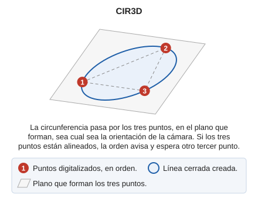

# CIR3D
<!-- id: cir3d -->

Dibuja la circunferencia que pasa por tres puntos dados, en el plano que definen esos tres puntos.

## Parámetros

| Número de parámetro | Descripción | Valores | Opcional |
| :--- | :--- | :--- | :--- |
| 1 | Punto en el espacio de trabajo | Coordenadas X, Y y Z | Sí |
| 2 | Punto en el espacio de trabajo | Coordenadas XYZ | Sí |
| 3 | Punto en el espacio de trabajo | Coordenadas XYZ | Sí |

## Observaciones

La diferencia con [CIR3P](cir3p.md) está en el plano en el que se construye la circunferencia:

* **CIR3P** trabaja en el plano de la cámara. El círculo pasa por los tres puntos proyectados sobre ese plano y todos los vértices del círculo quedan a la misma profundidad. Esta orden se utiliza para trabajar en planta.
* **CIR3D** trabaja en el plano que definen los tres puntos, sea cual sea la orientación de la cámara. El círculo pasa exactamente por los tres puntos digitalizados.

CIR3D permite trabajar con los sensores con cámara libre —nube de puntos y ortofoto estereoscópica—, donde la cámara puede mirar en cualquier dirección: por ejemplo, para digitalizar un ojo de buey en el casco de un barco, con la cámara de frente al casco. Al digitalizar el ojo de buey con CIR3P y la cámara de frente al casco, el círculo se construye en el plano de la cámara y no sobre la superficie del casco.

Si los tres puntos están alineados, no definen un plano: la orden avisa y espera otro tercer punto.

## Características de la orden

| Tipo de orden | [Orden interactiva](/digi3d-ai/referencia/ordenes/ordenes-interactivas.md) |
| :--- | :--- |
| Repite automáticamente | No |
| Extensión | DigiNG.OrdenesStandard.dll |
| Implementación | Nativa |
| Variables relacionadas | [REPITE](/digi3d-ai/referencia/ventana-de-dibujo/variables/r/repite.md) — repite la última orden ejecutada |
| Órdenes relacionadas | [CIR2P](/digi3d-ai/referencia/ventana-de-dibujo/ordenes/c/cir2p.md) [CIR3P](/digi3d-ai/referencia/ventana-de-dibujo/ordenes/c/cir3p.md) [CIRCR](/digi3d-ai/referencia/ventana-de-dibujo/ordenes/c/circr.md) |
| Nombre interno | {042900CE-F65B-48AF-91EA-BA55665D6572} |
