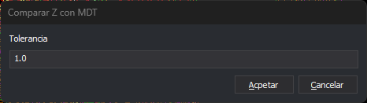

# COMPARAR\_Z\_MDT
<!-- id: comparar-z-mdt -->

Compara la coordenada Z de los vértices de las entidades con la Z del modelo digital del terreno (MDT) cargado y añade al panel Tareas una tarea por cada entidad en la que la diferencia supera una tolerancia.

## Parámetros

| Número de parámetro | Descripción | Opcional |
| :--- | :--- | :--- |
| 1...n | Códigos de las entidades a comparar. Los códigos admiten los comodines \* y ?. Un parámetro que empieza por `#` se sustituye por todos los códigos que tienen esa etiqueta en la tabla de códigos. | Sí. Si no se especifica ningún parámetro, la orden pide que selecciones las entidades a comparar |

## Cuadro de diálogo Comparar Z con MDT

Esta orden solicita la tolerancia en este cuadro de diálogo.

* **Tolerancia**: diferencia máxima admitida entre la Z de un vértice y la Z del modelo digital del terreno, en las unidades del sistema de referencia. El valor por defecto es 1.0. Escribe los decimales con punto: con coma, la orden ignora la parte decimal (`1,5` se lee como 1).
* **Aceptar**: compara las entidades con esa tolerancia.
* **Cancelar**: termina la orden sin comparar. Dejar el campo vacío y pulsar **Aceptar** tiene el mismo efecto.

## Observaciones

1. Si está activada la opción [Vaciar automáticamente](../../../cuadros-de-dialogo/configuracion/panel-de-tareas/vaciar-automaticamente.md) del panel Tareas, la orden vacía el panel al aceptar la tolerancia.
2. Si no hay ningún archivo cargado que pueda proyectar una Z \(un modelo digital del terreno\), la orden emite un sonido de error y termina. La orden comprueba si hay un archivo que pueda proyectar una Z después de pedir la tolerancia y, si está activada la opción de vaciado automático, de vaciar el panel Tareas.
3. Para cada entidad, la orden recorre sus vértices. Un vértice que no se puede proyectar sobre ningún modelo se ignora. En la primera diferencia entre la Z del vértice y la Z del modelo mayor que la tolerancia, la orden añade al panel Tareas una tarea de error que permite localizar ese vértice, con el texto «Geometría con vértices con coordenada Z que no coincide con los MDTs cargados». Cada entidad analizada genera como máximo una tarea.
4. Con parámetros, la orden analiza todas las entidades visibles y no borradas del archivo de dibujo que tienen alguno de los códigos indicados y termina sin pedir selección.
5. Sin parámetros, la orden compara las entidades de cada selección múltiple y sigue activa: puedes hacer varias selecciones seguidas con la misma tolerancia.

## Opciones de menú

* **Análisis geométricos/Comparar Z con MDTs cargados/Geometrías visibles**: ejecuta la orden con el parámetro `*`, que compara todas las entidades visibles.
* Debajo, el submenú muestra una opción por cada etiqueta de la tabla de códigos. Cada opción compara las entidades con códigos de esa etiqueta.

## Características de la orden

| Tipo de orden | [Orden interactiva](/digi3d-ai/referencia/ordenes/ordenes-interactivas.md) |
| :--- | :--- |
| Repite automáticamente | No |
| Opción del menú donde aparece la orden | Análisis geométricos/Comparar Z con MDTs cargados/Geometrías visibles |
| Barra de herramientas en la que aparece la orden | _Esta orden no tiene asociado ningún botón en ninguna barra de herramientas_ |
| Extensión | DigiNG.OrdenesMDT.dll |
| Implementación | Nativa |
| Variables relacionadas | No tiene variables relacionadas |
| Órdenes relacionadas | [PROYECTA\_POR\_CONDICION](/digi3d-ai/referencia/ventana-de-dibujo/ordenes/p/proyecta-por-condicion.md) |
| Nombre interno | {08589CEE-2BEA-42BC-AD4E-5F65709CDA35} |
