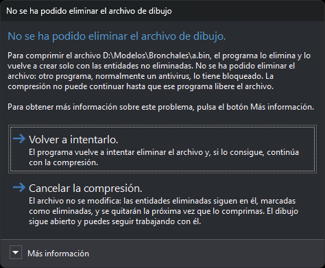

# COMPRIMIR
<!-- id: comprimir -->

Elimina del archivo de dibujo activo todas las entidades que tienen la marca de borrado.

## Parámetros

No admite parámetros.

## Observaciones

La orden actúa sobre el archivo de dibujo activo. Si el importador/exportador del archivo no admite la compresión, la orden muestra el aviso «El importador/exportador del archivo de dibujo activo no ha permitido comprimir el archivo.» y no hace nada.

Si la opción [Generar copia de seguridad al comprimir](/digi3d-ai/referencia/cuadros-de-dialogo/configuracion/copia-de-seguridad/generar-copia-de-seguridad-al-comprimir.md) está en **Sí**, la orden genera una copia de seguridad del archivo antes de comprimirlo.

La orden ejecuta estos pasos:

1. Descarga todas las topologías cargadas en memoria.
2. Quita de la memoria las entidades borradas y libera la memoria que ocupaban.
3. Si el formato lo admite, como los archivos `.bin` y `.bind`, vuelve a escribir el archivo de dibujo solo con las entidades no borradas. El tamaño del archivo se reduce. Si el archivo está abierto en solo lectura, no lo modifica.
4. Vacía la lista de operaciones que se pueden deshacer.

Tras ejecutar esta orden no se puede recuperar ninguna de las entidades borradas ni deshacer las operaciones anteriores.

Si otra instancia de Digi3D.AI tiene cargado el mismo archivo como archivo de referencia, al terminar la compresión esa instancia muestra el mensaje «Archivo comprimido».

### El archivo de dibujo está bloqueado

Para comprimir un archivo `.bin` o `.bind`, Digi3D.AI ejecuta estos pasos:

1. Cambia el nombre del archivo añadiéndole la extensión `.comprimiendo` (por ejemplo, `dibujo.bin.comprimiendo`). Si ya existe un archivo con ese nombre, añade además un número: `.comprimiendo1`, `.comprimiendo2`...
2. Crea un archivo nuevo con el nombre original y escribe en él las entidades no borradas.
3. Borra el archivo renombrado. Si no puede borrarlo, lo indica con un aviso y el archivo renombrado se queda en la carpeta; puedes borrarlo.

Si falla el paso 2, Digi3D.AI borra el archivo a medio escribir, devuelve su nombre al archivo original, que no se ha modificado, y muestra un mensaje con el motivo. Si el fallo se produce al escribir las entidades, los cambios que hagas después en el dibujo no se guardarán en el archivo: cierra el dibujo y vuelve a abrirlo. Si Digi3D.AI no puede devolver su nombre al archivo original, el mensaje indica la ruta del archivo renombrado, que contiene el dibujo sin comprimir; cierra el dibujo y cambia el nombre de ese archivo al nombre original.

Si no puede cambiar el nombre del archivo porque otro programa, normalmente un antivirus, lo tiene bloqueado, muestra el cuadro de tareas **No se ha podido cambiar el nombre del archivo de dibujo**:

El cuadro muestra la ruta del archivo y ofrece dos opciones:

* **Volver a intentarlo.**: Digi3D.AI vuelve a intentar cambiar el nombre del archivo. Si lo consigue, continúa con la compresión. Si no, vuelve a mostrar el cuadro.
* **Cancelar la compresión.**: Digi3D.AI no modifica el archivo. Las entidades borradas siguen en el archivo con la marca de borrado, y se quitarán la próxima vez que lo comprimas. El dibujo sigue abierto y puedes seguir trabajando con él. Las entidades borradas ya no están en memoria, así que en esta sesión no se pueden recuperar; al volver a abrir el archivo se cargan de nuevo con la marca de borrado. Las otras instancias de Digi3D.AI no reciben el mensaje «Archivo comprimido».

**Más información** describe los tres pasos de la compresión y propone cerrar el programa que bloquea el archivo o deshabilitar el antivirus antes de pulsar **Volver a intentarlo**.

## Características de la orden

| Tipo de orden | [Orden inmediata](/digi3d-ai/referencia/ordenes/ordenes-no-interactivas.md) |
| :--- | :--- |
| Repite automáticamente | No |
| Opción del menú donde aparece la orden | Archivo/Herramientas/Comprimir |
| Barra de herramientas en la que aparece la orden | _Esta orden no tiene asociado ningún botón en ninguna barra de herramientas_ |
| Extensión | DigiNG.OrdenesStandard.dll |
| Variables relacionadas | No tiene variables relacionadas |
| Órdenes relacionadas | [RECUPERA](/digi3d-ai/referencia/ventana-de-dibujo/ordenes/r/recupera.md) [RECUPERA\_COD](/digi3d-ai/referencia/ventana-de-dibujo/ordenes/r/recupera-cod.md) |
| Nombre interno | {B1032F97-7A85-4f2b-8CC1-F665DB1FC57E} |

