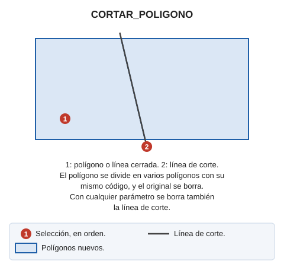

# CORTAR\_POLÍGONO
<!-- id: cortar-poligono -->

Recorta un polígono en varios polígonos en función de las intersecciones entre el polígono que se va a recortar y la línea de corte.

## Parámetros

| Número de parámetro | Descripción | Valores | Opcional |
| :--- | :--- | :--- | :--- |
| 1 | Eliminar la línea de corte | Cualquier valor, como por ejemplo un 1 | Sí |

## Observaciones

Esta orden realiza las siguientes operaciones:

1. La orden solicita que selecciones el polígono que quieres modificar. Solo puedes seleccionar polígonos \(con o sin huecos\) del archivo de dibujo activo. No puedes seleccionar otros tipos de entidades ni polígonos de archivos de referencia.
2. La orden solicita que selecciones la línea de corte.
3. Analiza las intersecciones entre el polígono seleccionado y la línea de corte.
   * Si la línea no intersecciona con el polígono, la orden muestra un globo con esa información y no realiza ninguna operación.
   * Si la línea únicamente intersecciona con los huecos del polígono \(sin interseccionar con el límite del polígono\), la orden muestra un globo con esa información y no realiza ninguna operación.
4. Recorta el polígono en función de las intersecciones calculadas con la línea de corte.

El polígono original será eliminado del archivo de dibujo.

Los polígonos generados tendrán el mismo código que el polígono original. En caso de tener enlace a base de datos, se conservará el índice del polígono.

## Características de la orden

| Tipo de orden | [Orden interactiva](/digi3d-ai/referencia/ordenes/ordenes-interactivas.md) |
| :--- | :--- |
| Repite automáticamente | No |
| Opción del menú donde aparece la orden | Editar/Polígonos/Cortar polígono |
| Barra de herramientas en la que aparece la orden | _Esta orden no tiene asociado ningún botón en ninguna barra de herramientas_ |
| Extensión | DigiNG.Commands.dll |
| Implementación | [.NET](/digi3d-ai/programacion/.net/README.md) |
| Código fuente | [CortarPoligono.cs](https://github.com/digi21/DigiNG.Commands/blob/main/DigiNG.Commands/Operaciones%20con%20entidades/CortarPoligono.cs) |
| Variables relacionadas | No tiene variables relacionadas |
| Órdenes relacionadas | [RECORTAR\_POLÍGONO](/digi3d-ai/referencia/ventana-de-dibujo/ordenes/r/recortar-poligono.md) [RECORTAR\_POLÍGONOS](/digi3d-ai/referencia/ventana-de-dibujo/ordenes/r/recortar-poligonos.md) |

