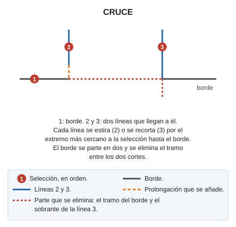

# CRUCE
<!-- id: cruce -->

Dibuja el cruce de una entidad con otras dos y elimina el tramo de la primera entidad comprendido entre las dos intersecciones.

## Parámetros

Esta orden no admite parámetros.

## Observaciones

Esta orden se utiliza para dibujar cruces de caminos, carreteras, etc.

Si el control de calidad descarta la primera línea modificada, se conserva la línea original. Si el control de calidad descarta cualquiera de las entidades nuevas del segundo paso (la segunda línea o los dos trozos del borde), se conservan la segunda línea y el borde originales y no se añade ninguna de las entidades nuevas del segundo paso.

## Características de la orden

| Tipo de orden | [Orden interactiva](/digi3d-ai/referencia/ordenes/ordenes-interactivas.md) |
| :--- | :--- |
| Repite automáticamente | Sí |
| Opción del menú donde aparece la orden | Editar/Polilíneas/Crear un cruce de caminos |
| Barra de herramientas en la que aparece la orden | Extender/Recortar |
| Extensión | DigiNG.OrdenesStandard.dll |
| Implementación | Nativa |
| Variables relacionadas | [REPITE](/digi3d-ai/referencia/ventana-de-dibujo/variables/r/repite.md) — repite la última orden ejecutada |
| Órdenes relacionadas | No tiene órdenes relacionadas |
| Nombre interno | {E46C5B7B-41E3-45fd-9ACC-9D6958ADDB97} |

