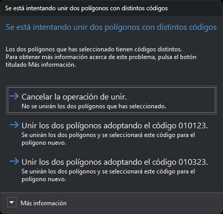

# FORMAR\_POLIGONOS
<!-- id: formar-poligonos -->

Crea/modifica polígonos mediante inundaciones y eliminando segmentos comunes

## Parámetros

No admite parámetros.

## Observaciones

1. Selecciona las líneas y polígonos con los que se van a formar los polígonos y pulsa la barra espaciadora. La orden parte las líneas por sus cruces, descarta las duplicadas y forma una topología temporal. Cada recinto toma los códigos de la línea cerrada o del polígono seleccionado más pequeño que lo contiene.
2. Selecciona dos polígonos contiguos para localizar sus caras comunes. Al pasar el ratón por encima de un recinto, la orden lo resalta. Pulsa Suprimir para eliminar las caras comunes y unir los dos polígonos, o Esc para deseleccionarlas. Mientras las caras comunes están seleccionadas, la orden no admite más selecciones. Si los dos polígonos tienen códigos o atributos distintos, la orden pregunta cuál de los dos conservar o si no se unen. El primer botón de unir conserva el código del primer polígono seleccionado y el segundo, el del segundo.

   
3. Pulsa la barra espaciadora para aceptar. Si hay caras comunes seleccionadas, la orden las deselecciona sin eliminarlas. La orden crea un polígono, con sus huecos, por cada recinto. Si un recinto no tiene códigos asignados, la orden pide el código; si se cancela, ese recinto no se crea. Las entidades seleccionadas en el paso 1 se borran.

Si el control de calidad descarta cualquiera de los polígonos nuevos, se conservan todas las entidades seleccionadas y no se añade ningún polígono.

La orden no usa la topología de inundaciones que haya cargada: forma su propia topología temporal con las entidades seleccionadas en el paso 1. Los recintos solo se resaltan al pasar el ratón después de pulsar la barra espaciadora la primera vez.

## Características de la orden

| Tipo de orden | [Orden interactiva](formar-poligonos.md) |
| :--- | :--- |
| Repite automáticamente | No |
| Opción del menú donde aparece la orden | Dibujar/Polígono mediante inundaciones |
| Barra de herramientas en la que aparece la orden | _Esta orden no tiene asociado ningún botón en ninguna barra de herramientas_ |
| Extensión | DigiNG.OrdenesTopologia.dll |
| Variables relacionadas | No tiene variables relacionadas |
| Órdenes relacionadas | [CREAR\_POLÍGONO](/digi3d-ai/referencia/ventana-de-dibujo/ordenes/c/crear-poligono.md) [POL](/digi3d-ai/referencia/ventana-de-dibujo/ordenes/p/pol.md) |
| Nombre interno | {F3F9E21F-BC9A-432E-B9D2-4DCBB070CCE4} |
