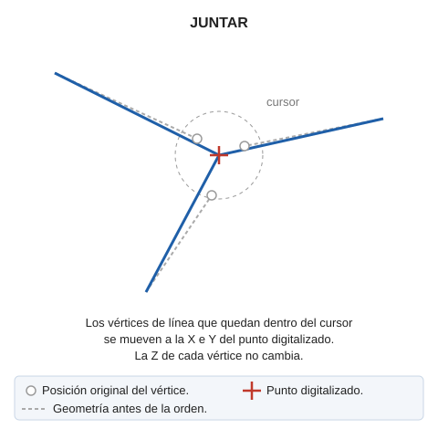

# JUNTAR
<!-- id: juntar -->

Traslada todos los puntos situados dentro del cursor al punto digitalizado. Solo cambian las coordenadas X e Y de los vértices; la Z no cambia.

## Parámetros

| Número de parámetro | Descripción | Valores | Opcional |
| :--- | :--- | :--- | :--- |
| 1 | Tamaño del cursor, en píxeles | Número entero | Sí |

Sin parámetro, la orden usa el tamaño del cursor de la ventana de dibujo.

Si el control de calidad descarta la entidad modificada, la entidad original se conserva sin cambios. Si hay varias entidades, la orden trata cada entidad de forma independiente: conserva la versión original de cada entidad cuya modificación se descarte y modifica las demás entidades.

## Características de la orden

| Tipo de orden | [Orden interactiva](/digi3d-ai/referencia/ordenes/ordenes-interactivas.md) |
| :--- | :--- |
| Repite automáticamente | Sí |
| Opción del menú donde aparece la orden | _Esta orden no tiene asociada ninguna opción de menú_ |
| Barra de herramientas en la que aparece la orden | _Esta orden no tiene asociado ningún botón en ninguna barra de herramientas_ |
| Extensión | DigiNG.OrdenesStandard.dll |
| Implementación | Nativa |
| Variables relacionadas | [REPITE](/digi3d-ai/referencia/ventana-de-dibujo/variables/r/repite.md) — repite la última orden ejecutada |
| Órdenes relacionadas | [JUNTAR\_VERTICES\_CERCANOS](/digi3d-ai/referencia/ventana-de-dibujo/ordenes/j/juntar-vertices-cercanos.md) [JUNTAR\_Z](/digi3d-ai/referencia/ventana-de-dibujo/ordenes/j/juntar-z.md) |
| Nombre interno | {7B3A0FBA-E03F-4c93-909C-6183536653FB} |

