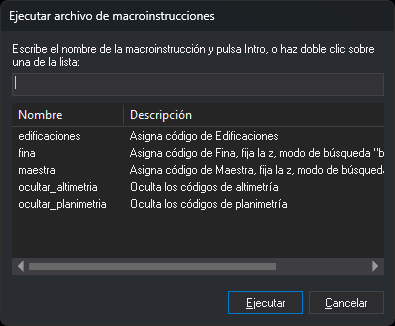

# MACROINSTRUCCIONES
<!-- id: macroinstrucciones-2 -->

Ejecuta macroinstrucciones, también llamadas arrobas.

## Parámetros

No admite parámetros.

## Cuadro de diálogo Ejecutar archivo de macroinstrucciones

Esta orden solicita la macroinstrucción a ejecutar en este cuadro de diálogo.

* **Cuadro de texto**: escribe el nombre de la macroinstrucción, sin la arroba, y pulsa Intro o el botón **Ejecutar**. Mientras escribes, la lista muestra solo las macroinstrucciones cuyo nombre o descripción contienen el texto, sin distinguir mayúsculas de minúsculas.
* **Lista**: haz doble clic sobre una macroinstrucción para ejecutarla. Un doble clic en la zona de la lista sin filas no hace nada. Seleccionar una fila con un solo clic no cambia el cuadro de texto: **Ejecutar** ejecuta siempre el nombre escrito en el cuadro de texto. La lista tiene dos columnas, **Nombre** y **Descripción**, y muestra:
  * las macroinstrucciones de la [tabla de códigos](../../../editor-de-tablas-de-codigos/pestanas/macroinstrucciones.md), con su descripción;
  * los archivos de macroinstrucciones (`@nombre`) del [directorio de macroinstrucciones](../../../cuadros-de-dialogo/configuracion/diging/directorio-de-macroinstrucciones.md). La columna **Nombre** muestra el nombre del archivo sin la arroba inicial. Si la primera línea del archivo es un [comentario](../../../ordenes/formas-de-ejecutar-una-orden/ejecutar-una-orden-desde-la-linea-de-comandos/macroinstrucciones.md) (empieza por `//` o por `#`), su texto se muestra como descripción.
* **Ejecutar**: antepone la arroba al nombre escrito en el cuadro de texto y lo ejecuta como si se hubiera tecleado en la [línea de comandos](../../../ordenes/formas-de-ejecutar-una-orden/ejecutar-una-orden-desde-la-linea-de-comandos/macroinstrucciones.md). Si el cuadro de texto está vacío o solo tiene espacios, emite un sonido de aviso y el cuadro de diálogo sigue abierto.
* **Cancelar**: cierra el cuadro de diálogo sin ejecutar ninguna macroinstrucción.

## Características de la orden

| Tipo de orden | [Orden interactiva](/digi3d-ai/referencia/ordenes/ordenes-interactivas.md) |
| :--- | :--- |
| Repite automáticamente | No |
| Opción del menú donde aparece la orden | Inmediato/Ejecutar un archivo de macroinstrucciones \(@\)... |
| Barra de herramientas en la que aparece la orden | _Esta orden no tiene asociado ningún botón en ninguna barra de herramientas_ |
| Extensión | DigiNG.OrdenesStandard.dll |
| Variables relacionadas | No tiene variables relacionadas |
| Órdenes relacionadas | No tiene órdenes relacionadas |
| Nombre interno | {B1A86A33-6B33-40b2-8C84-693696E7418B} |
