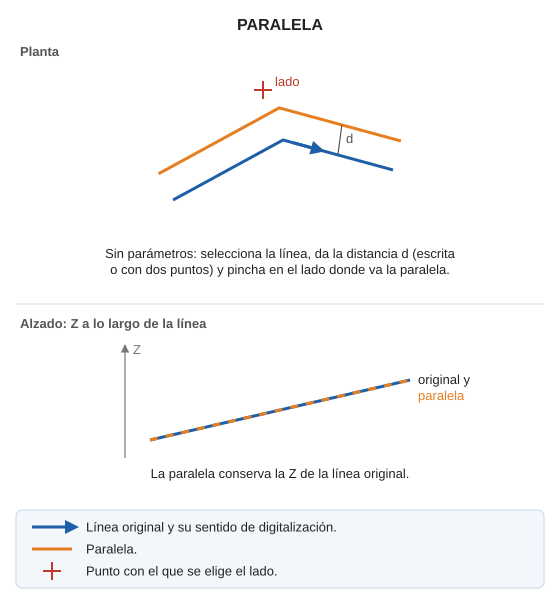

# PARALELA
<!-- id: paralela -->

Dibuja líneas paralelas a una o varias entidades, a una distancia determinada.

## Parámetros

| Número de parámetro | Descripción | Opcional |
| :--- | :--- | :--- |
| 1 | Código. Si se indica, la orden genera, sin solicitar más datos, una paralela a cada línea visible con ese código a la [distancia activa DA](/digi3d-ai/referencia/ventana-de-dibujo/variables/d/da.md), a la derecha del sentido de digitalización de cada línea, y suma DA2 a la Z de cada paralela. | Sí |

## Observaciones

Sin parámetros:

1. Selecciona la línea.
2. Indica la distancia: escríbela en la barra de estado y pulsa Intro, o digitaliza dos puntos (la distancia es la separación entre los dos puntos en planta).
3. Haz clic en el lado de la línea en el que quieres generar la paralela.

La paralela conserva la Z de la línea original. Las paralelas se generan con el código que esté activo en el momento de ejecutar la orden.

## Características de la orden

| Tipo de orden | [Orden interactiva](/digi3d-ai/referencia/ordenes/ordenes-interactivas.md) |
| :--- | :--- |
| Repite automáticamente | Sí |
| Opción del menú donde aparece la orden | Dibujar/Más/Paralela clásica (selección/distancia/lado) |
| Barra de herramientas en la que aparece la orden | _Esta orden no tiene asociado ningún botón en ninguna barra de herramientas_ |
| Extensión | DigiNG.OrdenesStandard.dll |
| Implementación | Nativa |
| Variables relacionadas | [REPITE](/digi3d-ai/referencia/ventana-de-dibujo/variables/r/repite.md) |
| Órdenes relacionadas | [PARALELA\_DA](/digi3d-ai/referencia/ventana-de-dibujo/ordenes/p/paralela-da.md) [PARALELA\_DINÁMICA](/digi3d-ai/referencia/ventana-de-dibujo/ordenes/p/paralela-dinamica.md) [PARALELA\_Z](/digi3d-ai/referencia/ventana-de-dibujo/ordenes/p/paralela-z.md) |
| Nombre interno | {C98B960F-F4D1-4f65-8945-029EB0914CA7} |

