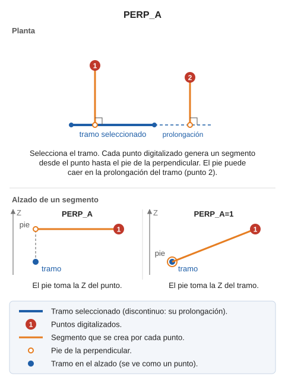

# PERP\_A
<!-- id: perp-a -->

Dibuja segmentos perpendiculares a una entidad dada.

## Parámetros

| Número de parámetro | Descripción | Valores | Opcional |
| :--- | :--- | :--- | :--- |
| 1 | Modo de asignación de cotas a la línea perpendicular | 0 o 1 | Sí |

## Observaciones

Si la orden se ejecuta sin pasarle ningún parámetro, la línea que se genera tendrá la cota del punto desde el que se traza la perpendicular. Si pasas el valor 1 como parámetro a la orden:

PERP\_A=1

El programa asigna a la línea perpendicular las siguientes cotas:

* En el extremo correspondiente al punto desde el que se traza la perpendicular, se asigna la cota de dicho punto.
* En el otro extremo se asigna la cota correspondiente a la entidad hacia la que se traza la perpendicular.

## Características de la orden

| Tipo de orden | [Orden interactiva](/digi3d-ai/referencia/ordenes/ordenes-interactivas.md) |
| :--- | :--- |
| Repite automáticamente | Sí |
| Opción del menú donde aparece la orden | Dibujar/Más/Múltiples líneas de dos puntos perpendiculares a una línea existente |
| Barra de herramientas en la que aparece la orden | _Esta orden no tiene asociado ningún botón en ninguna barra de herramientas_ |
| Extensión | DigiNG.OrdenesStandard.dll |
| Implementación | Nativa |
| Variables relacionadas | No tiene variables relacionadas |
| Órdenes relacionadas | [PERP](/digi3d-ai/referencia/ventana-de-dibujo/ordenes/p/perp.md) [PERP\_Z](/digi3d-ai/referencia/ventana-de-dibujo/ordenes/p/perp-z.md) |
| Nombre interno | {E2B84309-4C10-49aa-A11E-2C09AC3FFD16} |

