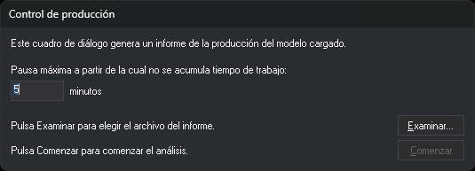

# PRODUCCION
<!-- id: produccion -->

Permite generar un fichero con la información acerca de la producción del archivo de dibujo activo.

## Parámetros

No admite parámetros.

## Cuadro de diálogo Control de producción

Esta orden solicita en este cuadro de diálogo la pausa máxima y el archivo del informe:

* **Pausa máxima a partir de la cual no se acumula tiempo de trabajo**: en minutos (valor por defecto: 5). Al pulsar **Comenzar**, el valor se guarda para la próxima vez.
* **Examinar...**: abre un cuadro de diálogo para guardar el archivo HTML del informe, con el filtro **Archivos de informes (\*.html)**. El cuadro se abre en la última carpeta usada en los cuadros de diálogo Abrir y Guardar de Digi3D.AI. Si el archivo ya existe, se sobrescribe sin pedir confirmación.
* **Comenzar**: cierra el cuadro de diálogo y genera el informe. Está deshabilitado hasta que eliges el archivo con **Examinar...**.

El cuadro no tiene botón para cancelar. La tecla Esc lo cierra sin generar el informe.

## Observaciones

La orden calcula la producción a partir de la fecha y hora de creación de las líneas no borradas del archivo de dibujo activo. Las demás entidades no se tienen en cuenta. Dos líneas consecutivas del mismo día separadas por menos de la pausa máxima cuentan como tiempo de trabajo.

El informe contiene:

* El nombre del primer archivo de dibujo cargado.
* La fecha y la hora de la primera y de la última línea.
* El tiempo total de trabajo.
* Para cada día con líneas, numerado como «Día 1», «Día 2»…, los intervalos de trabajo y, en rojo, las pausas iguales o mayores que la pausa máxima.

Al terminar, la orden abre el archivo HTML con la aplicación asociada. Si no se puede crear el archivo HTML, la orden muestra un mensaje de error y termina. Si el archivo de dibujo no tiene ninguna línea, la orden termina sin crear el informe y sin mostrar ningún mensaje.

## Características de la orden

| Tipo de orden | [Orden inmediata](/digi3d-ai/referencia/ordenes/ordenes-no-interactivas.md) |
| :--- | :--- |
| Repite automáticamente | No |
| Opción del menú donde aparece la orden | _Esta orden no tiene asociada ninguna opción de menú_ |
| Barra de herramientas en la que aparece la orden | _Esta orden no tiene asociado ningún botón en ninguna barra de herramientas_ |
| Extensión | DigiNG.OrdenesControlTrabajos.dll |
| Variables relacionadas | No tiene variables relacionadas |
| Órdenes relacionadas | No tiene órdenes relacionadas |
| Nombre interno | {9A3109BC-561C-426B-9776-8925DD88E866} |
