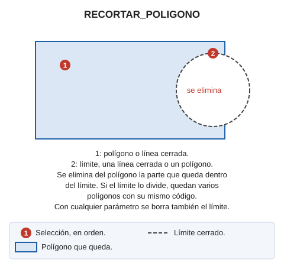

# RECORTAR\_POLÍGONO
<!-- id: recortar-poligono -->

Recorta un polígono eliminando la parte que intersecciona con un límite.

## Parámetros

| Número de parámetro | Descripción | Valores | Opcional |
| :--- | :--- | :--- | :--- |
| 1 | Eliminar la línea de límite | Cualquier valor, como por ejemplo un 1 | Sí |

## Observaciones

Selecciona el polígono que quieres recortar. La orden solo permite seleccionar entidades de tipo _polígono_ o entidades de tipo _línea_ cerradas.  
Selecciona la entidad que actuará como límite. El límite puede ser una línea cerrada o un polígono. Si la entidad que actúa como límite es un polígono, la orden usa como límite el contorno exterior del polígono e ignora los huecos del polígono.

La orden analiza la intersección entre el polígono que quieres recortar y la entidad que actúa como límite y crea uno o varios polígonos \(la línea de límite puede dividir el polígono en varias partes\).

## Características de la orden

| Tipo de orden | [Orden interactiva](/digi3d-ai/referencia/ordenes/ordenes-interactivas.md) |
| :--- | :--- |
| Repite automáticamente | No |
| Opción del menú donde aparece la orden | Editar/Polígonos/Recortar polígono |
| Barra de herramientas en la que aparece la orden | _Esta orden no tiene asociado ningún botón en ninguna barra de herramientas_ |
| Extensión | DigiNG.Commands.dll |
| Implementación | [.NET](/digi3d-ai/programacion/.net/README.md) |
| Código fuente | [RecortarPoligono.cs](https://github.com/digi21/DigiNG.Commands/blob/main/DigiNG.Commands/Operaciones%20con%20entidades/RecortarPoligono.cs) |
| Variables relacionadas | No tiene variables relacionadas |
| Órdenes relacionadas | [CORTAR\_POLÍGONO](/digi3d-ai/referencia/ventana-de-dibujo/ordenes/c/cortar-poligono.md) [RECORTAR\_POLÍGONOS](/digi3d-ai/referencia/ventana-de-dibujo/ordenes/r/recortar-poligonos.md) |

