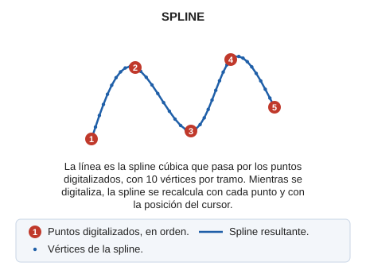

# SPLINE
<!-- id: spline -->

Dibuja una figura mediante arcos y los convierte en una curva suave.

## Parámetros

No admite parámetros.

## Observaciones

Define los puntos por los que pasará la curva SPLINE. A medida que digitalizas los puntos, el movimiento del cursor modifica los vértices que determinan la forma de la curva.

Las _SPLINES_ generadas en DIGI son SPLINES CÚBICAS.

## Características de la orden

| Tipo de orden | [Orden interactiva](/digi3d-ai/referencia/ordenes/ordenes-interactivas.md) |
| :--- | :--- |
| Repite automáticamente | Sí |
| Opción del menú donde aparece la orden | Dibujar/Spline |
| Barra de herramientas en la que aparece la orden | Polilíneas |
| Extensión | DigiNG.OrdenesStandard.dll |
| Implementación | Nativa |
| Variables relacionadas | [REPITE](/digi3d-ai/referencia/ventana-de-dibujo/variables/r/repite.md) — repite la última orden ejecutada |
| Órdenes relacionadas | [CIERRA\_ENT](/digi3d-ai/referencia/ventana-de-dibujo/ordenes/c/cierra-ent.md) [LINEA](/digi3d-ai/referencia/ventana-de-dibujo/ordenes/l/linea.md) [SUAVIZA\_SPLINE](/digi3d-ai/referencia/ventana-de-dibujo/ordenes/s/suaviza-spline.md) |
| Nombre interno | {A585D55F-20B4-41a7-AC7E-4B0E8A9C32AA} |

