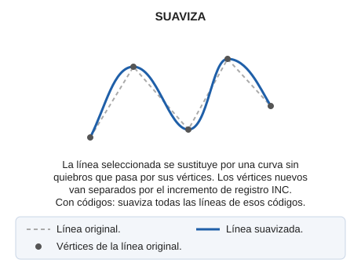

# SUAVIZA
<!-- id: suaviza -->

Suaviza la forma geométrica de un elemento lineal existente en el dibujo.

## Parámetros

| Número de parámetro | Descripción | Opcional |
| :--- | :--- | :--- |
| 1 … N | Código o códigos de las entidades a suavizar | Sí |

## Observaciones

Indica el código como parámetro de la orden SUAVIZA para suavizar todas las entidades que tengan ese código:

`SUAVIZA=020200`

La orden necesita que se especifique el elemento, cuya selección se realizará de forma gráfica. Así, al llamar a la orden el programa solicita que el usuario seleccione la entidad.

La orden añade puntos a la entidad para generar una línea sin quiebros.

Los puntos nuevos se crean separados por una distancia igual al valor de la variable [INC](/digi3d-ai/referencia/ventana-de-dibujo/variables/i/inc.md).

Si el control de calidad descarta la entidad modificada, la entidad original se conserva sin cambios. Con varias entidades, cada una se trata de forma independiente: solo se conserva el original de cada entidad descartada y las demás se suavizan.

## Características de la orden

| Tipo de orden | [Orden interactiva](/digi3d-ai/referencia/ordenes/ordenes-interactivas.md) |
| :--- | :--- |
| Repite automáticamente | Sí |
| Opción del menú donde aparece la orden | Editar/Polilíneas/Suavizar |
| Barra de herramientas en la que aparece la orden | Editar polilínea |
| Extensión | DigiNG.OrdenesStandard.dll |
| Implementación | Nativa |
| Variables relacionadas | [INC](/digi3d-ai/referencia/ventana-de-dibujo/variables/i/inc.md) — incremento de registro activo [REPITE](/digi3d-ai/referencia/ventana-de-dibujo/variables/r/repite.md) — repite la última orden ejecutada |
| Órdenes relacionadas | [SUAVIZA\_SPLINE](/digi3d-ai/referencia/ventana-de-dibujo/ordenes/s/suaviza-spline.md) |
| Nombre interno | {D65F1A76-8D76-43fa-9ACC-809CFE01E035} |

