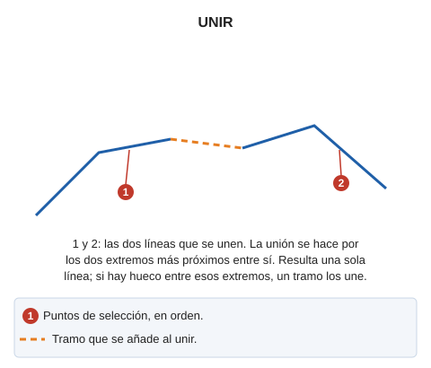
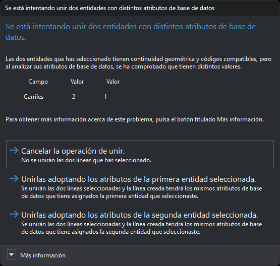

# UNIR
<!-- id: unir -->

Une dos entidades lineales que has de seleccionar, generando un único elemento de dibujo.

## Parámetros

| Número de parámetro | Descripción | Opcional |
| :--- | :--- | :--- |
| 1 | Código de las líneas que se unen por ventana | Si |

Con un código como parámetro (`UNIR=<código>`), la orden une por ventana. Es la opción **Unir polilíneas por ventana y código** del menú:

1. Digitaliza los 4 vértices de una ventana.
2. La orden busca las líneas visibles de ese código que cortan la ventana y une entre sí cada par de esas líneas por el extremo de cada una más cercano a su corte con la ventana, si los dos extremos tienen la misma Z.

Si una de las dos líneas no pertenece al modelo actual, la orden no la modifica: mueve el extremo de la otra línea al extremo de la primera.

## Observaciones

Sin parámetros, la orden pide que selecciones las dos líneas. El punto de selección no decide por qué extremos se unen las líneas. La orden mide en planta las cuatro distancias entre los extremos de la primera línea y los de la segunda, y une las líneas por el par de extremos más próximos entre sí.

Si las dos líneas tienen el mismo código y los mismos atributos de base de datos, la orden las une sin preguntar. En los demás casos:

* Si los códigos son iguales y algún atributo de base de datos tiene distinto valor, la orden muestra el cuadro de diálogo **Se está intentando unir dos entidades con distintos atributos de base de datos**, descrito en la sección siguiente.
* Si los códigos son distintos, la orden emite el sonido de error. Lo que hace después depende de la opción **Si las dos líneas tienen códigos distintos**, de la categoría **Unir** del cuadro de diálogo de configuración:
  * Con el valor **No unir las líneas** (valor por defecto), la orden muestra el mensaje «Se han seleccionado líneas con códigos distintos.» y no une las líneas.
  * Con el valor **Preguntar el código de la línea a generar**, la orden muestra un cuadro de diálogo con el texto «Selecciona los códigos a almacenar en la geometría nueva» y tres botones: los códigos de la primera línea (botón por defecto), los códigos de la segunda línea y **No unir las dos líneas**.

La orden trata también como códigos distintos dos líneas con el mismo código en estos casos: la tabla de base de datos del código es distinta en cada línea, o los ID son distintos y la primera línea no tiene atributos cargados o las dos tienen distinto número de atributos.

Si el control de calidad descarta la línea unida, se conservan las dos líneas originales y no se añade la unión. Si una de las dos líneas no pertenece al modelo actual y el control de calidad descarta la línea modificada, la línea original se conserva sin cambios. Con la unión por ventana, cada par de líneas se trata de forma independiente.

## Cuadro de diálogo Se está intentando unir dos entidades con distintos atributos de base de datos

Esta orden solicita en este cuadro de diálogo qué atributos de base de datos tendrá la línea unida. La orden lo muestra cuando las dos líneas tienen los mismos códigos y algún atributo con distinto valor.

El cuadro muestra una tabla con los campos que tienen distinto valor. La columna **Campo** contiene el nombre del campo. La primera columna **Valor** contiene el valor en la primera línea seleccionada y la segunda columna **Valor**, el valor en la segunda. La comparación no tiene en cuenta los campos marcados con `comparable="0"` en el esquema de la base de datos ni los campos binarios.

* **Cancelar la operación de unir.**: no une las líneas. Es la opción por defecto.
* **Unirlas adoptando los atributos de la primera entidad seleccionada.**: une las líneas. La línea unida conserva los códigos y los atributos de la primera línea.
* **Unirlas adoptando los atributos de la segunda entidad seleccionada.**: une las líneas. La línea unida recibe los códigos y los atributos de la segunda línea.
* **Más información**: despliega un texto que indica que dos entidades con enlace a base de datos solo se pueden unir si coinciden todos sus atributos, excepto el campo marcado como clave primaria. El texto pone como ejemplo una carretera con el atributo Carriles igual a 2 y otra con Carriles igual a 10.

Si una de las dos líneas no pertenece al modelo actual, la opción elegida no cambia los atributos: la línea del modelo actual conserva los suyos.

## Características de la orden

| Tipo de orden | [Orden interactiva](/digi3d-ai/referencia/ordenes/ordenes-interactivas.md) |
| :--- | :--- |
| Repite automáticamente | No |
| Opción del menú donde aparece la orden | Editar/Polilíneas/Unir dos polilíneas |
| Barra de herramientas en la que aparece la orden | Unir |
| Extensión | DigiNG.OrdenesStandard.dll |
| Variables relacionadas | No tiene variables relacionadas |
| Órdenes relacionadas | [EXT2X](/digi3d-ai/referencia/ventana-de-dibujo/ordenes/e/ext2x.md) [UNIR\_COD](/digi3d-ai/referencia/ventana-de-dibujo/ordenes/u/unir-cod.md) |
| Nombre interno | {88F56A67-0638-495d-99FB-6265DAD1CF1B} |

