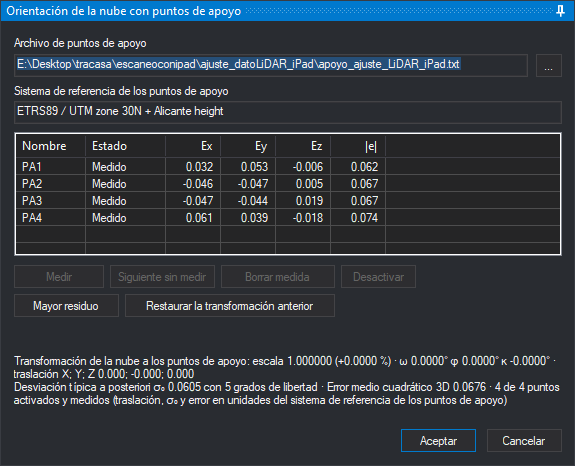
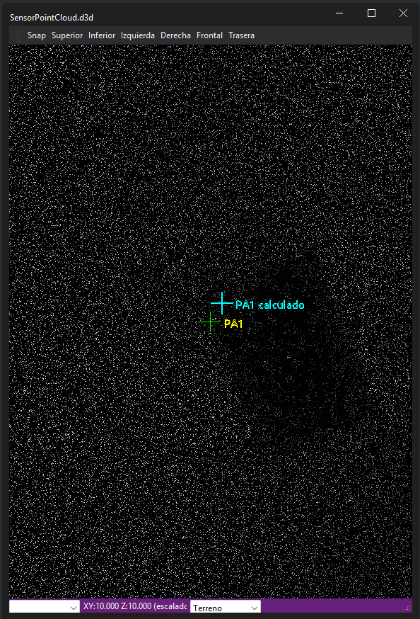

# ORI\_NUBE
<!-- id: ori-nube -->

Abre el panel **Orientación de la nube con puntos de apoyo**, en el que se miden con el cursor 3D los puntos de apoyo de la nube del modelo, se calcula la semejanza que lleva la nube al sistema de referencia de los puntos de apoyo y, al aceptar, la orden escribe la transformación calculada en el archivo `.transform.json` de la nube y vuelve a cargar la nube.

La orden solo está disponible con el sensor PointCloud y con un modelo que tenga un único archivo local de nube de puntos y ninguna nube remota. Solo puede haber una orientación de nube en curso a la vez.

## Parámetros

No admite parámetros.

## Uso

1. Selecciona la opción **Ventana fotogramétrica/Orientación con puntos de apoyo...**. Si la nube no tiene todavía un archivo de puntos de apoyo asociado, Digi3D.AI abre el cuadro de diálogo [Archivo de puntos de apoyo](../../../cuadros-de-dialogo/archivo-de-puntos-de-apoyo.md); elige el archivo y su sistema de referencia. Si cancelas el cuadro, la orden termina.
2. Selecciona un punto en la lista y pulsa **Medir** (o **Siguiente sin medir**, que elige el primer punto activado que aún no tiene medida).
3. Coloca el cursor 3D sobre ese punto de la nube y pulsa el pedal. Digi3D.AI guarda la medida y calcula la orientación. Con **Siguiente sin medir**, tras cada medida el panel pasa al siguiente punto activado sin medir hasta que no queda ninguno.
4. Revisa los residuos de la lista y el texto de resultado. Si algún punto tiene un residuo alto, pulsa **Mayor residuo**, vuelve a medirlo con **Remedir** o desactívalo con **Desactivar**.
5. Pulsa **Aceptar** para escribir la transformación en el archivo `.transform.json` de la nube y recargar la nube en la ventana abierta.

## Panel Orientación de la nube con puntos de apoyo

Los botones que no se pueden usar en cada momento aparecen desactivados. Mientras otra orden ocupa la ventana, el panel no permite cambiar el archivo de puntos, medir, borrar medidas, activar ni desactivar puntos, aceptar, cancelar ni restaurar.

* **Archivo de puntos de apoyo**: archivo con las coordenadas terreno de los puntos de apoyo. El botón **...** abre el cuadro de diálogo [Archivo de puntos de apoyo](../../../cuadros-de-dialogo/archivo-de-puntos-de-apoyo.md) para cambiar el archivo de puntos de apoyo. Al cargar otro archivo, los puntos cuyo nombre ya estaba en el panel conservan su medida y su activación; los nombres se comparan sin distinguir mayúsculas de minúsculas.
* **Sistema de referencia de los puntos de apoyo**: el sistema de las coordenadas del archivo de puntos. Se elige en el cuadro de diálogo que abre el botón **...**.
* **Lista de puntos**: muestra, para cada punto, estas columnas:
  * **Nombre**: nombre del punto en el archivo de puntos.
  * **Estado**: **Medido**, **Sin medir** o **Desactivado**.
  * **Ex**, **Ey**, **Ez**: residuos en X, Y y Z, es decir, la coordenada de apoyo menos la coordenada del punto medido transformada con la semejanza calculada, en las unidades del sistema de referencia de los puntos de apoyo.
  * **|e|**: módulo del residuo en tres dimensiones.

  Los residuos aparecen cuando hay una orientación calculada. Un punto medido y desactivado también muestra su residuo, aunque no interviene en el cálculo de la orientación. El residuo de un punto medido y desactivado permite comprobar la orientación calculada. En cada una de las columnas **Ex**, **Ey**, **Ez** y **|e|**, Digi3D.AI muestra en rojo las celdas cuyo valor absoluto, redondeado a los tres decimales que muestra la celda, es el mayor de la columna (todas las que empatan), salvo que ese valor sea 0. Al hacer clic en un punto, el cursor 3D se desplaza a su medida o, si no está medido y hay una orientación calculada, a la posición que le corresponde según esa orientación.
* **Medir** / **Remedir**: espera a que se pulse el pedal para medir el punto seleccionado. El botón se llama **Remedir** si el punto ya tiene medida. Mientras se espera, el panel indica «Coloca el cursor 3D sobre *punto* y pulsa el pedal. Esc cancela la identificación.». Con la tecla Esc se cancela la medida pendiente. Al hacer doble clic en un punto de la lista, el panel también queda esperando su medida.
* **Siguiente sin medir**: selecciona el primer punto activado que no tiene medida y espera su medida. Después de cada medida avanza al siguiente punto activado sin medir.
* **Borrar medida**: elimina la medida del punto seleccionado y vuelve a calcular la orientación.
* **Activar** / **Desactivar**: activa o desactiva el punto seleccionado. Solo los puntos activados y medidos intervienen en el cálculo.
* **Mayor residuo**: selecciona el punto activado y medido con mayor módulo de residuo.
* **Restaurar la transformación anterior**: escribe en el archivo `.transform.json` la transformación que tenía la nube antes de la última orientación aceptada y vuelve a cargar la nube. Antes de restaurar la transformación anterior, la orden pide confirmación. Solo está disponible si existe una transformación anterior.
* **Texto de resultado**: describe la transformación calculada (véase el apartado siguiente).
* **Aceptar**: escribe la transformación calculada en el archivo `.transform.json` de la nube, vuelve a cargar la nube en la ventana abierta y termina la orden. Solo está disponible cuando hay una orientación calculada. Si no se ha elegido el sistema de referencia de los puntos de apoyo, Digi3D.AI muestra un aviso y no escribe la transformación en el archivo `.transform.json` de la nube.
* **Cancelar**: termina la orden sin escribir ninguna transformación.

## Cálculo de la transformación

Digi3D.AI calcula una semejanza de siete parámetros (un factor de escala, tres giros y tres traslaciones) que lleva las medidas de los puntos, tomadas en las coordenadas del archivo original de la nube, a las coordenadas de apoyo. Usa el método de Horn, que minimiza la suma de los cuadrados de las distancias entre los puntos transformados y los puntos de apoyo, con el mismo peso para todos los puntos activados y medidos. La semejanza no produce reflexiones.

Para calcular la orientación hacen falta al menos tres puntos activados y medidos. Si hay menos de tres puntos activados y medidos, el texto de resultado indica cuántos puntos cumplen las dos condiciones. Si los puntos están alineados, repetidos o tienen coordenadas que no son números finitos, el texto de resultado lo indica y no se calcula la orientación. Si los puntos están casi alineados (la razón entre la segunda y la primera desviación típica de sus coordenadas es menor que 0,05), el texto de resultado añade un aviso: el giro alrededor de la recta que une los puntos queda poco determinado.

El texto de resultado muestra:

* La escala, con su diferencia respecto de 1 en tanto por ciento; los giros ω, φ y κ en grados; y la traslación en X, Y y Z. Estos parámetros transforman las coordenadas del modelo en la ventana (el documento) en las coordenadas de apoyo.
* La desviación típica a posteriori σ₀, los grados de libertad (3n − 7, con n el número de puntos activados y medidos), el error medio cuadrático 3D y el número de puntos activados y medidos frente al total de puntos del archivo. La traslación, σ₀ y el error medio cuadrático están en las unidades del sistema de referencia de los puntos de apoyo.

## Marcas en la ventana fotogramétrica

Mientras la orden está activa, el sensor PointCloud dibuja sobre la nube, sin tener en cuenta la profundidad, estas marcas:

* Una cruz amarilla con el nombre del punto, en la posición medida del punto seleccionado.
* Una cruz cian con el texto «*nombre* calculado», en la posición del punto seleccionado según la orientación calculada. Solo aparece si hay una orientación calculada.
* Una cruz blanca en la posición medida de cada uno de los demás puntos medidos.

Si hay más de 1024 marcas, se descartan cruces blancas.

## Archivos que usa la orden

* **Medidas**: la orden guarda el archivo de puntos, su sistema de referencia, las medidas y la activación de cada punto en `<original>.extensions\lop.orientation\orientation.json`, donde `<original>` es la ruta completa del archivo de nube con su extensión. Es el mismo archivo que usa la extensión de orientación de Lot Of Points. Si `<original>.extensions\lop.orientation\orientation.json` no existe y existe `<original>.extensions\lop_orientation\orientation.json`, la orden lee y escribe este último. La orden guarda el archivo después de cada cambio (medida, borrado de medida, activación o desactivación, cambio de archivo de puntos), de modo que **Cancelar** no deshace esos cambios.
* **Transformación**: **Aceptar** escribe `<original>.transform.json` con la matriz de la semejanza calculada y el sistema de referencia de los puntos de apoyo. Antes de escribir `<original>.transform.json`, la orden guarda en `orientation.json` la transformación anterior de la nube para que **Restaurar la transformación anterior** pueda recuperarla. Si no se puede escribir `.transform.json`, la orden sigue activa y la nube conserva su transformación.

## Características de la orden

| Tipo de orden | Orden interactiva |
| :--- | :--- |
| Repite automáticamente | No |
| Opción del menú donde aparece la orden | Ventana fotogramétrica/Orientación con puntos de apoyo... (opción que añade el sensor PointCloud) |
| Barra de herramientas en la que aparece la orden | _Esta orden no tiene asociado ningún botón en ninguna barra de herramientas_ |
| Extensión | Digi3D.PointCloud.dll |
| Implementación | Nativa |
| Variables relacionadas | No tiene variables relacionadas |
| Órdenes relacionadas | [ORI\_ABSOLUTA](/digi3d-ai/referencia/ventana-fotogrametrica/ordenes/o/ori-absoluta.md) |
| Nombre interno | {627C0DAC-D2FC-4885-8512-BAA65F157723} |
