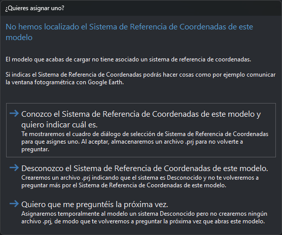
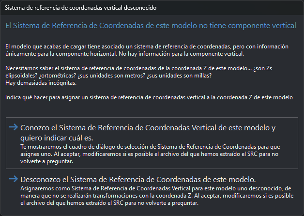

# Modelo sin sistema de referencia de coordenadas
<!-- id: modelo-sin-sistema-de-referencia -->

Al cargar un modelo del sensor [Cónico](README.md), la extensión que lee el archivo de aerotriangulación obtiene de él el sistema de referencia de coordenadas del modelo. Si el archivo no lo indica, o lo indica sin componente vertical, Digi3D.AI muestra uno de los cuadros de esta página.

Por ejemplo, la extensión [IMU](extensiones/imu.md) lee el sistema de un archivo `.eo` en este orden: el archivo `.prj` con el mismo nombre que el `.eo` (`Bronchales.prj` para `Bronchales.eo`), el código EPSG del propio `.eo` y, si no hay ninguno de los dos, el cuadro de sistema horizontal.

## Sistema de referencia de coordenadas horizontal

El cuadro **¿Quieres asignar uno?** («No hemos localizado el Sistema de Referencia de Coordenadas de este modelo») ofrece tres opciones:

* **Conozco el Sistema de Referencia de Coordenadas de este modelo y quiero indicar cuál es.**: muestra el cuadro de selección de sistema de referencia de coordenadas. Al aceptar, crea un archivo `.prj` con el sistema seleccionado junto al archivo de aerotriangulación, con su mismo nombre (con la extensión [DVP](extensiones/dvp.md), junto a la imagen izquierda). Si se cancela el cuadro de selección, actúa como la opción siguiente.
* **Desconozco el Sistema de Referencia de Coordenadas de este modelo.**: crea el archivo `.prj` con un sistema desconocido.
* **Quiero que me preguntéis la próxima vez.**: asigna al modelo un sistema desconocido y no crea ningún archivo `.prj`. El cuadro vuelve a aparecer la próxima vez que se carga el modelo.

Las extensiones leen ese `.prj` antes de preguntar, así que el cuadro no vuelve a aparecer para ese archivo de aerotriangulación. Para cambiar el sistema, edita o borra el `.prj`.

Con un sistema desconocido, Digi3D.AI no transforma las coordenadas del modelo a otros sistemas: por ejemplo, no puede comunicar la ventana fotogramétrica con Google Earth.

## Sistema de referencia de coordenadas vertical

Si el sistema que proporciona el archivo de aerotriangulación solo tiene componente horizontal y la opción [Solicitar sistema vertical para sensores](../../../cuadros-de-dialogo/configuracion/sistema-de-referencia-de-coordenadas/solicitar-sistema-vertical-para-sensores.md) de la configuración está en **Sí**, aparece el cuadro **Sistema de referencia de coordenadas vertical desconocido** («El Sistema de Referencia de Coordenadas de este modelo no tiene componente vertical») con dos opciones:

* **Conozco el Sistema de Referencia de Coordenadas Vertical de este modelo y quiero indicar cuál es.**: muestra el cuadro de selección de sistema de referencia de coordenadas vertical. El modelo usa el sistema horizontal del archivo con el vertical seleccionado. Si se cancela el cuadro de selección, vuelve a aparecer el cuadro **Sistema de referencia de coordenadas vertical desconocido**.
* **Desconozco el Sistema de Referencia de Coordenadas de este modelo.**: el modelo usa el sistema horizontal del archivo con un sistema vertical desconocido. Digi3D.AI no transforma la coordenada Z.

Si el sistema procede del código EPSG de un archivo `.eo` o `.imu` de la extensión [IMU](extensiones/imu.md), al elegir cualquiera de las dos opciones Digi3D.AI crea junto a ese archivo un archivo `.prj` con su mismo nombre (`Bronchales.prj` para `Bronchales.eo`). El `.prj` contiene el sistema compuesto que usa el modelo: el horizontal del archivo con el vertical seleccionado o con un vertical desconocido. La extensión lee el `.prj` antes que el código EPSG, así que el cuadro no vuelve a aparecer para ese archivo. Para que vuelva a aparecer, borra el `.prj`. El archivo `.eo` no se modifica. Si no se puede crear el `.prj` (por ejemplo, porque la carpeta es de solo lectura), el modelo se carga igual y el cuadro vuelve a aparecer en la siguiente carga.

Con los demás formatos, como los proyectos de Metashape o de Inpho, la elección no se guarda en ningún archivo y el cuadro aparece cada vez que se carga el modelo. Con la opción **Solicitar sistema vertical para sensores** en **No**, el cuadro no aparece, el sistema vertical es desconocido y no se crea ningún archivo.
