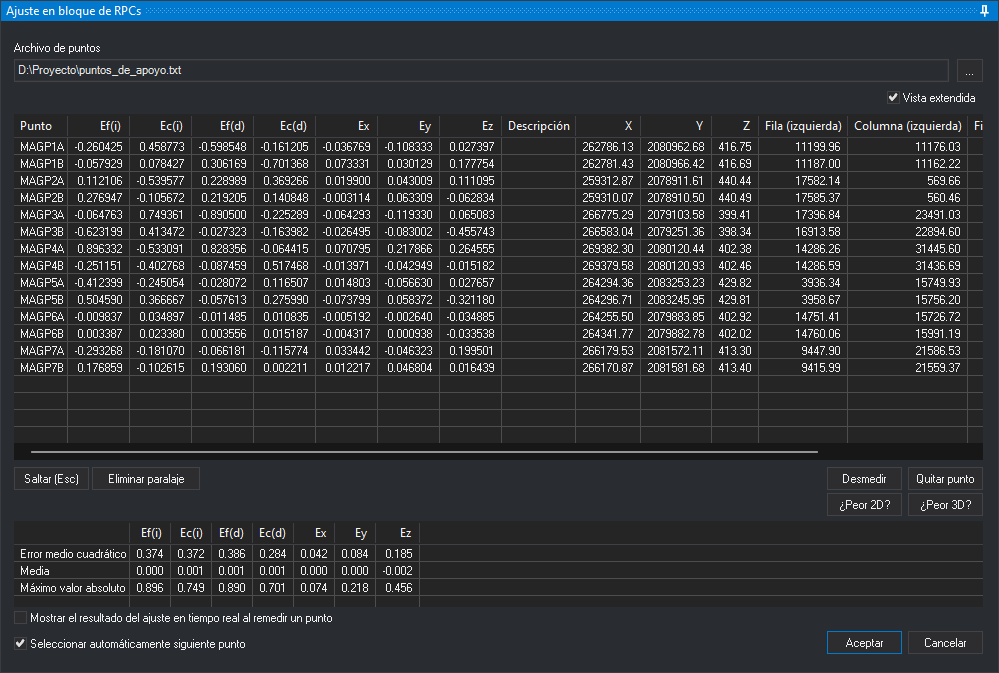

# Ajuste en bloque de RPCs
<!-- id: ajuste-en-bloque-de-rpcs -->

El panel **Ajuste en bloque de RPCs** calcula una corrección de los coeficientes RPC de las dos imágenes del modelo a partir de puntos de apoyo medidos en estereoscopía (ajuste RPCBA, *RPC Block Adjustment*). La corrección compensa desplazamientos y deformaciones afines de las coordenadas imagen.

Selecciona la opción **Ventana fotogramétrica/Ajuste en bloque de RPCs** para abrir el panel. La opción solo funciona si:

* El sensor activo es el sensor [Satélite RPC](README.md) estereoscópico.
* No hay otra orden de ajuste en bloque de RPCs en ejecución.
* La imagen izquierda y la derecha del modelo son distintas.

Si no se cumple alguna condición, Digi3D.AI muestra un mensaje y la orden termina.

## Al empezar

1. Digi3D.AI pone a cero los términos de corrección afín de los RPC de las dos imágenes. Las medidas se hacen sobre los RPC sin corregir, aunque el modelo tuviera un ajuste guardado.
2. Digi3D.AI carga el último archivo de puntos utilizado. Si no existe, solicita uno con el cuadro de diálogo de abrir archivo; si se cancela, la orden termina.
3. Si existe el archivo `<directorio de trabajo>\<nombre del modelo>.rpcba`, Digi3D.AI carga las medidas guardadas en una sesión anterior.

## Archivo de puntos

El archivo de puntos es un archivo de texto con un punto por línea: nombre, X, Y, Z y, opcionalmente, una descripción, separados por espacios. Las líneas con menos de cuatro campos se ignoran. Los nombres de los puntos distinguen mayúsculas: P1 y p1 son dos puntos distintos. Solo se cargan los puntos cuya proyección cae dentro de las dos imágenes.

El campo **Archivo de puntos** muestra la ruta del archivo cargado. El botón **...** permite elegir otro archivo (`.xyz`, `.pnt`, `.ctl` o `.txt`): la lista pasa a contener los puntos del archivo nuevo y las medidas de los puntos con el mismo nombre se conservan. Las medidas de los puntos que no están en el archivo nuevo se siguen guardando en el archivo `.rpcba`, pero no entran en el ajuste. Si el archivo no se puede abrir, se mantiene el anterior.

## Lista de puntos

Cada fila es un punto del archivo de puntos. Las columnas son:

| Columna | Contenido |
|---|---|
| **Punto** | Nombre del punto. |
| **Ef(i)**, **Ec(i)** | Residuo en fila y en columna de la imagen izquierda, en píxeles: posición calculada con el ajuste menos posición medida. |
| **Ef(d)**, **Ec(d)** | Residuo en fila y en columna de la imagen derecha, en píxeles. |
| **Ex**, **Ey**, **Ez** | Diferencia entre la posición ajustada del punto y sus coordenadas del archivo de puntos, en unidades del sistema de referencia de coordenadas del sensor. |
| **Descripción** | Descripción del punto en el archivo de puntos. |

Las columnas de residuos están vacías mientras el punto no esté medido o no se haya calculado el ajuste.

Si se activa la casilla **Vista extendida**, la lista añade las columnas **X**, **Y** y **Z** (coordenadas del archivo de puntos) y **Fila** y **Columna** medidas en cada imagen. El estado de la casilla se conserva entre sesiones.

## Medir un punto

1. Haz clic en el punto en la lista. Digi3D.AI lleva el cursor a sus coordenadas y la barra de estado muestra el mensaje **Digitaliza el punto *nombre* estereoscópicamente**.
2. Coloca el cursor sobre el punto en estereoscopía y pulsa el botón de registro. Digi3D.AI guarda la fila y la columna del cursor en las dos imágenes y recalcula el ajuste.

El ajuste se calcula cuando el número de puntos medidos alcanza el valor de [Número de puntos para calcular](../../../cuadros-de-dialogo/configuracion/parametros-del-ajuste-rpcba/numero-de-puntos-para-calcular.md). Solo cuentan y entran en el ajuste los puntos medidos que están en el archivo de puntos. Si el ajuste no converge en 100 iteraciones, los RPC no cambian, y las columnas de residuos y la tabla de [estadísticas de los residuos](#estadísticas-de-los-residuos) quedan vacías. Las precisiones del ajuste se configuran en [Parámetros del ajuste RPCBA](../../../cuadros-de-dialogo/configuracion/parametros-del-ajuste-rpcba/README.md).

## Botones

| Botón | Acción |
|---|---|
| **Saltar (Esc)** | Deselecciona el punto que se está midiendo. Durante **Eliminar paralaje**, cancela la eliminación. Equivale a pulsar la tecla **Esc**. |
| **Eliminar paralaje** | Desplaza los RPC de la imagen derecha para eliminar el paralaje en un punto. Digitaliza un punto: Digi3D.AI bloquea la imagen izquierda en esa posición. Digitaliza el mismo punto en la imagen derecha después de digitalizarlo en la imagen izquierda: la diferencia de fila y de columna entre las dos pulsaciones se suma a la corrección de la imagen derecha. La barra de estado indica qué imagen hay que digitalizar. La corrección se mantiene hasta que se recalcula el ajuste: al medir, desmedir, quitar o saltar un punto, o al cambiar de archivo de puntos. Si pulsas **Aceptar** antes de que se recalcule el ajuste, la corrección se guarda con el ajuste. |
| **Desmedir** | Borra las medidas del punto seleccionado y recalcula el ajuste. El punto sigue en la lista. |
| **Quitar punto** | Quita el punto seleccionado de la lista y borra sus medidas. El archivo de puntos no se modifica. Si el punto quitado era el que se estaba midiendo, deja de estar seleccionado. |
| **¿Peor 2D?** | Selecciona el punto con mayor residuo en imagen (el mayor valor absoluto de fila o columna en cualquiera de las dos imágenes) y lleva el cursor a él para remedirlo. |
| **¿Peor 3D?** | Selecciona el punto con mayor diferencia en X, Y o Z entre su posición ajustada y sus coordenadas del archivo de puntos, y lleva el cursor a él. |

## Estadísticas de los residuos

Debajo de los botones, una tabla muestra tres estadísticas de cada columna de residuos de la lista de puntos (**Ef(i)**, **Ec(i)**, **Ef(d)**, **Ec(d)**, **Ex**, **Ey** y **Ez**), calculadas con los puntos medidos:

| Fila | Contenido |
|---|---|
| **Error medio cuadrático** | Raíz cuadrada de la media de los cuadrados de los residuos de la columna. |
| **Media** | Suma de los residuos de la columna, con su signo, dividida entre el número de residuos. |
| **Máximo valor absoluto** | Mayor valor absoluto de los residuos de la columna. |

Un residuo que Digi3D.AI no puede calcular aparece como valor no numérico en la lista de puntos y no entra en las estadísticas de su columna. Las columnas **Ef(i)**, **Ec(i)**, **Ef(d)** y **Ec(d)** están en píxeles, y **Ex**, **Ey** y **Ez**, en unidades del sistema de referencia de coordenadas del sensor. Las celdas están vacías mientras no haya ajuste calculado.

## Opciones

* **Mostrar el resultado del ajuste en tiempo real al remedir un punto**: con un punto seleccionado, cada movimiento del cursor recalcula el ajuste como si el punto estuviera medido en la posición del cursor y actualiza la lista y la tabla de estadísticas de los residuos. La medida no se guarda hasta que se pulsa el botón de registro. El ajuste no se recalcula durante **Eliminar paralaje** ni después, mientras se mantenga la corrección de paralaje.
* **Seleccionar automáticamente siguiente punto**: después de medir un punto, Digi3D.AI selecciona el primer punto sin medir, por orden de nombre, y lleva el cursor a él.

## Aceptar y Cancelar

**Aceptar** guarda el ajuste si está calculado:

* Los RPC corregidos de cada imagen, en `<directorio de trabajo>\<nombre de la imagen>.digi3d_rpcba`. El sensor Satélite RPC carga este archivo al abrir el modelo.
* Las medidas, en `<directorio de trabajo>\<nombre del modelo>.rpcba`.
* El informe del ajuste, en `<directorio de trabajo>\<nombre del modelo>.rpcba.txt`. Consulta [Informe del ajuste](#informe-del-ajuste). El panel Resultados muestra la ruta del informe.

Después de guardar el ajuste calculado al pulsar **Aceptar**, Digi3D.AI muestra en la ventana fotogramétrica los puntos de apoyo medidos. Consulta [Puntos de apoyo medidos en la ventana fotogramétrica](#puntos-de-apoyo-medidos-en-la-ventana-fotogramétrica).

Si no hay ajuste calculado, **Aceptar** cierra el panel sin guardar nada.

Si pulsas **Cancelar** o terminas la orden de cualquier otra forma sin aceptar un ajuste, los RPC de las dos imágenes recuperan los valores que tenían al ejecutar la orden. Digi3D.AI no guarda las medidas si terminas la orden sin aceptar un ajuste.

## Informe del ajuste

El archivo `<nombre del modelo>.rpcba.txt` es un archivo de texto en UTF-8, en el idioma de la interfaz de Digi3D.AI, con estas secciones:

1. Una cabecera con el título «Digi3D.AI - Informe del ajuste en bloque de coeficientes polinómicos racionales (RPC)», la fecha y la hora en que se genera el informe, el nombre del modelo, los nombres de las dos imágenes, la ruta del archivo de puntos, el número de puntos del ajuste y el significado de cada columna.
2. Una tabla por imagen con estas columnas para cada punto del ajuste:
   * **Punto**, **X**, **Y** y **Z**: nombre y coordenadas del punto en el archivo de puntos.
   * **Ef** y **Ec**: fila y columna calculadas con el ajuste menos fila y columna medidas, en píxeles. Son los valores de las columnas **Ef(i)** y **Ec(i)**, o **Ef(d)** y **Ec(d)**, de la lista del panel.
   * **DX** y **DY**: coordenadas X e Y del punto donde el rayo correspondiente a la fila y la columna medidas en esa imagen interseca la superficie de altura constante situada a la cota del punto, menos las coordenadas X e Y del archivo de puntos.

   Debajo de la tabla, el informe muestra los coeficientes de corrección de los RPC de la imagen (`IOCOEF_LINE` e `IOCOEF_SAMPLE`).
3. Una tabla del modelo estereoscópico con **DX**, **DY** y **DZ**: coordenadas ajustadas del punto menos coordenadas del archivo de puntos. Son los valores de las columnas **Ex**, **Ey** y **Ez** de la lista del panel.

Debajo de cada tabla, el informe muestra el error medio cuadrático, la media y el máximo valor absoluto de cada columna de residuos. Si Digi3D.AI no puede calcular un valor de **DX** o **DY** de una imagen, deja la celda vacía y no la tiene en cuenta en las estadísticas de esa columna. X, Y, Z, DX, DY y DZ están en unidades del sistema de referencia de coordenadas del terreno.

## Puntos de apoyo medidos en la ventana fotogramétrica

Si existe el archivo `<directorio de trabajo>\<nombre del modelo>.rpcba`, la ventana fotogramétrica dibuja en cada imagen, para cada punto medido, un círculo en la posición medida y el nombre del punto. Digi3D.AI lee el archivo al abrir el modelo y al pulsar **Aceptar** en este panel. Si el archivo no existe, la ventana fotogramétrica no dibuja ningún punto de apoyo medido, tampoco al cambiar a ese modelo desde otro del mismo proyecto.

* Los círculos usan el color y el tamaño de los puntos de apoyo del sensor de cámara cónica. Puedes cambiar ese color y ese tamaño en el cuadro de diálogo **Configuración**.
* La casilla de los puntos medidos del cuadro de diálogo de propiedades de la imagen muestra y oculta los círculos y los nombres.

## Proyectos con varios pares

El panel ajusta únicamente las dos imágenes del par cargado en la ventana fotogramétrica. Para ajustar un [proyecto con varios pares](README.md#proyectos-con-varios-pares), debes ajustar cada par por separado: carga el par, mide sus puntos de apoyo y pulsa **Aceptar**.

La corrección se guarda por imagen, en `<directorio de trabajo>\<nombre de la imagen>.digi3d_rpcba`. Si dos pares con el mismo directorio de trabajo comparten una imagen, al aceptar el ajuste de uno de ellos se sustituye la corrección de esa imagen, y Digi3D.AI usa la nueva corrección de esa imagen cuando vuelve a cargar el otro par.
