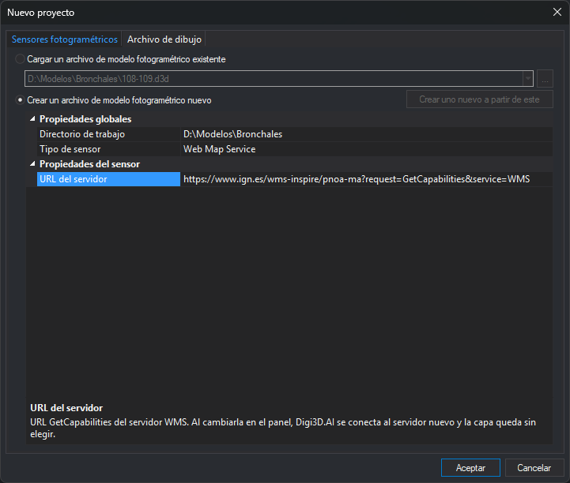
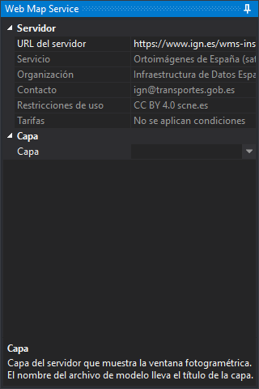
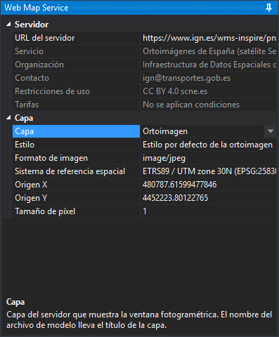
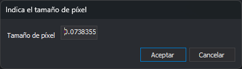

# Web Map Service
<!-- id: sensor-wms -->

El sensor Web Map Service muestra en la ventana fotogramétrica una capa de un servidor WMS (*Web Map Service*), por ejemplo la ortofoto del PNOA. El modelo tiene una sola imagen y no admite estereoscopía. Digi3D.AI pide al servidor las teselas de la zona visible a medida que te desplazas por el modelo.

Para ver las capas de un servidor WMS en la ventana de dibujo, consulta [Conectarse a un servidor WMS](/digi3d-ai/procedimientos/conectar-servidor-wms.md).

## Crear el modelo

En la pestaña [Sensores fotogramétricos](../../cuadros-de-dialogo/nuevo-proyecto/sensores-fotogrametricos.md) del cuadro de diálogo **Nuevo proyecto**, con **Crear un archivo de modelo fotogramétrico nuevo** y el **Tipo de sensor** **Web Map Service**, **Propiedades del sensor** muestra solo la propiedad **URL del servidor**:



1. En **URL del servidor**, escribe la URL **GetCapabilities** del servidor WMS. Por ejemplo, la del PNOA del IGN:

   ```
   https://www.ign.es/wms-inspire/pnoa-ma?request=GetCapabilities&service=WMS
   ```

2. Pulsa **Aceptar**. Digi3D.AI crea el archivo de modelo y abre la ventana fotogramétrica, vacía, con el panel **Web Map Service** abierto para elegir la capa.

Al pulsar **Aceptar**, Digi3D.AI comprueba la URL sin conectar con el servidor. Si la propiedad está vacía, muestra el mensaje «Escribe la URL GetCapabilities del servidor WMS.»; si la URL no es válida (por ejemplo, empieza por `ftp://`), muestra «La URL del servidor no es válida» con la URL. En los dos casos selecciona la propiedad **URL del servidor** y el cuadro de diálogo sigue abierto. Si la URL no lleva esquema, Digi3D.AI añade `http://`.

Cuando la rejilla muestra un modelo existente, o uno preparado con **Crear uno nuevo a partir de este**, aparecen también, sin permitir modificarlas, la **Capa**, el **Sistema de referencia espacial**, el **Formato de imagen**, el **Origen X**, el **Origen Y** y el **Tamaño de píxel** guardados en el archivo. Se cambian en el panel de la ventana fotogramétrica. Si en un modelo preparado con **Crear uno nuevo a partir de este** cambias la **URL del servidor**, esas propiedades desaparecen y el modelo nuevo se crea sin capa.

## Nombre del archivo de modelo

El archivo de modelo se llama `servidor - capa.d3d`, con el nombre del servidor de la URL y el título de la capa. Por ejemplo, `www.ign.es - Ortoimagen.d3d`. Un modelo que todavía no tiene capa se llama como el servidor: `www.ign.es.d3d`.

* Los caracteres que Windows no admite en un nombre de archivo se sustituyen: `\`, `/` y `|` por `-`; `:`, `*`, `?` y `%` por `_`; `"` por `'`; `<` y `>` por paréntesis. Un puerto se escribe con `_`: `servidor_8080`.
* Al crear el modelo, si en el directorio de trabajo ya existe un archivo de modelo Web Map Service del mismo servidor, con la misma capa, el mismo sistema de referencia, el mismo estilo y el mismo formato, Digi3D.AI lo reutiliza: escribe en él la configuración nueva. Si existe un archivo con ese nombre que difiere en cualquiera de esos datos o es de otro sensor, el modelo nuevo se llama `servidor - capa (2).d3d`, `servidor - capa (3).d3d`, etc.
* Al elegir otra capa en el panel, Digi3D.AI cambia el nombre del archivo al de la capa nueva, también la primera vez que eliges una capa en un modelo sin capa. El nombre nuevo nunca sustituye a un archivo que ya existe: si existe, se añade ` (2)`, ` (3)`, etc. La barra de título de la ventana fotogramétrica y el título del panel muestran el nombre nuevo.
* Si el nombre del archivo no es uno de los que genera Digi3D.AI (por ejemplo, porque lo has cambiado tú, o porque el modelo se creó con una versión anterior, que lo llamaba con 32 caracteres hexadecimales), el archivo conserva su nombre aunque cambies de capa.

## Abrir el modelo

Al abrir el modelo, Digi3D.AI se conecta al servidor. Si la URL no es válida o el servidor no responde, muestra el error y no abre el modelo.

Si el modelo no tiene capa, la ventana fotogramétrica se abre vacía. Si el servidor ya no publica la capa del modelo, la ventana se abre vacía y el panel [Resultados](../../paneles/resultados.md) muestra el mensaje «La capa *capa* del modelo no está en el servidor *servidor*. Elige otra en el panel Web Map Service.». En los dos casos, elige la capa en el panel.

Los modelos creados con versiones anteriores se abren igual. Ya no aparece el cuadro de diálogo **Acepta o rechaza las restricciones de uso del servicio**: las restricciones de uso se muestran en el panel.

## Panel Web Map Service

Al abrir el modelo, Digi3D.AI acopla a la derecha de la ventana principal el panel **Web Map Service: *nombre del modelo***. Cada ventana fotogramétrica de un modelo Web Map Service tiene su propio panel, que se cierra con ella. Los cambios que haces en el panel se aplican a la ventana fotogramétrica y se guardan en el archivo de modelo en ese momento.

En un modelo recién creado, el panel muestra los datos del servidor y la **Capa** sin elegir:



### Servidor

| Propiedad | Descripción |
| :--- | :--- |
| **URL del servidor** | URL GetCapabilities del servidor WMS. Al cambiarla, Digi3D.AI se conecta al servidor nuevo (la barra de estado muestra **Estableciendo conexión con el servidor...**), la capa queda sin elegir y la ventana fotogramétrica se vacía. El archivo de modelo pasa a llamarse como el servidor nuevo, y Digi3D.AI borra de él la última posición y el factor de escala. Si la conexión falla, muestra el error y conserva el servidor anterior. |
| **Servicio** | Título que publica el servidor. La zona de descripción del panel muestra el resumen del servicio. |
| **Organización** | Organización que publica el servicio. |
| **Contacto** | Persona de contacto, correo electrónico y teléfono que publica el servidor. |
| **Restricciones de uso** | Condiciones de uso del servicio que publica el servidor. Al seleccionar la propiedad, la zona de descripción del panel muestra el texto completo. |
| **Tarifas** | Precio del servicio que publica el servidor. |

Las propiedades **Servicio**, **Organización**, **Contacto**, **Restricciones de uso** y **Tarifas** no se pueden modificar.

### Capa



| Propiedad | Descripción |
| :--- | :--- |
| **Capa** | Capa del servidor que se muestra en la ventana fotogramétrica. El desplegable lista, en el orden en que los publica el servidor, los títulos de las capas que el servidor puede dibujar; no incluye las capas que solo agrupan otras. Si dos capas tienen el mismo título, solo aparece la primera. En un modelo sin capa, el resto de propiedades de esta categoría no aparece hasta que eliges una. |
| **Estilo** | Estilo de la capa con el que se piden las imágenes, por su título o, si no lo tiene, por su nombre. Si dos estilos tienen el mismo título, se muestra también su nombre entre paréntesis. Solo aparece si la capa publica estilos. Al elegir otra capa, el estilo vuelve a ser el primero. |
| **Formato de imagen** | `image/jpeg` o `image/png`. El desplegable ofrece siempre los dos, aunque el servidor no admita alguno. |
| **Sistema de referencia espacial** | Sistema de referencia de coordenadas en el que se piden las imágenes al servidor, de entre los que el servidor admite para la capa. Los códigos EPSG se muestran con el nombre del sistema y el código; si Digi3D.AI no lo conoce, se muestra **<Desconocido>** con el código. Los demás, como `CRS:84`, se muestran tal como los publica el servidor. Es también el sistema de referencia del modelo. |
| **Origen X** y **Origen Y** | Coordenadas en las que se abre el modelo. Al cambiarlas, la ventana fotogramétrica se desplaza a ellas. |
| **Tamaño de píxel** | Tamaño del píxel con el que se piden las imágenes al servidor, en unidades del sistema de referencia. Al cambiarlo, el origen pasa a ser la posición actual de la ventana fotogramétrica, como con los botones de la barra de herramientas. |

Al elegir una capa:

* Si la capa admite el sistema de referencia que tenía el modelo, Digi3D.AI lo conserva, junto con el tamaño de píxel, y la ventana fotogramétrica sigue en la misma posición, que pasa a ser el origen.
* Si no lo admite, el modelo no tenía capa o su capa ya no estaba en el servidor, Digi3D.AI elige el primer sistema de referencia de la capa, propone el origen y el tamaño de píxel y desplaza la ventana al origen.

Al cambiar el **Sistema de referencia espacial**, Digi3D.AI también propone el origen y el tamaño de píxel y desplaza la ventana al origen:

* El origen propuesto es el centro del recuadro de la capa en el sistema de referencia elegido; en un sistema geográfico EPSG se usa el recuadro en CRS:84 si la capa lo publica. Si la capa no publica recuadro para ese sistema, el origen propuesto es (0, 0). El origen puede caer fuera de la zona con imagen: en el PNOA con CRS:84, el recuadro de las capas incluye las islas Canarias, y su centro (-7, 35,5) está en el mar. En ese caso, escribe en **Origen X** y **Origen Y** un punto de tu zona de trabajo.
* Si el sistema de referencia es geográfico (por ejemplo CRS:84 o EPSG:4326), el tamaño de píxel propuesto se expresa en grados y equivale a 1 metro en el origen, calculado con las fórmulas geodésicas de Sodano sobre el elipsoide del sistema. En un sistema proyectado se propone 1 unidad del sistema.

Al cambiar de sistema de referencia, la ventana de dibujo vuelve a calcular la transformación de coordenadas entre los dos sistemas, y Digi3D.AI borra del archivo de modelo la última posición y el factor de escala, que estaban en el sistema anterior.

Si un cambio no se puede aplicar, Digi3D.AI muestra el mensaje «No se ha podido aplicar el cambio» con el motivo, y el panel vuelve a mostrar los valores del modelo.

En el PNOA (`https://www.ign.es/wms-inspire/pnoa-ma`), la ortofoto es la capa **Ortoimagen** (`OI.OrthoimageCoverage`). La capa **Mosaico** (`OI.MosaicElement`) muestra las huellas de los vuelos, no la ortofoto.

La conexión usa el tipo de conexión a Internet de la configuración: directa, la del sistema o un proxy. Consulta [Tipo de conexión](../../cuadros-de-dialogo/configuracion/comunicacion-con-internet/tipo-de-conexion.md).

## Teselas y caché

Digi3D.AI pide las teselas al servidor en el formato elegido y las guarda en la carpeta temporal de Windows, en la subcarpeta **Caché WMS**, por servidor, capa, estilo, sistema de referencia y tamaño de píxel, con la extensión `.tile.jpg` o `.tile.png`. Una tesela que ya está en la caché no se vuelve a pedir.

Si el servidor no devuelve datos o no devuelve una imagen del formato pedido, la tesela se dibuja en rojo y el panel [Resultados](../../paneles/resultados.md) muestra **No se ha podido obtener una imagen del servidor WMS.**, con el motivo y la petición enviada. Cada motivo se muestra una sola vez.

## Botones de la barra de herramientas

El sensor añade estos botones a la barra de herramientas de la ventana fotogramétrica:

| Botón | Descripción |
| :--- | :--- |
| **Conectar** | Activa o desactiva la conexión con el servidor. Aparece marcado mientras la conexión está activa, que es el estado al abrir el modelo. Con la conexión desactivada, Digi3D.AI no pide teselas nuevas al servidor. |
| **+** | Divide entre 2 el tamaño de píxel: el servidor devuelve imágenes con más detalle. |
| **-** | Multiplica por 2 el tamaño de píxel: el servidor devuelve imágenes de una zona mayor. |
| **Tamaño pixel** | Abre el cuadro de diálogo **Indica el tamaño de píxel**, que muestra el tamaño de píxel actual en el campo **Tamaño de píxel**. **Aceptar** aplica el valor escrito si es distinto del actual; **Cancelar** cierra el cuadro sin cambiarlo. |



Al cambiar el tamaño de píxel con **+**, **-** o **Tamaño pixel**, el origen del modelo pasa a ser la posición actual del cursor, Digi3D.AI vuelve a pedir las teselas, guarda el cambio en el archivo de modelo y actualiza el panel.
