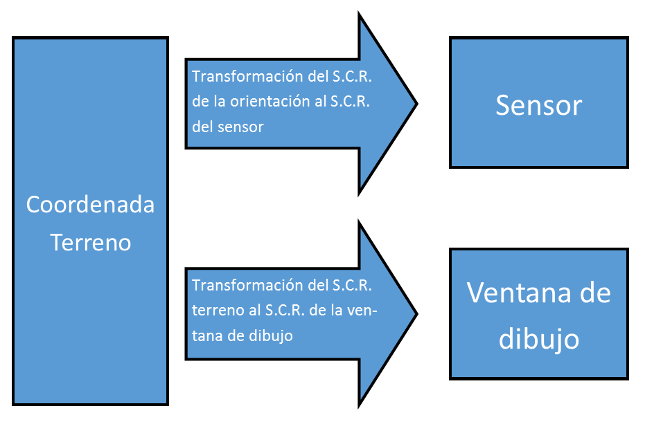

# Ventana Fotogramétrica
<!-- id: ventana-fotogrametrica -->

## Resúmen de la operativa de la ventana fotogramétrica

La ventana fotogramétrica básicamente realiza estas tareas:

1. Modifica la _coordenada terreno_.
2. Muestra imágenes en una determinada posición.
3. Notifica a la ventana de dibujo que el usuario ha realizado alguna acción, como por ejemplo: el usuario se ha movido, el usuario ha pulsado el pedal _data_, el usuario ha liberado el pedal _tentativo_,...
4. Vuelve a esperar a que el usuario realice alguna acción y repite este proceso.

### Paso 1: Modificación de la _coordenada terreno_

La ventana fotogramétrica tiene una coordenada (denominada _coordenada terreno_). La coordenada terreno varía cuando el usuario desplaza el dispositivo de entrada y se utiliza para calcular dónde mostrar las imágenes en la ventana fotogramétrica.

La ventana fotogramétrica sigue los siguientes pasos para transformar la _coordenada terreno_.

1. Espera a que el usuario interaccione con el dispositivo de entrada (topomouse, manivelas,...).
2. Modifica las coordenadas de la ventana fotogramétrica en función de lo que ha hecho el usuario (si el usuario ha desplazado el topomouse 1 el equivalente a un metro en X, se modifican las coordenadas terreno de la ventana fotogramétrica 1 metro en X).

### Paso 2: Mostrar las imágenes en una determinada posición

La ventana fotogramétrica no realiza las operaciones matemáticas que permiten determinar qué píxel de cada imagen debe aparecer en el centro de la pantalla para una coordenada terreno.

La ventana fotogramétrica muestra las imágenes y delega en el sensor cargado el cálculo de la posición de las imágenes. Para una coordenada terreno, la ventana solicita al sensor las coordenadas píxel en las que debe centrar cada imagen. Una vez recibidas las coordenadas píxel, la ventana fotogramétrica muestra las imágenes en la posición calculada por el sensor.

Si cargas un sensor de cámara cónica, el sensor realiza las operaciones necesarias para transformar la coordenada terreno en coordenadas píxel de las imágenes izquierda y derecha. Si cargas un sensor satelital, el sensor realiza la misma transformación con operaciones distintas de las del sensor de cámara cónica. Como cada sensor realiza la transformación de coordenadas terreno a coordenadas píxel, no es necesario modificar la aplicación principal al añadir un nuevo sensor.

La ventana fotogramétrica sigue estos pasos para mostrar las imágenes:

1. Si el modelo fotogramétrico tiene asignada una orientación (_absoluta, afín_, ...), la ventana fotogramétrica transforma la _coordenada terreno_ mediante dicha orientación (_absoluta_ o _afín_) y obtiene la _coordenada a enviar al sensor_. Si el modelo fotogramétrico no tiene asignada una orientación, se modifica la _coordenada a enviar al sensor_ para que coincida con la _coordenada terreno._
2. La ventana fotogramétrica utiliza la _coordenada a enviar al sensor_ para preguntarle al sensor cargado (sensor ortofoto, cámara cónica estereoscópica, satelital, ADS,...) por la posición donde debe mostrar las imágenes en la ventana fotogramétrica.
3. El sensor responde con las coordenadas píxel que deben aparecer en el centro de la ventana.
4. La ventana fotogramétrica muestra las imágenes en pantalla asegurándose de que las coordenadas píxel devueltas por el sensor estén en el centro de la ventana.

### Paso 3: Notificar a la ventana de dibujo que el usuario ha realizado alguna acción:

Si hay una ventana de dibujo abierta:

1. La ventana fotogramétrica comunica a la ventana de dibujo la acción que ha realizado el usuario.

## Componentes que tienen sistemas de referencia de coordenadas

En el esquema explicado anteriormente hay tres componentes que tienen su propio sistema de referencia de coordenadas:

1. La _coordenada terreno._ Su sistema de referencia de coordenadas se denomina _Sistema de coordenadas de la Orientación._
2. El _sensor_. Su sistema de referencia de coordenadas se denomina _Sistema de referencia de coordenadas Sensor_.
3. La _ventana de dibujo_. Su sistema de referencia de coordenadas se denomina _Sistema de referencia de coordenadas Ventana de dibujo_.

Como los sistemas de referencia de coordenadas de la orientación, del sensor y de la ventana de dibujo pueden ser distintos, Digi3D.AI transforma las coordenadas entre esos sistemas. Los siguientes pasos incluyen esas transformaciones:

**Mostrar imágenes en una posición:**

1. Si el modelo fotogramétrico tiene asignada una orientación (_absoluta, afín_, ...), la ventana fotogramétrica transforma la _coordenada terreno_ mediante dicha orientación (_absoluta_ o _afín_) y obtiene la _coordenada a enviar al sensor_. Si el modelo fotogramétrico no tiene asignada una orientación, se modifica la _coordenada a enviar al sensor_ para que coincida con la _coordenada terreno._
2. **Se transforma la coordenada obtenida en el punto anterior del sistema de referencia de coordenadas de la orientación al sistema de referencia de coordenadas del sensor**_**.**_
3. La ventana fotogramétrica utiliza la _coordenada a enviar al sensor_ para preguntarle al sensor cargado (sensor ortofoto, cámara cónica estereoscópica, satelital, ADS,...) por la posición donde debe mostrar las imágenes en la ventana fotogramétrica.
4. El sensor responde con las coordenadas píxel que deben aparecer en el centro de la ventana.
5. La ventana fotogramétrica muestra las imágenes en pantalla asegurándose de que las coordenadas píxel devueltas por el sensor estén en el centro de la ventana.

**Notificar a la ventana de dibujo que el usuario ha realizado alguna acción:**

Si hay una ventana de dibujo abierta:

1. **La ventana fotogramétrica transforma la** _**coordenada terreno**_ **del sistema de referencia de coordenadas de la orientación al sistema de referencia de coordenadas de la ventana de dibujo.**
2. La ventana fotogramétrica comunica a la ventana de dibujo la acción del usuario y envía las coordenadas obtenidas en el paso 1.
