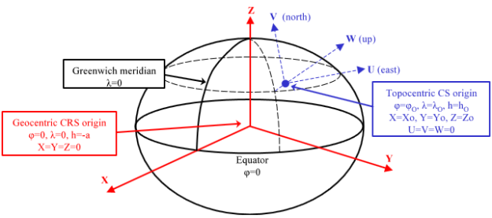

# Sistemas de Referencia de Coordenadas Geocéntricos
<!-- id: sistemas-referencia-coordenadas-geocentricos -->

Digi3D.AI en ocasiones debe transformar coordenadas de un sistema de coordenadas a un sistema de coordenadas geocéntrico.

Los sistemas de coordenadas geocéntricos son siempre sistemas de coordenadas cartesianos, con origen en el centro de la Tierra. Las unidades de los sistemas de coordenadas geocéntricos son siempre metros.

Digi3D.AI no permite seleccionar un sistema de referencia de coordenadas geocéntrico, pero utiliza estos sistemas internamente \(por ejemplo al calcular orientaciones absolutas, el cálculo en ocasiones se realiza en coordenadas geocéntricas\).

En la imagen anterior, el sistema geocéntrico es el representado con color rojo.

