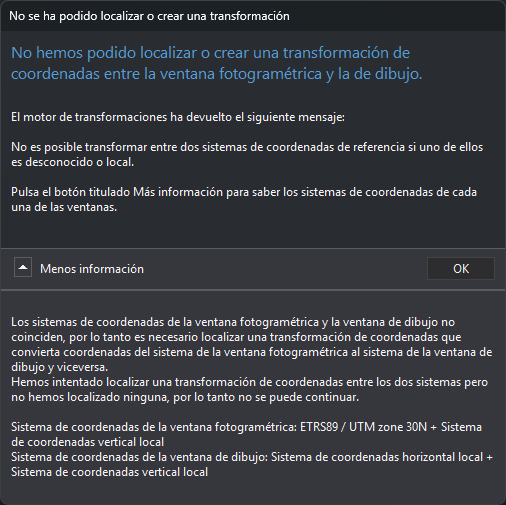

# Sistema de Referencia de Coordenadas Desconocido
<!-- id: sistema-referencia-vertical-desconocido -->

En ocasiones desconoces el sistema de coordenadas en el que están las coordenadas de un archivo (archivo de aerotriangulación, archivo de puntos de apoyo, archivo de dibujo,...).

Si desconoces el sistema de referencia de coordenadas de un archivo, indica que el sistema es desconocido cuando Digi3D.AI lo solicite.

**No se puede** realizar una **transformación de coordenadas** de un sistema de referencia de coordenadas **conocido a** uno **desconocido ni viceversa.** Por ejemplo, si cargas un modelo fotogramétrico en un sistema conocido, como _ED 50 / UTM Zone 30N + Alicante height_, e intentas cargar un archivo de dibujo con un sistema de referencia de coordenadas desconocido, Digi3D.AI mostrará el siguiente cuadro de error. El programa no puede transformar las coordenadas de la ventana fotogramétrica al sistema de referencia de coordenadas de la ventana de dibujo porque el sistema de referencia de coordenadas de la ventana de dibujo es desconocido. Ni siquiera se conocen las unidades del sistema desconocido (podrían ser metros, pies, millas, micras,...):

## Vídeo

<video controls><source src="https://digi21.blob.core.windows.net/videos-ayuda/SCR%20de%20la%20ventana%20foto%20conocido%20y%20de%20la%20ventana%20de%20dibujo%20desconocido.mp4" type="video/mp4"></video>
