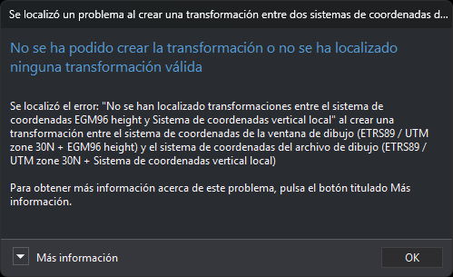
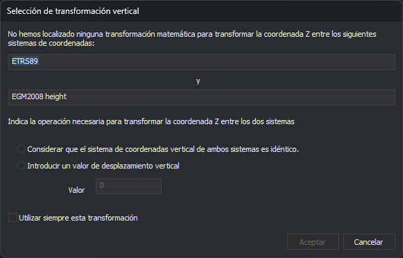

# Localización de transformaciones entre distintos sistemas de referencia de coordenadas
<!-- id: localizacion-transformaciones-src -->

Digi3D.AI en ocasiones tiene que transformar coordenadas entre distintos sistemas de referencia de coordenadas. Para poder realizar esta operación, necesita localizar una _transformación matemática_ entre ambos sistemas.

La base de datos _EPSG_ incluye una lista de las posibles transformaciones matemáticas existentes entre dos sistemas de referencia de coordenadas.

Digi3D.AI consulta a la base de datos _EPSG_ siempre que precisa localizar una transformación entre dos sistemas de referencia de coordenadas. Si Digi3D.AI encuentra en la base de datos _EPSG_ una transformación entre los dos sistemas de referencia de coordenadas, utiliza la transformación para convertir las coordenadas entre esos sistemas.

Las transformaciones especificadas en la base de datos _EPSG_ son siempre entre

1. Sistemas horizontales 2D y sistemas horizontales 2D.
2. Sistemas horizontales 3D y sistemas horizontales 3D.
3. Sistemas horizontales 3D y sistemas verticales.
4. Sistemas verticales y sistemas verticales.

La base de datos _EPSG_ no define transformaciones directas entre sistemas compuestos. Digi3D.AI busca por separado las transformaciones horizontales y verticales necesarias para transformar las coordenadas entre sistemas compuestos y concatena las transformaciones que encuentra.

Si uno de los dos sistemas es compuesto, como _ED50 / UTM Zone 30N + EGM96 height_, Digi3D.AI localizará por separado las transformaciones horizontal y vertical y las concatenará en una única transformación.

No existen transformaciones entre todos los sistemas de referencia de coordenadas. Por ejemplo, no existe ninguna transformación entre los sistemas de coordenadas horizontales _ED50 / UTM Zone 30N y NAD83(NSR2007) / Florida East (ftUS)._

Si Digi3D.AI no localiza una transformación entre sistemas de referencia de coordenadas horizontales, el programa muestra un mensaje de error. Si Digi3D.AI no localiza una transformación vertical, el programa permite especificar una transformación genérica.

Cuando Digi3D.AI intenta localizar una transformación entre dos sistemas pueden darse tres posibilidades:

1.  Que se localice una única transformación entre ambos sistemas.

    Si Digi3D.AI localiza una única transformación entre los dos sistemas de referencia de coordenadas, el programa utilizará esa transformación sin solicitar tu intervención.
2.  Que no se localice ninguna transformación entre ambos sistemas.

    Si se está intentando localizar una transformación horizontal, Digi3D.AI muestra un cuadro de tareas con el mensaje de error del motor de transformaciones y los nombres de los dos sistemas, y cancela la operación que necesitaba la transformación. El mismo cuadro aparece si no se localiza una transformación vertical y cancelas el cuadro de diálogo **Selección de transformación vertical**, que se describe más abajo.

    El cuadro depende de los sistemas entre los que falta la transformación:

    * **Entre la ventana de dibujo y un archivo de dibujo.** Aparece el cuadro **Se localizó un problema al crear una transformación entre dos sistemas de coordenadas de referencia** («No se ha podido crear la transformación o no se ha localizado ninguna transformación válida»). **Más información** muestra el código EPSG y el nombre de los dos sistemas, y propone seleccionar el sistema Local para la ventana de dibujo. Digi3D.AI no carga el archivo de dibujo: si es el archivo con el que se abre la ventana de dibujo, la ventana no se abre; si es un archivo de referencia, no se añade.
    * **Entre la ventana fotogramétrica y la ventana de dibujo.** Aparece el cuadro **No se ha podido localizar o crear una transformación**. Si se estaba abriendo la ventana de dibujo, la ventana no se abre. Si se estaba cargando un modelo con la ventana de dibujo abierta, el modelo no se carga.

    La siguiente captura corresponde al primer caso. El sistema de la ventana de dibujo es _ETRS89 / UTM zone 30N + EGM96 height_. El sistema del archivo de dibujo es _ETRS89 / UTM zone 30N + Sistema de coordenadas vertical local_. Digi3D.AI asigna ese sistema vertical local a todo archivo de dibujo cuyo sistema no tiene componente vertical. No existe ninguna transformación entre _EGM96 height_ y un sistema vertical local, y el cuadro **Selección de transformación vertical** se canceló, así que el archivo no se carga.

    

    Si por el contrario se estaba intentando localizar una transformación vertical, Digi3D.AI muestra el cuadro de diálogo **Selección de transformación vertical**.

    

    El cuadro de diálogo contiene estos controles:

    * **Sistemas de coordenadas.** Los dos campos de texto, separados por la letra «y», muestran el nombre del sistema de coordenadas de origen (el campo superior) y el del sistema de coordenadas de destino (el campo inferior). Son de solo lectura.
    * **Considerar que el sistema de coordenadas vertical de ambos sistemas es idéntico.** Elige esta opción si la coordenada Z no cambia entre los dos sistemas. Digi3D.AI crea una transformación vertical con un desplazamiento de 0, de modo que la coordenada Z de destino es igual a la coordenada Z de origen.
    * **Introducir un valor de desplazamiento vertical.** Elige esta opción si la coordenada Z de destino se obtiene sumando un valor fijo a la coordenada Z de origen. Al elegirla se activa el campo **Valor**.
    * **Valor.** Escribe el desplazamiento vertical, que puede ser negativo. Digi3D.AI calcula la coordenada Z de destino como la coordenada Z de origen más este valor. En el sentido contrario, de destino a origen, resta el valor. El campo está desactivado hasta que eliges la opción de desplazamiento, y vuelve a desactivarse si eliges la opción de sistemas idénticos.
    * **Utilizar siempre esta transformación.** Marca esta casilla para que Digi3D.AI memorice la transformación elegida para este par de sistemas de coordenadas, en este orden de origen y destino. La próxima vez que necesite la transformación vertical entre estos dos sistemas, la aplicará sin mostrar el cuadro de diálogo. Si no marcas la casilla, el cuadro de diálogo se muestra cada vez que Digi3D.AI necesita esta transformación.
    * **Aceptar.** Está desactivado hasta que eliges una de las dos opciones. Al pulsarlo, Digi3D.AI crea la transformación vertical con el desplazamiento indicado.
    * **Cancelar.** Cierra el cuadro de diálogo sin crear ninguna transformación y sin memorizar nada. La operación que necesitaba la transformación decide qué hacer a continuación.

    Digi3D.AI guarda la transformación memorizada en el registro de Windows del usuario actual, en el valor `wkt` de la clave `HKEY_CURRENT_USER\Software\Digi21\Digi3D.NET\App\TransformacionesMemorizadas\<sistema de origen>\<sistema de destino>`. Guarda el desplazamiento con 6 decimales.

    Digi3D.AI no incluye ninguna orden ni cuadro de diálogo para deshacer esta elección. Para que vuelva a mostrarse el cuadro de diálogo con ese par de sistemas, abre el Editor del Registro de Windows y borra la clave `<sistema de destino>` de esa ruta.
3.  Que se localicen varias transformaciones entre ambos sistemas.

    Si Digi3D.AI localiza varias transformaciones entre los dos sistemas de referencia de coordenadas, el programa mostrará el **Cuadro de diálogo Localizadas Múltiples Transformaciones**.
