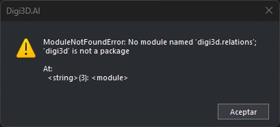
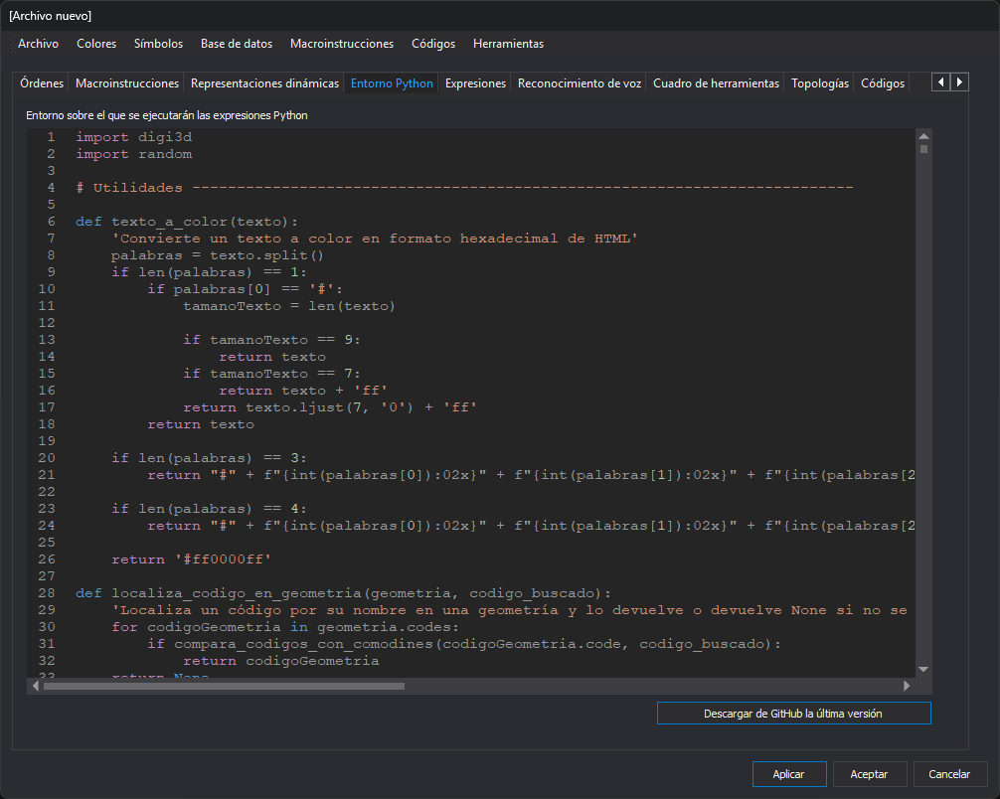

# Actualizar los controles de calidad Python de una tabla de códigos
<!-- id: actualizar-guiones-python -->

Los controles de calidad Python de las tablas de códigos creadas para versiones anteriores de Digi3D no son compatibles con Digi3D.AI. Al abrir un archivo de dibujo con una de esas tablas, o al analizar el control de calidad, Digi3D.AI muestra un error como este:



```text
ModuleNotFoundError: No module named 'digi3d.relations'; 'digi3d' is not a package
```

Para resolver este error, sustituye el entorno Python de la tabla de códigos por la última versión de los [controles de calidad de Digi21](https://github.com/digi21/Guiones-Control-Calidad-Python-Digi3D).

## Pasos

1. **Haz una copia de seguridad del archivo de la tabla de códigos.** Los controles nuevos no funcionan con las versiones anteriores de Digi3D: si vas a seguir usando la tabla con versiones anteriores de Digi3D, usa la copia de seguridad.
2. Abre la tabla de códigos con el [Editor de tablas de códigos](../referencia/editor-de-tablas-de-codigos/README.md).
3. Selecciona la pestaña [Entorno Python](../referencia/editor-de-tablas-de-codigos/pestanas/entorno-python.md).
4. Pulsa el botón **Descargar de GitHub la última versión**, debajo del editor. El contenido de la pestaña se sustituye por la versión descargada.
5. Pulsa **Aplicar**.
6. Pulsa **Aceptar**.



Al abrir de nuevo el archivo de dibujo en Digi3D.AI, los controles de calidad funcionan.

> Si habías añadido funciones propias al entorno Python de la tabla, la descarga del paso 4 borra las funciones propias. Copia tus funciones antes de pulsar el botón **Descargar de GitHub la última versión** y pégalas al final del entorno descargado una vez finalizada la descarga. Si las funciones propias usan módulos o nombres de la versión anterior (como `digi3d.relations` o `g.codes[0].name`), tendrás que adaptar las funciones a la interfaz de programación de aplicaciones (API) descrita en la [API de Python de Digi3D.AI](../programacion/python/controles-de-calidad/README.md). La tabla de [Nombres de la API de Python que han cambiado](#nombres-de-la-api-de-python-que-han-cambiado) indica el sustituto de cada nombre o señala que no tiene equivalente.

## Errores después de sustituir el entorno

Digi3D.AI ejecuta el entorno Python de la tabla de códigos en el módulo `__main__` del intérprete de Python al abrir el archivo de dibujo. Cuando las órdenes [ON\_EXPRESION\_PYTHON](../referencia/ventana-de-dibujo/ordenes/o/on_expresion_python.md), [OFF\_EXPRESION\_PYTHON](../referencia/ventana-de-dibujo/ordenes/o/off_expresion_python.md), [ON\_SOLO\_EXPRESION\_PYTHON](../referencia/ventana-de-dibujo/ordenes/o/on_solo_expresion_python.md) y [SELECCIONA\_EXPRESION\_PYTHON](../referencia/ventana-de-dibujo/ordenes/s/selecciona_expresion_python.md) se ejecutan desde la línea de comandos, un menú o una macroinstrucción, Digi3D.AI evalúa las expresiones de estas órdenes, incluidas las de las [selecciones](../referencia/editor-de-tablas-de-codigos/pestanas/selecciones.md) de la tabla de códigos, en el módulo `__main__`. Por eso, una expresión puede usar la variable `g`, las funciones integradas de Python (como `len` o `type`) y los nombres que define el entorno. Las expresiones y las funciones propias escritas para la versión anterior producen los errores de esta sección si usan nombres que el entorno descargado no define o que la API de Digi3D.AI ha cambiado.

Cuando una expresión produce un error, Digi3D.AI muestra el error de Python en un cuadro de mensaje y, en el archivo de dibujo en el que falla la expresión, ON\_EXPRESION\_PYTHON y OFF\_EXPRESION\_PYTHON no cambian la visibilidad de ninguna geometría por esa expresión (con varios nombres de selecciones indicados con `#`, aplican las selecciones cuya expresión no falla), ON\_SOLO\_EXPRESION\_PYTHON deja ocultas todas las geometrías, salvo las que cumplen otra selección indicada con `#` cuya expresión no falla, y SELECCIONA\_EXPRESION\_PYTHON envía una selección vacía a la orden en curso. Si la orden forma parte de una [macroinstrucción](../referencia/ordenes/formas-de-ejecutar-una-orden/ejecutar-una-orden-desde-la-linea-de-comandos/macroinstrucciones.md) (`@`), Digi3D.AI ejecuta la orden siguiente de la macroinstrucción después de que el usuario cierre el cuadro de mensaje. Por ejemplo, si una macroinstrucción ejecuta OFF\_EXPRESION\_PYTHON para ocultar los textos y después crea una topología, un error en la expresión de OFF\_EXPRESION\_PYTHON no detiene la macroinstrucción, y la macroinstrucción crea la topología sin que OFF\_EXPRESION\_PYTHON haya ocultado los textos de los archivos de dibujo en los que falla la expresión. La página de [ON\_EXPRESION\_PYTHON](../referencia/ventana-de-dibujo/ordenes/o/on_expresion_python.md#errores) detalla estos errores.

### NameError al usar Text, Line, Point, Polygon o Complex

Digi3D.AI muestra un cuadro de mensaje que empieza por este texto cuando una expresión, o una función del entorno a la que llama la expresión, usa el nombre de un tipo de geometría sin el prefijo `digi3d.` y el entorno no importa ese nombre:

```text
NameError: name 'Text' is not defined
```

El nombre entre comillas es el nombre que el entorno no define: `Text`, `Line`, `Point`, `Polygon`, `Complex` u otro nombre del módulo `digi3d`. El entorno de una tabla de códigos creada para Digi3D.NET podía incluir la línea `from digi3d import *`, que define en el entorno todos los nombres públicos del módulo `digi3d`. El entorno descargado de GitHub empieza por las líneas `import digi3d` e `import random` y no incluye la línea `from digi3d import *`, así que los nombres del módulo solo están disponibles con el prefijo `digi3d.`. Esta expresión de la orden OFF\_EXPRESION\_PYTHON produce el error:

```text
OFF_EXPRESION_PYTHON=type(g) is Text and "_A_" in g.codes[0].name
```

Corrige el error de una de estas dos formas:

* Añade al entorno, debajo de la primera línea `import digi3d`, una línea que importe los nombres que usan tus expresiones y tus funciones:

  ```python
  import digi3d
  from digi3d import Point, Text, Line, Polygon, Complex
  ```

  Si el error indica otro nombre del [módulo digi3d](../programacion/python/referencia/digi3d/README.md), añade ese nombre a la lista.
* Escribe el prefijo `digi3d.` delante de los nombres del módulo `digi3d` que las expresiones y las funciones usan sin prefijo: `type(g) is digi3d.Text`.

Después de modificar el entorno, pulsa **Aplicar** y **Aceptar** en el Editor de tablas de códigos y vuelve a abrir el archivo de dibujo: Digi3D.AI ejecuta el entorno modificado al abrir el archivo.

> La línea `from digi3d import *` también corrige el error, pero define en el entorno el nombre `Warning` con el valor `digi3d.TaskType.Warning`: las expresiones y las funciones del entorno que usan el nombre `Warning` obtienen `digi3d.TaskType.Warning` en lugar de la excepción `Warning` de Python. El entorno descargado de GitHub no usa la excepción `Warning`. Si tus funciones usan la excepción `Warning` de Python, importa los nombres de `digi3d` uno a uno.

### AttributeError al leer name de un código

Después de corregir el error `NameError`, la expresión del ejemplo produce un error `AttributeError` al evaluar `g.codes[0].name` con el primer texto del archivo de dibujo, si ese texto tiene algún código. El mensaje del error contiene este texto:

```text
object has no attribute 'name'
```

En las versiones de Digi3D.NET publicadas entre 2023 y 2025, los elementos de `g.codes` eran objetos `digi3d.Code`, que guardaban el texto del código en la propiedad `name`. En Digi3D.AI, los elementos de `g.codes` son objetos [FeatureCode](../programacion/python/referencia/digi21.base/featurecode.md), que guardan el texto del código en la propiedad `code`. `FeatureCode` no tiene la propiedad `name`.

Para corregir el error, sustituye `.name` por `.code` en los códigos de la geometría. Con la línea `from digi3d import Point, Text, Line, Polygon, Complex` en el entorno, la expresión del ejemplo queda así:

```text
OFF_EXPRESION_PYTHON=type(g) is Text and "_A_" in g.codes[0].code
```

Sustituye `.name` solo cuando se aplica a un código: las propiedades `Command.name` y `Camera.name` siguen existiendo en Digi3D.AI.

## Nombres de la API de Python que han cambiado

La tabla enumera los nombres del módulo `digi3d` de las versiones de Digi3D.NET publicadas entre 2023 y 2025 que no existen en Digi3D.AI e indica su sustituto cuando existe. Los demás nombres de clases, propiedades, métodos, funciones y valores de enumeraciones del módulo `digi3d` de esas versiones existen en Digi3D.AI con el mismo nombre. La tabla compara nombres; no recoge los cambios de los argumentos de los constructores.

| Digi3D.NET 2023 a 2025 | Digi3D.AI |
| :--- | :--- |
| `digi3d.Code` | `digi3d.FeatureCode` |
| `Code.name`, por ejemplo `g.codes[0].name` | `FeatureCode.code`, por ejemplo `g.codes[0].code` |
| `Geometry.drawing_file` | `Geometry.file` |
| `DrawingFile.min` y `DrawingFile.max` | No existen. |
| `digi3d.CoordinatesIterator` y `digi3d.GeometriesIterator` | No existen. Para recorrer los vértices de una geometría o las geometrías de un archivo de dibujo, usa `for` sobre la geometría o sobre el archivo. |
| Submódulo `digi3d.relations` | Métodos de las geometrías. Consulta [Relaciones entre geometrías](#relaciones-entre-geometrías). |
| `digi3d.CardinalPoint` | `digi3d.StandardViewpoint`. Los valores `Up` y `Down` se llaman `Top` y `Bottom`; los demás valores conservan el nombre. |
| `Camera.rotate_cardinal_point(cardinal_point)` | `Camera.rotate_standard(viewpoint)` |
| `Camera.rotation` | `Camera.rotations` |
| `Camera.frustrum_dimensions` | `Camera.frustum_dimensions` |
| `Camera.set_ortographic(min, max)` | `Camera.set_orthographic(min, max)` |
| `Camera.znear` y `Camera.zfar`, y los argumentos `znear` y `zfar` de `Camera.set_conic` | `Camera.z_near` y `Camera.z_far`, y los argumentos `z_near` y `z_far` de `Camera.set_conic` |
| `DrawingView.blendind` | `DrawingView.blending` |
| `DrawingView.paralelize_line_when_finish_line` | `DrawingView.parallelize_line_when_finish_line` |
| `digi3d.Inside`, `digi3d.Outside` y `digi3d.Edge` | `digi3d.PointLineRelativePosition.Inside`, `digi3d.PointLineRelativePosition.Outside` y `digi3d.PointLineRelativePosition.Edge` |
| `digi3d.N`, `digi3d.S`, `digi3d.E`, `digi3d.W` y `digi3d.C` | `digi3d.TextJustification.N`, `digi3d.TextJustification.S`, `digi3d.TextJustification.E`, `digi3d.TextJustification.W` y `digi3d.TextJustification.C` |
| `digi3d.NE`, `digi3d.NW`, `digi3d.SE` y `digi3d.SW` | `digi3d.StandardViewpoint.NE`, `digi3d.StandardViewpoint.NW`, `digi3d.StandardViewpoint.SE` y `digi3d.StandardViewpoint.SW`. Para la justificación de un texto, usa `digi3d.TextJustification.NE`, `digi3d.TextJustification.NW`, `digi3d.TextJustification.SE` y `digi3d.TextJustification.SW`. |
| `digi3d.Up`, `digi3d.Down`, `digi3d.Left`, `digi3d.Right`, `digi3d.Front`, `digi3d.Back` y `digi3d.Free` | `digi3d.StandardViewpoint.Top`, `digi3d.StandardViewpoint.Bottom`, `digi3d.StandardViewpoint.Left`, `digi3d.StandardViewpoint.Right`, `digi3d.StandardViewpoint.Front`, `digi3d.StandardViewpoint.Back` y `digi3d.StandardViewpoint.Free` |

En las versiones de Digi3D.NET publicadas entre 2023 y 2025, el módulo `digi3d` definía en su nivel superior los valores de las enumeraciones `PointLineRelativePosition`, `TextJustification` y `CardinalPoint`, y la línea `from digi3d import *` los definía en el entorno sin prefijo (por ejemplo, `Inside`). El módulo definía `CardinalPoint` después de `TextJustification`, así que `digi3d.NE`, `digi3d.NW`, `digi3d.SE` y `digi3d.SW` eran valores de `CardinalPoint`. En Digi3D.AI, los valores de `PointLineRelativePosition`, `TextJustification` y `StandardViewpoint` solo existen dentro de su enumeración: se escriben con el nombre de la enumeración delante, como en `digi3d.PointLineRelativePosition.Inside`.

### Relaciones entre geometrías

El submódulo `digi3d.relations` agrupaba las relaciones en clases según los tipos de las dos geometrías y exponía las relaciones como funciones que recibían las dos geometrías. En Digi3D.AI, cada relación que tiene equivalente se evalúa con un método que se llama sobre la primera geometría y recibe la segunda geometría como argumento: `digi3d.relations.LineLine.join(a, b)` pasa a ser `a.touches(b)`. La página [Geometry](../programacion/python/referencia/digi21.base/geometry.md#relaciones-espaciales) describe cada método.

| Digi3D.NET 2023 a 2025 (`digi3d.relations`) | Digi3D.AI |
| :--- | :--- |
| `PointPoint.disjoint(a, b)`, `PointLine.disjoint(a, b)`, `PointArea.disjoint(a, b)`, `LineLine.disjoint(a, b)`, `LineArea.disjoint(a, b)` y `AreaArea.disjoint(a, b)` | `a.disjoint(b)` |
| `PointPoint.coincident(a, b)`, `PointLine.coincident(a, b)` y `PointArea.coincident(a, b)` | `a.coincident(b)` |
| `PointLine.coincident_and_terminate(a, b)` | `a.coincident_and_terminates(b)` |
| `PointArea.within(a, b)`, `PointArea.withincoincident(a, b)`, `LineArea.within(a, b)` y `AreaArea.within(a, b)` | `a.within(b)` |
| `AreaArea.completely_within(a, b)` | `a.completely_within(b)` |
| `LineArea.adjacent(a, b)` y `AreaArea.adjacent(a, b)` | `a.adjacent(b)` |
| `AreaArea.outer_ring_adjacent(a, b)` | No hay un método equivalente. |
| `LineLine.join(a, b)`, `LineArea.join(a, b)` y `AreaArea.join(a, b)` | `a.touches(b)` |
| `LineLine.endpoint_join_endpoint(a, b)` y `LineArea.endpoint_join(a, b)` | `a.endpoint_touches(b)` |
| `LineLine.endpoint_join_excluding_endpoints(a, b)` | `a.endpoint_touches_interior(b)` |
| `LineArea.terminates_within(a, b)` | `a.terminates_within(b)` |
| `LineLine.across(a, b)` y `LineArea.across(a, b)` | `a.crosses(b)` |
| `LineLine.get_cross_vertices(a, b, parar)` | `a.cross_vertices(b, parar)`. Solo admite dos geometrías de tipo `Line`. |
| `LineLine.overlap(a, b)` | `a.overlaps(b)` |
| `AreaArea.overlap(a, b)`, que devolvía una tupla cuyo primer elemento indicaba si las áreas se solapaban | `a.overlaps(b)`, que devuelve `True` o `False`. Sustituye `AreaArea.overlap(a, b)[0]` por `a.overlaps(b)`. |
| `LineLine.equal(a, b)` y `AreaArea.equal(a, b)` | `a.equals(b)` |

Las clases `PointArea`, `LineArea` y `AreaArea` comparaban como área una línea cerrada (`Line`). Los métodos de Digi3D.AI eligen la comparación según el tipo de las dos geometrías:

* Comparan como área la `Line` que reciben como argumento en `within`, `adjacent`, `terminates_within` y `completely_within`, y en cualquier método que se llama sobre un `Polygon`.
* Comparan como línea la `Line` sobre la que se llama el método, y la `Line` que reciben como argumento en los métodos distintos de `within`, `adjacent`, `terminates_within` y `completely_within` que no se llaman sobre un `Polygon`.
* Lanzan un error `TypeError` si la relación no está definida para los tipos de las dos geometrías. Por ejemplo, `linea.overlaps(poligono)` produce este error:

  ```text
  TypeError: La relacion 'overlaps' no esta definida para esa combinacion de tipos de geometria.
  ```

Para que un método compare como área una línea cerrada que, según estas reglas, compararía como línea, crea antes un polígono con los vértices de la línea y llama al método sobre el polígono, o pasa el polígono como argumento del método:

```python
poligono = digi3d.Polygon((), list(linea))
```

## Véase también

* [Controles de calidad](../programacion/python/controles-de-calidad/README.md)
* [Pestaña Entorno Python](../referencia/editor-de-tablas-de-codigos/pestanas/entorno-python.md)
* [Actualizar las expresiones Python de selecciones y órdenes](actualizar-expresiones-python.md)
* [Geometry](../programacion/python/referencia/digi21.base/geometry.md)
