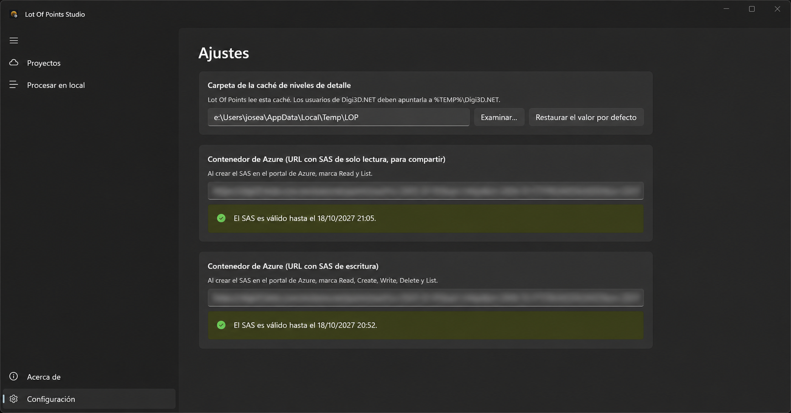

# Ajustes
<!-- id: lot-of-points-studio-ajustes -->

La página **Ajustes**, accesible desde el engranaje del menú lateral, reúne la carpeta de trabajo y los dos
localizadores uniformes de recursos (URL) de acceso a Azure. Studio guarda los campos cuando el usuario
los modifica y cambia el foco; la página no tiene un botón de guardar.

## Carpeta de la caché

**Carpeta de la caché de niveles de detalle** indica dónde prepara Studio las nubes. El valor por defecto es
`%TEMP%\LOP`, la raíz que utiliza Lot Of Points. Dentro de la carpeta raíz de la caché, Studio crea la carpeta `LiDAR` y una subcarpeta por
archivo.

Puedes escribir otra ubicación o elegirla con **Examinar…**. **Restaurar el valor por defecto** vuelve a seleccionar
la raíz de Lot Of Points. Para compartir la caché con Digi3D.NET, utiliza `%TEMP%\Digi3D.NET` y comprueba que sea
la ubicación que emplea esa aplicación.

Si escribes la ubicación a mano, sustituye `%TEMP%` por la ruta de la carpeta temporal de tu usuario; también puedes
seleccionarla con **Examinar…**.

La carpeta debe coincidir con la del visor para que este encuentre las nubes preparadas en local. Cambiar el
ajuste determina dónde creará Studio las cachés de los archivos que procese a continuación; no traslada las cachés que ya existen.

## Acceso al contenedor de Azure

Studio trabaja con un contenedor existente de Azure Blob Storage. Cada campo recibe una URL completa
con una firma de acceso compartido (SAS, del inglés *Shared Access Signature*)
después del signo `?`. La firma determina los permisos y la caducidad del acceso.

### URL de solo lectura

**Contenedor de Azure (URL con SAS de solo lectura, para compartir)** se utiliza para formar el enlace de cada
proyecto y permite consultar el contenedor cuando no hay configurada una URL de escritura.

Para consultar los proyectos desde Studio, el SAS necesita **Read** y **List**. Son las casillas que indica la
propia página de ajustes. Un SAS que solo tenga **Read** permite abrir un catálogo conocido en Lot Of Points, pero
no enumerar los proyectos del contenedor desde Studio.

### URL de escritura

**Contenedor de Azure (URL con SAS de escritura)** permite crear proyectos, publicar nubes y eliminar contenido.
Necesita los permisos **Read**, **Create**, **Write**, **Delete** y **List**.

Si configuras las dos URL, deben corresponder al mismo contenedor. Studio utiliza la de escritura para listar y gestionar
los proyectos. Studio utiliza la de lectura para generar los enlaces compartidos y para las miniaturas cuando
esa dirección está configurada; si falta, las miniaturas usan la de escritura.

## Comprobar el acceso

Debajo de cada URL aparece su estado. Studio comprueba los permisos y la fecha de caducidad que contiene el SAS.
Para el enlace de escritura exige Read, Create, Write, Delete y List. Para el estado del enlace de lectura
exige Read; al consultar proyectos sin enlace de escritura, Studio comprueba también List.
Un estado válido del enlace de lectura en **Ajustes** no acredita el permiso de listar proyectos.
Studio muestra hasta cuándo es válido el SAS, si ha caducado o qué permisos faltan. Cuando quedan menos de 48 horas para la
caducidad, el mensaje de validez se muestra como aviso.

Esta comprobación analiza el enlace sin conectarse a Azure. Si aparece un error al abrir **Proyectos** o al publicar,
revisa también que la dirección corresponda al contenedor correcto y que el acceso siga vigente.

## Archivo de ajustes

Studio guarda los ajustes en `%LOCALAPPDATA%\LopStudio\settings.json`.
La propiedad `WriteContainerUrl` utiliza la clave guardada `SasContainer`;
`ReadContainerUrl` utiliza `ReadSasContainer`. El cambio de nombres de las propiedades conserva
los valores guardados con esas claves.
