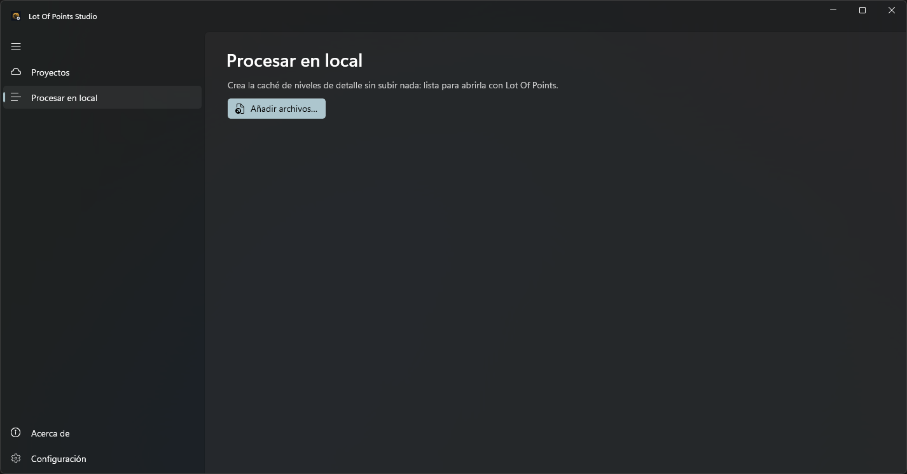

# Procesar en local
<!-- id: lot-of-points-studio-procesar-en-local -->

**Procesar en local** permite preparar un lote de nubes antes de trabajar con ellas en Lot Of Points. Studio crea
el nivel de detalle de cada nube y lo guarda en la caché del equipo para que el visor pueda reutilizarlo. Los archivos originales conservan
su contenido y no se sube ningún dato a Azure.

## Añadir archivos

Selecciona **Procesar en local** en el menú lateral y pulsa **Añadir archivos…**. Puedes elegir varios archivos de
una vez, en formato LAS (`.las`, formato de intercambio de nubes de puntos), LAZ (`.laz`, LAS comprimido), E57 (`.e57`), PTX (`.ptx`, escaneos en cuadrículas), PTS (`.pts`, puntos en texto) o PCD (`.pcd`, *Point Cloud Data*). Cada archivo
se incorpora como un trabajo independiente al panel **Tareas**, situado en la parte inferior de la ventana.

Studio comprueba primero si ya existe una caché para ese archivo. Si existe una caché para el archivo, Studio reutiliza esa caché y muestra el estado
**Ya existía**. Si necesita crearla, analiza el original y organiza sus puntos por niveles de detalle. Esa
organización permite al visor cargar las partes de la nube que necesita en cada momento.

Puedes seguir utilizando las otras páginas de Studio mientras se procesa el lote. La cola continúa trabajando
aunque cambies de página; los archivos pequeños pueden procesarse a la vez. Studio procesa los archivos grandes de uno en uno, sin otros trabajos simultáneos.

## Seguir el trabajo

Despliega **Tareas** para consultar el estado y el progreso de cada archivo. El encabezado del panel muestra
también cuántos trabajos quedan pendientes o en marcha y el avance del conjunto.

| Estado | Significado |
|---|---|
| En cola | El archivo está esperando su turno. |
| Analizando el archivo | Se está leyendo la nube original. |
| Creando el nivel de detalle | Se están organizando y escribiendo los puntos de la caché. |
| Completado | El trabajo ha terminado. |
| Ya existía | Se ha encontrado una caché ya preparada para ese archivo. |
| Cancelado | El trabajo se ha cancelado. |
| Error o mensaje del problema | No se ha podido completar el trabajo; la fila muestra el motivo. |

El mismo panel muestra las publicaciones iniciadas desde **Proyectos**. Esos trabajos pasan por la fase
**Subiendo a Azure** después de preparar la nube.

Para cancelar un trabajo, pulsa la cruz de su fila. **Cancelar todo** solicita la cancelación de todos los trabajos
pendientes y en marcha. La cancelación durante la creación puede tardar hasta que el código que crea el nivel de detalle
compruebe la solicitud de cancelación; una caché a medio crear se elimina.

## Dónde queda el resultado

Por defecto, Studio utiliza `%TEMP%\LOP` como raíz de la caché y guarda las nubes en subcarpetas de `LiDAR`.
Puedes cambiar esa raíz en [Ajustes](ajustes.md#carpeta-de-la-caché). Cada nube tiene su propia subcarpeta, con los
archivos del nivel de detalle, las estadísticas y las imágenes que haya aportado el formato de origen.

| Archivo | Contenido |
|---|---|
| `<nombre>.index` | Índice que permite localizar los puntos de cada región y nivel de detalle. |
| `<nombre>.index.points` | Puntos de la nube, organizados para su lectura en el visor. |
| `<nombre>.index.atributos` | Correspondencia con los registros originales y atributos adicionales de los puntos. |
| `<nombre>.stats.json` | Estadísticas calculadas a partir de la caché y del archivo original. |

La identificación de la caché incluye el nombre del archivo, su fecha de modificación y la versión del formato
del nivel de detalle. Si cambia el original, Studio prepara una caché nueva la próxima vez que procesa el archivo modificado.

## Abrir la nube preparada

Cuando el trabajo haya terminado, abre el archivo original desde el panel **Capas** de Lot Of Points, con
**Abrir nubes de puntos o capas vectoriales**. Si Studio ha utilizado la misma raíz de caché que el visor, este
encontrará el nivel de detalle preparado y podrá reutilizarlo.

Para trabajar con la caché de Digi3D.NET, elige `%TEMP%\Digi3D.NET` como raíz en Studio. La ubicación debe coincidir
con la que utilice la aplicación que va a leerla.
