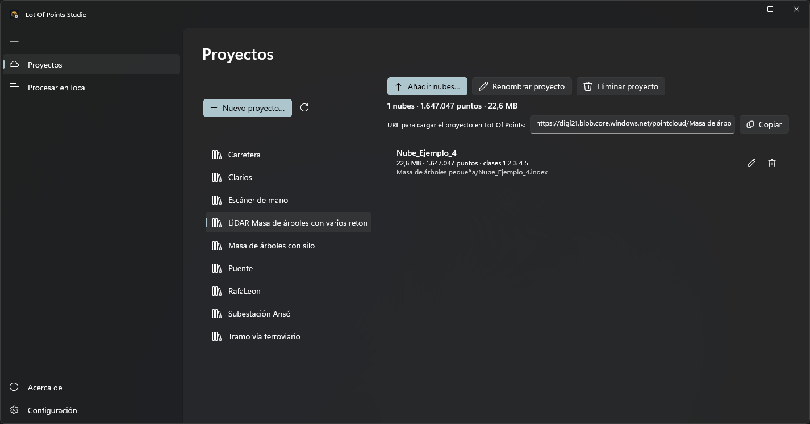

# Proyectos en Azure
<!-- id: lot-of-points-studio-proyectos-en-azure -->

Un proyecto agrupa las nubes que quieres publicar juntas en Azure. Studio mantiene un catálogo con su contenido;
Lot Of Points utiliza ese catálogo para abrir las nubes del proyecto y leerlas a medida que las necesita.

## Conectar el contenedor

Introduce en [Ajustes](ajustes.md#acceso-al-contenedor-de-azure), antes de consultar o publicar proyectos, un
localizador uniforme de recursos (URL) del contenedor con una firma de acceso compartido (SAS, del inglés
*Shared Access Signature*). La firma determina los permisos y la caducidad del acceso.

Con una URL de solo lectura cuyo SAS tenga los permisos Read y List puedes consultar los proyectos, sus nubes, estadísticas y miniaturas. La página muestra
el aviso **Solo consulta** y oculta los botones de publicación y eliminación. Para crear proyectos o modificar su
contenido, configura también la URL con SAS de escritura.

Al entrar en **Proyectos**, la lista de la izquierda muestra los proyectos del contenedor. Selecciona uno para ver
sus nubes a la derecha. El botón de la flecha circular permite actualizar la lista de proyectos.

## Crear un proyecto

Pulsa **Nuevo proyecto…**, escribe el nombre y confirma con **Crear**. El proyecto aparece en la lista y queda
seleccionado. Studio rechaza un nombre que coincida con el nombre visible o el identificador de otro proyecto,
sin distinguir entre mayúsculas y minúsculas.

El nombre se utiliza en la dirección del catálogo publicado. Al introducir la dirección de un catálogo publicado,
respeta las mayúsculas y minúsculas del nombre de archivo: Azure distingue las mayúsculas de las minúsculas. El cuadro de creación sustituye las barras por guiones
y retira los signos de interrogación del nombre.

## Añadir y publicar nubes

Pulsa **Añadir nubes…** con el proyecto seleccionado y elige los archivos originales. Se admiten los mismos
[formatos que en el procesamiento local](procesar-en-local.md#añadir-archivos). Cada archivo entra en la cola de
**Tareas** con ese proyecto como destino.

Studio resuelve el [sistema de referencia de cada archivo](procesar-en-local.md#sistema-de-referencia)
antes de encolarlo. Como sistema del proyecto, utiliza el primer WKT (*Well-Known Text*) válido del catálogo
cuyo componente horizontal no sea local. Ese sistema aparece preseleccionado cuando un archivo requiere una elección.

Si algún archivo tiene un sistema válido y no local que no es equivalente al del proyecto, Studio muestra
el sistema del proyecto y los archivos afectados y solicita confirmación con **Añadir a la cola**.
**Cancelar** no encola ninguno de los archivos seleccionados.
Para decidir si el sistema del archivo y el del proyecto son equivalentes, Studio compara sus componentes horizontales y compara los componentes verticales solo si los dos sistemas tienen componente vertical.

Studio prepara el nivel de detalle o reutiliza una caché existente y después pasa a **Subiendo a Azure**. La
publicación incluye los puntos, el índice, los atributos adicionales disponibles y las imágenes esféricas con sus
miniaturas. El catálogo se actualiza después de subir esos datos. Cuando la publicación termina, la lista del
proyecto seleccionado se actualiza para mostrar la nube.

Studio publica `<nombre>.prj` antes del índice cuando el archivo existe en la caché.
Si la caché no contiene `<nombre>.prj`, Studio borra el `.prj` publicado anteriormente para la nube. La publicación termina antes de
que Studio elimine la caché local.

Al publicar una nube por primera vez, su nombre y la dirección de sus archivos se forman a partir del nombre del
original sin su extensión. Volver a publicar en esa misma dirección sustituye los datos de la nube y conserva el
nombre visible asignado a la nube en Studio. Si una nube nueva tiene una dirección distinta y su nombre visible
ya está ocupado, Studio añade « (2)», « (3)» y los números siguientes hasta obtener un nombre libre.
La coincidencia de nombres no sustituye una nube cuya dirección sea distinta.
Para publicar dos nubes distintas en un mismo proyecto, utiliza nombres de archivo distintos, aunque procedan
de carpetas diferentes; el nombre del archivo determina la dirección de publicación.

Una vez publicada, la nube se consulta con el [enlace del proyecto](compartir-proyectos.md). No es necesario copiar
manualmente sus archivos al equipo de quien vaya a abrirla.

## Consultar y asignar el sistema de referencia

Cada nube publicada muestra el sistema obtenido de su archivo `<nombre>.prj` del contenedor.
La fila indica el nombre del sistema, **desconocido** si su componente horizontal es local,
**sin asignar** si falta el archivo o un aviso si la definición guardada no es un WKT válido.

1. Pulsa el botón con el globo de una nube para asignarle un sistema, o **Sistema de referencia…** para asignarlo a todas las nubes del proyecto.
2. Elige el sistema en el selector o indica que es desconocido.
3. Confirma la elección.

El selector muestra preseleccionado el primer sistema guardado entre las nubes seleccionadas, según el orden de la lista.
Si ninguna nube seleccionada tiene un sistema guardado, el selector no muestra ningún sistema preseleccionado. Studio sustituye el `.prj` de cada nube seleccionada por el WKT elegido.
Usa esta asignación en las nubes publicadas con versiones de Studio que no publicaban el `.prj`.

## Renombrar proyectos y nubes

Pulsa **Renombrar proyecto** para cambiar el nombre del proyecto seleccionado, escribe el nuevo nombre y confirma
con **Renombrar**. Utiliza el lápiz de la fila de una nube para cambiar su nombre. El nombre debe tener contenido
y no coincidir con el de otro proyecto del contenedor o el de otra nube del mismo proyecto. La comprobación de
duplicados no distingue entre mayúsculas y minúsculas.

El cambio afecta al nombre que se muestra en la lista. Las direcciones del catálogo y de las nubes conservan su
valor, por lo que los enlaces compartidos siguen sirviendo y no hace falta volver a publicar los archivos.
El catálogo guarda el nombre visible del proyecto en el campo `name`.
Si un catálogo carece de ese campo, Studio muestra el nombre del archivo del catálogo.
Lot Of Points utiliza también el nombre visible del proyecto al incorporar sus nubes al panel **Capas**.
Un catálogo ya abierto conserva el nombre hasta que el usuario cierra ese catálogo y lo abre otra vez.

## Qué ocurre con la caché local

Si Studio ha creado una caché nueva para publicar una nube, intenta eliminarla al terminar la subida: Studio creó esa caché
para preparar los datos que publica en Azure y la nube ya está disponible en Azure. Si la caché existía antes de ese trabajo, la
conserva, porque puede estar utilizándola Lot Of Points u otra aplicación.

Si cancelas la subida o esta falla, la caché local se conserva. Puedes consultar el motivo en **Tareas** y volver
a añadir el archivo cuando quieras intentarlo de nuevo. La cancelación no añade la nueva entrada al catálogo,
aunque puede haber dejado parte de los archivos subidos al contenedor.

## Eliminar nubes o proyectos

Pulsa la papelera de la fila de una nube y confirma con **Eliminar** para quitar esa nube. Studio retira la entrada del
catálogo y borra del contenedor los archivos de esa nube, incluido el `.prj`, y sus imágenes.

**Eliminar proyecto** actúa sobre el proyecto seleccionado: tras la confirmación, elimina su catálogo y todos
sus archivos publicados. Estas operaciones afectan al contenido de Azure; los archivos originales del equipo
conservan su contenido.

## Si no puedes acceder

El aviso **Configura el contenedor** indica que no hay ninguna URL configurada. Si solo aparece **Solo consulta**,
estás trabajando con el acceso de lectura. Para publicar o eliminar necesitas configurar el de escritura.

Los fallos al consultar o modificar el contenedor aparecen en la página como **Error del contenedor:** seguido del
motivo. Comprueba en **Ajustes** la dirección, los permisos y la caducidad del SAS. Los errores de una publicación
individual se muestran en la fila de ese archivo, dentro de **Tareas**.
