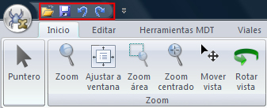

# Barra de herramientas de acceso rápido
<!-- id: barra-de-herramientas-de-acceso-rapido -->

[Cinta de herramientas](/mdtopx/cinta-de-herramientas/)

La cinta de herramientas incluye una barra de herramientas configurable donde figuran los comandos más útiles. En esta barra se incluyen los iconos de los comandos en un tamaño pequeño.

La primera vez que se utiliza el programa, se incluyen por defecto los siguientes comandos

* Abrir archivo: Comando alojado en el [botón de MDTopX](../introduccion/boton-de-mdtopx.md).
* Guardar archivo: Comando alojado en el [botón de MDTopX](../introduccion/boton-de-mdtopx.md).
* Deshacer: Deshace la última modificación realizada sobre el documento actual. Esta herramienta puede ser seleccionada pulsando las teclas \[CTRL] + \[Z]. Al pasar el ratón por el botón se ve el nombre de la herramienta que se va a deshacer (por ejemplo, _Deshacer: Borrar_). No hay un número máximo de pasos: cada paso guarda solo lo que cambió la herramienta, y se guardan todos los que caben en la memoria reservada para deshacer, que se configura en el cuadro de [diálogo de Opciones](../otras-herramientas/opciones.md), al que se puede acceder desde el [botón de MDTopX](../introduccion/boton-de-mdtopx.md). Los pasos más antiguos que no caben en esa memoria pasan a un archivo temporal en el disco. Mientras se está ejecutando un proceso, Deshacer y Rehacer están desactivados.
* Rehacer: Rehace la última modificación deshecha anteriormente. Esta herramienta puede ser seleccionada pulsando las teclas \[CTRL] + \[Y]. Como en Deshacer, el botón muestra el nombre de la herramienta que se va a rehacer.

Operaciones permitidas con la barra de herramientas de acceso rápido:

* [Mover la barra de herramientas de acceso rápido](/mdtopx/cinta-de-herramientas/mover-la-barra-de-herramientas-de-acceso-rapido.md) para colocarla por debajo o por encima de la cinta de herramientas
* [Personalizar la barra de herramientas de acceso rápido](/mdtopx/cinta-de-herramientas/personalizar-la-barra-de-herramientas-de-acceso-rapido.md) para agregar botones que representarán los comandos que utiliza frecuentemente
