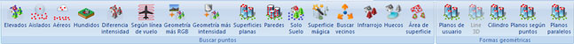

# Ficha de herramientas Clasificar LiDAR
<!-- id: ficha-de-herramientas-clasificar-lidar -->

[Cinta de herramientas](/mdtopx/cinta-de-herramientas/)

En esta ficha de herramientas aparecen los comandos relacionados con la clasificación de puntos LiDAR medidos con dispositivos láser aerotransportados del [módulo láser](../modulo-laser/).

Estos comandos aparecen agrupados según los siguientes epígrafes:

* [**Algoritmos específicos para registros aéreos**](../modulo-laser/buscar-puntos/)
* [**Superficie mágica**](../modulo-laser/buscar-puntos/superficie-magica/)
* [**Formas geométricas**](../modulo-laser/formas-geometricas/)
* [**Forestal**](../modulo-mms/forestal/)

Vea también:

* [Ficha de herramientas Archivos LiDAR](/mdtopx/fichas-de-herramientas/ficha-de-herramientas-archivos-lidar/)
* [Ficha de herramientas Puntos LiDAR](/mdtopx/fichas-de-herramientas/ficha-de-herramientas-puntos-lidar/)
