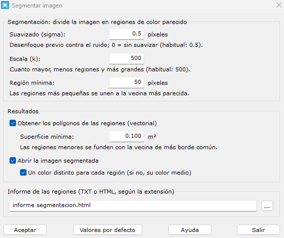

# Segmentar imagen
<!-- id: segmentar-imagen -->

[Calcular](/mdtopx/fichas-de-herramientas/ficha-de-herramientas-imagen/imagen-calcular.md)

Esta herramienta divide una imagen en regiones de color parecido. Si se pide, obtiene además los polígonos de esas regiones, georreferenciados y con las estadísticas de color de cada una. Sirve, por ejemplo, para separar en una ortofoto las cubiertas, la calzada, la vegetación o el césped y llevar sus contornos a un dibujo.

Se puede usar desde la vista de una imagen, sobre esa imagen, o desde la vista de un proyecto, sobre las imágenes del proyecto que se elijan.

## Cómo funciona

1. La imagen se suaviza con un filtro gaussiano, para que el ruido no parta las regiones.
2. Los píxeles vecinos de color parecido se agrupan con el algoritmo de Felzenszwalb y Huttenlocher. Dos zonas vecinas se unen si la diferencia de color en su borde no supera la variación de color dentro de cada una más un margen. El margen es la **Escala** dividida por el número de píxeles de la zona: las zonas pequeñas se unen con facilidad, y una zona grande y uniforme no se une a otra distinta.
3. Las regiones con menos píxeles que la **Región mínima** se unen a la vecina más parecida.
4. Si se piden los polígonos, se traza el contorno de cada región. Los polígonos cubren la imagen sin huecos ni solapes: cada borde lo comparten exactamente las dos regiones vecinas, y una región que rodea a otra lleva el hueco como isla. Las regiones con menos superficie que la **Superficie mínima** se funden con la vecina con la que comparten más borde.

En una imagen en color se compara el color RGB; en una en escala de grises, el gris. En una imagen esférica, el borde izquierdo y el derecho se tratan como vecinos, porque la panorámica da la vuelta completa.

Las regiones sin dato (todas blancas) o completamente negras no dan polígono.

## Resultados

* **Imagen segmentada**: si se marca **Abrir la imagen segmentada**, se abre un documento nuevo, «Segmentación de» y el nombre de la imagen, con cada región pintada de un color distinto o de su color medio.
* **Polígonos**: si se marca **Obtener los polígonos de las regiones**, se abre un documento de dibujo nuevo. Desde una imagen se llama «Límites de» y el nombre de la imagen; desde un proyecto, «Vectorización de» y el nombre del proyecto. El contorno exterior de cada región sale con el código LIMEXT, y sus islas, con el código LIMINT.
* **Tabla de la región**: desde una imagen, el dibujo lleva una tabla con una fila por región, y cada polígono tiene un atributo con su fila. Las columnas son las siguientes:
  * `index`: número de la región.
  * `mediaR`, `mediaG`, `mediaB` y `dvR`, `dvG`, `dvB`: media y desviación típica de cada banda.
  * `cPixel`: número de píxeles.
  * `minR`, `maxR`, `minG`, `maxG`, `minB`, `maxB`: mínimo y máximo de cada banda.
  * `minH`, `maxH`, `mediaH`, `dvH`: cota mínima, máxima, media y desviación típica de la región, si la imagen tiene mapa de profundidad.

  Desde un proyecto no hay tabla: cada polígono lleva los valores en sus atributos. La tabla 2 es el número de la región, y las tablas 3 a 15, por este orden, la media y la desviación de R, G y B, el número de píxeles y el mínimo y el máximo de R, G y B.
* **Informe**: si se escribe un nombre de fichero, se guarda un informe con una fila por polígono: región, si es exterior o isla, media y desviación de cada banda, píxeles, mínimo y máximo de cada banda, cotas, área, perímetro y número de vértices. Si el nombre acaba en `.html` o `.htm`, el informe sale en HTML, con un resumen de la imagen y de los parámetros y una muestra del color de cada región; si no, sale en texto.

El [panel de Resultados](../introduccion/paneles-de-la-aplicacion/panel-resultados.md) muestra el número de regiones encontradas y la ruta del informe.

### Georreferencia de los polígonos

* **Ortofoto**: los vértices se pasan a terreno con el origen y el tamaño de píxel de la imagen.
* **Imagen cónica**: cada vértice se proyecta sobre el plano horizontal de la cota media de la orientación de la imagen. La superficie mínima se mide en ese plano.
* **Imagen con mapa de profundidad** (ortofotos y esféricas): los vértices toman la cota del mapa de profundidad. Los polígonos que caen fuera del mapa se descartan.
* **Imagen esférica sin mapa de profundidad**: los polígonos salen en coordenadas de píxel.

## Parámetros

* **Suavizado (sigma)**: Desenfoque previo contra el ruido, en píxeles. Con 0 no se suaviza. El valor habitual es 0,5.
* **Escala (k)**: Cuanto mayor es, menos regiones salen y más grandes son. El valor habitual es 500.
* **Región mínima**: Número de píxeles por debajo del cual una región se une a la vecina más parecida.
* **Obtener los polígonos de las regiones (vectorial)**: Crea el dibujo con los polígonos.
* **Superficie mínima**: Superficie en m² por debajo de la cual una región se funde con la vecina con la que comparte más borde. Con 0 no se funde ninguna.
* **Abrir la imagen segmentada**: Crea el documento de imagen con las regiones pintadas.
* **Un color distinto para cada región**: Si está marcada, cada región de la imagen segmentada se pinta de un color distinto; si no, de su color medio.
* **Informe de las regiones**: Fichero del informe. El botón **...** permite elegirlo. Si se deja vacío, no hay informe. Por defecto se propone el nombre de la imagen, o el del proyecto, con la extensión TXT. Si el nombre no lleva carpeta, el informe se guarda en la carpeta de la imagen o del proyecto.
* **Valores por defecto**: Pone los valores habituales en el cuadro.

## Desde un proyecto

Al aceptar el cuadro, la herramienta pide las imágenes del proyecto que se van a segmentar. Las imágenes se procesan en paralelo, tantas a la vez como caben en la memoria libre: cada imagen necesita unos 80 bytes por píxel.

Solo se obtienen los polígonos de las imágenes georreferenciadas que son ortofotos o cónicas, o que tienen mapa de profundidad. Los polígonos de todas las imágenes van al mismo dibujo. Las zonas comunes de dos imágenes que se solapan salen dos veces, una por imagen.

Si se pide informe, sale uno solo para todas las imágenes, en el orden de la lista. El informe HTML empieza con un resumen y un índice con un enlace a cada imagen, y después lleva una sección por imagen. Tras el resumen, el informe enumera las imágenes que no han salido y el motivo: les falta la georreferencia o la profundidad, no ha habido memoria, se ha cancelado el proceso o sus polígonos no caben con los decimales del dibujo de resultado.

Vea también:

* [Vectorizar](vectorizar.md)
* [Generar límites de imagen](generar-limites-de-imagen.md)
* [NDVI](ndvi.md)
