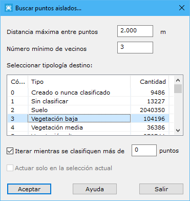

# Buscar puntos aislados
<!-- id: buscar-puntos-aislados -->

[Ficha de herramientas Clasificar LiDAR](/mdtopx/fichas-de-herramientas/ficha-de-herramientas-clasificar-lidar.md)

Esta herramienta busca y clasifica los puntos LiDAR aislados, que tienen pocos puntos cerca, normalmente porque su cota es errónea.

Los parámetros que precisa son los siguientes:

* **Distancia máxima entre puntos**: dos puntos son vecinos si están a menos de esta distancia en 3D. Este parámetro dependerá de la densidad de puntos: con un valor demasiado alto casi ningún punto sale aislado, y con uno demasiado bajo salen muchos.
* **Número mínimo de vecinos**: un punto con menos vecinos que este número está aislado.
* **Tipología destino**: la clase que reciben los puntos aislados.
* **Iterar mientras se clasifiquen más de x puntos**: los puntos ya clasificados dejan de contar como vecinos, así que en la pasada siguiente pueden quedar aislados los que estaban junto a ellos. El programa repite el proceso mientras una pasada clasifique más puntos de los indicados.
* **Actuar sólo en la selección actual**: solo se buscan los puntos seleccionados, y solo ellos cuentan como vecinos.

Los puntos de vegetación (clases 3, 4 y 5), edificación (6) y ruido (7), y los de la tipología destino, no se buscan ni cuentan como vecinos.

Hasta noviembre de 2026, la herramienta contaba como vecinos solo los puntos unidos al punto por un lado de la triangulación de la nube. Ahora cuenta todos los puntos que hay a menos de la distancia, así que marca muchos menos: en una hoja del PNOA de 4,8 millones de puntos, con 3 m y 3 vecinos, 37.216 puntos en lugar de 324.330, y en 5 segundos en lugar de más de 3 minutos.

Con dibujos de referencia cargados, la herramienta usa el método anterior, con la triangulación.

El programa comenzará a procesar el archivo actual e irá mostrando los resultados parciales sobre el [panel de Resultados](../../introduccion/paneles-de-la-aplicacion/panel-resultados.md) del programa. Si desea **Cancelar** el proceso el programa le preguntará si desea conservar los cálculos generados hasta ese momento.

Vea también:

* [Buscar puntos elevados](/mdtopx/modulo-laser/buscar-puntos/buscar-puntos-elevados.md)
* [Buscar puntos aéreos](/mdtopx/modulo-laser/buscar-puntos/buscar-puntos-aereos.md)
* [Buscar puntos hundidos](/mdtopx/modulo-laser/buscar-puntos/buscar-puntos-hundidos.md)
* [Buscar puntos en Superficies Planas](/mdtopx/modulo-laser/buscar-puntos/buscar-puntos-en-superficies-planas.md)
* [Buscar puntos en Paredes](/mdtopx/modulo-laser/buscar-puntos/buscar-puntos-en-paredes.md)
* [Buscar puntos Solo Suelo](solo-suelo.md)
* [Superficie mágica](/mdtopx/modulo-laser/buscar-puntos/superficie-magica/)
* [Buscar puntos vecinos](buscar-vecinos.md)
* [Buscar puntos según infrarrojo](/mdtopx/modulo-laser/buscar-puntos/buscar-puntos-segun-infrarrojo.md)
* [Buscar huecos](/mdtopx/modulo-laser/buscar-puntos/buscar-huecos.md)
* [Buscar puntos según Área de superficie](buscar-puntos-segun-area.md)
* [Buscar puntos según planos de usuario](../formas-geometricas/buscar-puntos-sobre-planos.md)
