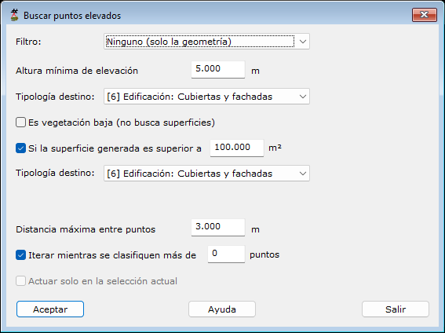
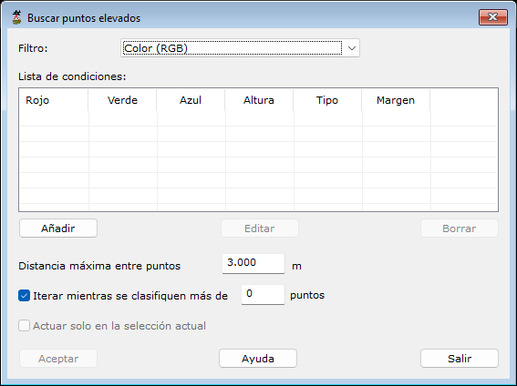

# Buscar puntos elevados
<!-- id: buscar-puntos-elevados -->

[Ficha de herramientas Clasificar LiDAR](/mdtopx/fichas-de-herramientas/ficha-de-herramientas-clasificar-lidar.md)

Esta herramienta busca y clasifica los puntos LiDAR que están por encima de su entorno, en función de las propiedades geométricas que cada punto tiene con sus vecinos. Opcionalmente puede tener en cuenta además el color o la intensidad de los puntos, para clasificar solo ciertos objetos que han tenido una determinada respuesta radiométrica o al láser.

## Filtro

El desplegable **Filtro** indica qué se tiene en cuenta además de la geometría:

* **Ninguno (solo la geometría)**: los puntos se clasifican solo por su altura respecto a sus vecinos.
* **Color (RGB)**: se clasifican los puntos elevados cuyo color se parece al de alguna de las condiciones de la lista. No todos los archivos LiDAR tienen color registrado en sus puntos. Si no fuera así, se podría asignar en un proceso posterior: consulte la herramienta [Asignar color RGB a puntos](/mdtopx/modulo-laser/editar/asignar-color-rgb-a-puntos.md).
* **Intensidad**: se clasifican los puntos elevados cuya intensidad está dentro del rango de alguna de las condiciones de la lista.

El cuadro recuerda el último filtro utilizado.

## Sin filtro

* **Altura mínima de elevación**: Altura mínima que tiene que existir entre el punto en consideración con respecto a alguno de sus vecinos para que se cambie su clasificación.
* **Tipología destino**: Tipología de clasificación destino de los puntos que cumplan con las condiciones del cálculo.
* **Es vegetación baja (no busca superficies)**: Si se está buscando vegetación baja, cuya diferencia de altura es igualmente baja, se debería activar esta opción para que el programa no intente buscar superficies encerradas entre los puntos clasificados, ya que se podrían llegar a clasificar puntos no deseados. Al activarla, se desactiva la opción siguiente.
* **Si la superficie generada es superior a x m²**: Una vez que se ha clasificado un conjunto de puntos, el programa busca la formación de superficies para considerar aquellos puntos que se encuentren en el interior. Si la superficie es superior al valor indicado en este campo, se puede cambiar la clasificación e indicar otra clasificación destino.
* **Tipología destino**: Tipología destino si los puntos forman una superficie de área superior a la indicada en el campo anterior.

## Con filtro de color o de intensidad

* **Lista de condiciones**: Condiciones que deben cumplir los puntos para ser clasificados. Se gestionan con los botones **Añadir**, **Editar** y **Borrar** (también con las teclas `Insert` y `Supr`, y con doble clic sobre una condición para editarla). Cada condición tiene su propia altura mínima respecto a su entorno y su propia tipología destino, y además:
  * con el filtro de color, un color, definido por sus componentes RGB, y un margen de tolerancia para cada componente;
  * con el filtro de intensidad, un rango de intensidad, definido por un mínimo y un máximo.

Las listas de color y de intensidad son independientes: al cambiar de filtro no se pierde la lista del otro. Con filtro, el botón **Aceptar** no se activa mientras la lista esté vacía.

## Campos comunes

* **Distancia máxima entre puntos**: Distancia máxima para considerar dos puntos como adyacentes o vecinos en el terreno. Este parámetro dependerá de la densidad de puntos. No es adecuado poner un valor demasiado elevado porque ello provocará que se consideren puntos muy alejados del punto en consideración. Si se indica un valor demasiado escaso, no se podrá relacionar el punto en consideración con ningún otro punto.
* **Iterar mientras se clasifiquen más de x puntos**: El proceso de clasificación puede mejorar si se realizan iteraciones. Por ello, se puede indicar una cantidad mínima de puntos por encima de la cual el programa automáticamente repite el proceso. Por tanto, estas iteraciones se detendrán cuando no se clasifiquen más puntos de los indicados en este campo.
* **Actuar solo en la selección actual**: Se podrá activar esta opción para calcular solo en los puntos que actualmente se tengan seleccionados.

El programa comenzará a procesar el archivo actual e irá mostrando los resultados parciales sobre el [panel de Resultados](../../introduccion/paneles-de-la-aplicacion/panel-resultados.md) del programa. Si desea **Cancelar** el proceso el programa le preguntará si desea conservar los cálculos generados hasta ese momento.

Vea también:

* [Buscar puntos aislados](/mdtopx/modulo-laser/buscar-puntos/buscar-puntos-aislados.md)
* [Buscar puntos aéreos](/mdtopx/modulo-laser/buscar-puntos/buscar-puntos-aereos.md)
* [Buscar puntos hundidos](/mdtopx/modulo-laser/buscar-puntos/buscar-puntos-hundidos.md)
* [Buscar puntos en Superficies Planas](/mdtopx/modulo-laser/buscar-puntos/buscar-puntos-en-superficies-planas.md)
* [Buscar puntos en Paredes](/mdtopx/modulo-laser/buscar-puntos/buscar-puntos-en-paredes.md)
* [Buscar puntos Solo Suelo](solo-suelo.md)
* [Superficie mágica](/mdtopx/modulo-laser/buscar-puntos/superficie-magica/)
* [Buscar puntos vecinos](buscar-vecinos.md)
* [Buscar puntos según infrarrojo](/mdtopx/modulo-laser/buscar-puntos/buscar-puntos-segun-infrarrojo.md)
* [Buscar huecos](/mdtopx/modulo-laser/buscar-puntos/buscar-huecos.md)
* [Buscar puntos según Área de superficie](buscar-puntos-segun-area.md)
* [Buscar puntos según planos de usuario](../formas-geometricas/buscar-puntos-sobre-planos.md)
