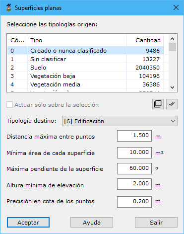

# Buscar puntos en Superficies Planas
<!-- id: buscar-puntos-en-superficies-planas -->

[Ficha de herramientas Clasificar LiDAR](/mdtopx/fichas-de-herramientas/ficha-de-herramientas-clasificar-lidar.md)

Esta herramienta está destinada a la búsqueda y clasificación de puntos LiDAR que están situados en superficies planas con una inclinación máxima y una superficie mínima. Es decir, es muy indicada para la búsqueda de puntos que se han medido sobre las cubiertas de los edificios. Antes de ejecutar esta herramienta es recomendable que se clasifiquen los puntos elevados utilizando alguna de las herramientas disponibles al efecto. Con esto se consigue aislar los puntos que tienen una determinada altura y que pueden pertenecer a edificaciones. En los parámetros que se solicitan en el cuadro de diálogo, se deberá seleccionar sólo aquellos puntos que previamente fueron clasificados por ser elevados. Con esto, se evita clasificar puntos que forman superficies planas pero están en el suelo.

Los parámetros que precisa son los siguientes:

* **Seleccione las tipologías origen**: Se deberán seleccionar las tipologías origen donde buscar los puntos que forman la superficie.
* **Actuar sólo en la selección actual**: Se podrá activar esta opción para calcular sólo en los puntos que actualmente se tengan seleccionados. Sólo cambian los puntos seleccionados; el terreno sobre el que se mide la altura es siempre el de todo el archivo.
* **Tipología destino**: Se deberá elegir la tipología de clasificación destino de los puntos que cumplan con las condiciones del cálculo.
* **Distancia máxima entre puntos**: Distancia máxima para considerar dos puntos como adyacentes o vecinos en el terreno. Este parámetro dependerá de la densidad de puntos. No es adecuado poner un valor demasiado elevado porque ello provocará que se consideren puntos muy alejados del punto en consideración. Si se indica un valor demasiado escaso, no se podrá relacionar el punto en consideración con ningún otro punto.
* **Mínima área de cada superficie**: Valor que deberá superar el conjunto de puntos vecinos que cumplen con la condición de ser superficie plana.
* **Máxima pendiente de la superficie**: Valor máximo en grados sexagesimales que no deberá superar la superficie que forman los puntos.
* **Altura mínima de elevación**: Altura mínima de la superficie sobre el terreno. El terreno lo forman los puntos de la tipología Suelo (clase 2) de todo el archivo, por lo que conviene clasificarlos antes, por ejemplo con [Solo suelo](solo-suelo.md). Las superficies que quedan fuera de la zona con suelo no se clasifican. Si el archivo no tiene puntos de suelo, la herramienta no puede medir esta altura y no la tiene en cuenta.
* **Precisión en cota de los puntos**: Desviación típica máxima, en metros, de los puntos respecto al plano de la superficie. Con un valor pequeño, las cubiertas con ruido no se consideran planas.

Dentro del contorno de cada superficie encontrada pasan a la tipología destino los puntos de las tipologías origen situados a la altura mínima o más sobre el terreno. Los de otras tipologías, por ejemplo la vegetación que cubra parte de una cubierta, no cambian.

Vea también:

* [Buscar puntos elevados](/mdtopx/modulo-laser/buscar-puntos/buscar-puntos-elevados.md)
* [Buscar puntos aislados](/mdtopx/modulo-laser/buscar-puntos/buscar-puntos-aislados.md)
* [Buscar puntos aéreos](/mdtopx/modulo-laser/buscar-puntos/buscar-puntos-aereos.md)
* [Buscar puntos hundidos](/mdtopx/modulo-laser/buscar-puntos/buscar-puntos-hundidos.md)
* [Buscar puntos en Paredes](/mdtopx/modulo-laser/buscar-puntos/buscar-puntos-en-paredes.md)
* [Buscar puntos Solo Suelo](solo-suelo.md)
* [Superficie mágica](/mdtopx/modulo-laser/buscar-puntos/superficie-magica/)
* [Buscar puntos vecinos](buscar-vecinos.md)
* [Buscar puntos según infrarrojo](/mdtopx/modulo-laser/buscar-puntos/buscar-puntos-segun-infrarrojo.md)
* [Buscar huecos](/mdtopx/modulo-laser/buscar-puntos/buscar-huecos.md)
* [Buscar puntos según Área de superficie](buscar-puntos-segun-area.md)
* [Buscar puntos según planos de usuario](../formas-geometricas/buscar-puntos-sobre-planos.md)

[Ver video: Buscar edificios en un archivo LiDAR](https://youtu.be/qm8dz4AmSRQ)
