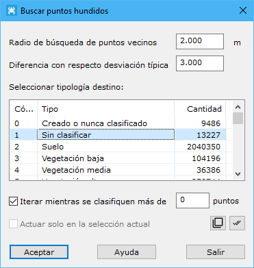

# Buscar puntos hundidos
<!-- id: buscar-puntos-hundidos -->

[Ficha de herramientas Clasificar LiDAR](/mdtopx/fichas-de-herramientas/ficha-de-herramientas-clasificar-lidar.md)

Esta herramienta busca y clasifica los puntos LiDAR que tienen una cota mucho más baja que la de los puntos de su entorno, normalmente porque esa cota es errónea (ruido bajo).

Los parámetros que precisa son los siguientes:

* **Radio de búsqueda de puntos vecinos**: los vecinos de un punto son los puntos que están a menos de esta distancia en planta. Este parámetro dependerá de la densidad de puntos.
* **Diferencia con respecto desviación típica**: un punto está hundido si su cota queda por debajo de la media de las cotas de sus vecinos en más de este número de desviaciones típicas de esas cotas.
* **Solo si está aislado en 3D (como mucho un vecino)**: además, el punto tiene que tener como mucho un vecino a menos del radio en 3D. Los puntos bajos que son terreno, como los del fondo de una cuneta, tienen otros puntos cerca; el ruido casi nunca los tiene. Está activada por omisión.
* **Tipología destino**: la clase que reciben los puntos hundidos.
* **Iterar mientras se clasifiquen más de x puntos**: los puntos ya clasificados dejan de contar como vecinos, así que la pasada siguiente puede encontrar otros. El programa repite el proceso mientras una pasada clasifique más puntos de los indicados.
* **Actuar sólo en la selección actual**: solo se buscan los puntos seleccionados, y solo ellos cuentan como vecinos.

Así decide el programa qué puntos están hundidos:

1. Los puntos de vegetación (clases 3, 4 y 5), edificación (6) y ruido (7), y los de la tipología destino, no se buscan ni cuentan como vecinos.
2. Solo se examinan los puntos que tienen algún vecino más de 30° por encima.
3. Un punto con menos de 3 vecinos no se clasifica.
4. El punto está hundido si cumple la condición de la desviación típica y, con la casilla activada, la de estar aislado en 3D.

En una hoja del PNOA de 4,8 millones de puntos sin clasificar, con un radio de 2 m y 3 desviaciones típicas, la búsqueda con iteraciones tarda unos 4 segundos. La casilla de aislado en 3D quita un tercio de los puntos marcados y conserva casi todo el ruido real.

Con dibujos de referencia cargados, la herramienta usa el método anterior, que triangula la nube: es mucho más lento y no tiene la casilla de aislado en 3D.

El programa comenzará a procesar el archivo actual e irá mostrando los resultados parciales sobre el [panel de Resultados](../../introduccion/paneles-de-la-aplicacion/panel-resultados.md) del programa. Si desea **Cancelar** el proceso el programa le preguntará si desea conservar los cálculos generados hasta ese momento.

Vea también:

* [Buscar puntos elevados](/mdtopx/modulo-laser/buscar-puntos/buscar-puntos-elevados.md)
* [Buscar puntos aislados](/mdtopx/modulo-laser/buscar-puntos/buscar-puntos-aislados.md)
* [Buscar puntos aéreos](/mdtopx/modulo-laser/buscar-puntos/buscar-puntos-aereos.md)
* [Buscar puntos en Superficies Planas](/mdtopx/modulo-laser/buscar-puntos/buscar-puntos-en-superficies-planas.md)
* [Buscar puntos en Paredes](/mdtopx/modulo-laser/buscar-puntos/buscar-puntos-en-paredes.md)
* [Buscar puntos Solo Suelo](solo-suelo.md)
* [Superficie mágica](/mdtopx/modulo-laser/buscar-puntos/superficie-magica/)
* [Buscar puntos vecinos](buscar-vecinos.md)
* [Buscar puntos según infrarrojo](/mdtopx/modulo-laser/buscar-puntos/buscar-puntos-segun-infrarrojo.md)
* [Buscar huecos](/mdtopx/modulo-laser/buscar-puntos/buscar-huecos.md)
* [Buscar puntos según Área de superficie](buscar-puntos-segun-area.md)
* [Buscar puntos según planos de usuario](../formas-geometricas/buscar-puntos-sobre-planos.md)
