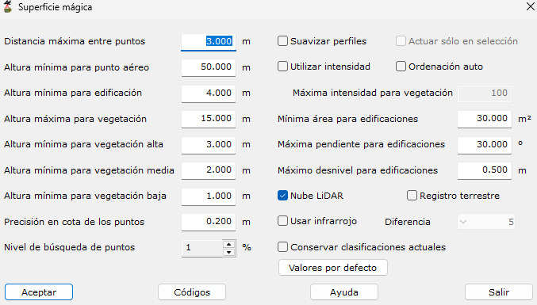

# Superficie mágica
<!-- id: superficie-magica -->

[Ficha de herramientas Clasificar LiDAR](/mdtopx/fichas-de-herramientas/ficha-de-herramientas-clasificar-lidar.md)

Esta herramienta busca y clasifica automáticamente los puntos LiDAR. Combina algoritmos y herramientas del programa y elige los algoritmos y los parámetros según el tipo de archivo y el tipo de zona, de modo que usted no tiene que decidirlos en cada ejecución.

Funciona con un archivo de nube de puntos abierto o con un proyecto. Además del suelo, la vegetación y la edificación, clasifica los puentes y pasarelas, la calzada y los vehículos, y los cables y apoyos de las líneas eléctricas (ver [Qué clasifica](#qué-clasifica)), y al terminar agrupa los puntos en [objetos](#los-objetos).

Parámetros:

* **Distancia máxima entre puntos**: Distancia máxima entre dos puntos para considerarlos vecinos en la zona. Se recomienda un valor de 2 o 3 veces la separación nominal entre los puntos escaneados.
* **Altura mínima para punto aéreo**: Diferencia de altura mínima que debe tener un punto con su entorno para que sea clasificado como punto aéreo. Si introduce 0, la herramienta no aplica este criterio de altura mínima.
* **Altura mínima para edificación**: Diferencia de altura mínima que debe tener un punto con su entorno para que sea clasificado como punto edificación. Si introduce 0, la herramienta no aplica este criterio de altura mínima.
* **Altura máxima para vegetación**: Diferencia de altura máxima que debe tener un punto con su entorno para que sea clasificado como vegetación. Si introduce 0, la herramienta no aplica este criterio de altura máxima. Las copas de los árboles más altos que este valor, si tienen vegetación debajo y no forman un plano, también son vegetación alta.
* **Altura mínima para vegetación alta**: Diferencia de altura mínima que debe tener un punto con su entorno para que sea clasificado como vegetación alta. Si introduce 0, la herramienta no aplica este criterio de altura mínima.
* **Altura mínima para vegetación media**: Diferencia de altura mínima que debe tener un punto con su entorno para que sea clasificado como vegetación media. Si introduce 0, la herramienta no aplica este criterio de altura mínima.
* **Altura mínima para vegetación baja**: Diferencia de altura mínima que debe tener un punto con su entorno para que sea clasificado como vegetación baja. Si introduce 0, la herramienta no aplica este criterio de altura mínima.
* **Precisión en cota de los puntos**: Precisión en la definición de la cota.
* **Nivel de búsqueda de puntos**: Valor entre 1 y 10. Con valores más bajos, la búsqueda es más exhaustiva porque la herramienta repite algunos de los procesos de clasificación.
* **Suavizar perfiles**: Si los datos se han tomado siguiendo líneas, suaviza los puntos antes de clasificar para eliminar irregularidades. El suavizado también puede eliminar elementos característicos del relieve.
* **Actuar sólo en selección**: Si se han seleccionado puntos en pantalla antes de ejecutar la herramienta, se da la opción al usuario de que sólo calcule con los puntos seleccionados.
* **Utilizar intensidad**: Marque esta opción para usar el campo intensidad de cada punto en la clasificación. La intensidad permite distinguir el suelo de los objetos que hay sobre él cuando sus valores de intensidad difieren mucho, como en una plantación (olivar, viñedo, etc.). No se recomienda usar la intensidad en otras situaciones.
* **Ordenación auto**: Marque esta opción para ordenar los puntos por su tiempo GPS (Sistema de Posicionamiento Global) antes de clasificar. Ordenarlos es útil si la nube combina varios grupos de puntos.
* **Máxima intensidad para vegetación**: Si **Utilizar intensidad** está marcada, indique el valor máximo de intensidad para que un punto se clasifique como vegetación, entre 0 y 255.
* **Mínima área para edificaciones**: Para identificar edificaciones correctamente se puede indicar un valor mínimo de superficie. Por debajo de este valor, la zona no se considerará edificación.
* **Máxima pendiente para edificaciones**: Pendiente máxima de una superficie que la herramienta puede clasificar como edificación.
* **Máximo desnivel para edificaciones**: Por último, se puede indicar el valor máximo de desnivel que puede existir entre puntos pertenecientes a la misma zona que tiene posibilidad de ser edificación.
* **Nube LiDAR:** Activar si la nube procede de medidas láser o desactivar si la nube procede de una multicorrelación fotogramétrica (ver [Nubes fotogramétricas](#nubes-fotogramétricas)). Con un archivo, la casilla viene marcada según la nube: es LiDAR si sus puntos tienen tiempo GPS o intensidad, y fotogramétrica si no tienen ninguno de los dos y tienen color. Con un proyecto, se marca a mano.
* **Registro terrestre**: Se deberá seleccionar esta opción si el registro es terrestre, ya que la resolución y la precisión es muy superior al caso aéreo.
* **Usar infrarrojo**: Marque esta opción para calcular el índice de vegetación de diferencia normalizada (NDVI) a partir del infrarrojo cercano (IR) y el rojo (R) de cada punto. Si la nube tiene el campo NIR del LAS (formatos de punto 8 y 10, como el PNOA 2024), la herramienta usa ese infrarrojo con el rojo del color de cada punto y no toca los puntos que no tienen NIR. Si no, cada punto debe tener falso color con la terna infrarrojo-rojo-verde (IR-R-G). La herramienta usa el NDVI para distinguir la vegetación de la edificación (ver [Con infrarrojo](#con-infrarrojo)).
* **Diferencia**: Si **Usar infrarrojo** está marcada, indique el umbral del NDVI, en onceavos: con 3, el umbral es 3/11 (0,27). Use un valor bajo si el infrarrojo no está bien definido en las zonas de vegetación (por ejemplo, la vegetación de hoja caduca en un vuelo de invierno) y uno alto en caso contrario.
* **Conservar clasificaciones actuales**: La nube se clasifica siempre desde cero, pero al terminar los puntos que ya tenían una clase (cualquiera salvo 0 y 1, sin clasificar) la recuperan. Esto conserva las ediciones hechas a mano. Los puntos que ya tenían una clase distinta de 0 y 1 no entran en los objetos nuevos, y la herramienta no quita los puntos sintéticos de la ejecución anterior ni añade otros. Desmarque **Conservar clasificaciones actuales** para que todos los puntos tomen la clasificación nueva.
* **Vectorial al terminar (huellas de edificios)**: Si está marcada, al terminar la clasificación la herramienta calcula, a partir de las clases de edificación y de suelo de los puntos, la huella de cada edificio con lados rectos y la de sus patios, a la cota del suelo, y las abre en un documento nuevo titulado «Vectorial de» seguido del título del documento de origen. Muestra en el [panel de Resultados](../../../introduccion/paneles-de-la-aplicacion/panel-resultados.md) el número de edificios, cuántos tienen lados rectos, el número de patios y el tamaño de celda. Si no hay ningún edificio, no se crea el documento, y si el cálculo falla, la clasificación se conserva. Con un proyecto, la herramienta calcula las huellas únicamente si se guardan los archivos del proyecto, y las calcula con todos los archivos a la vez. La casilla **Vectorial al terminar (huellas de edificios)** está marcada por defecto. Para calcular las huellas después de la clasificación, sin modificar las clases de los puntos, use la orden **Vectorial SM**.
* **Valores por defecto**: Pone los valores por defecto en todos los parámetros. No cambia los [códigos](codigos-lidar.md), que tienen su propio cuadro, ni las casillas **Actuar sólo en selección**, **Conservar clasificaciones actuales** y **Vectorial al terminar (huellas de edificios)**. Si algún valor del cuadro no es válido, el cuadro informa de él y conserva todos los valores.
* [**Clases LiDAR...**](codigos-lidar.md): Abre el cuadro de diálogo donde se modifican los códigos de clasificación de Hundidos, Paredes, Aéreos, Otros, Puentes, Calzada, Vehículos, Cables y Apoyos.

Los valores por defecto son:

| Parámetro | Por defecto |
|---|---|
| Distancia máxima entre puntos | 3 m |
| Altura mínima para punto aéreo | 50 m |
| Altura mínima para edificación | 4 m |
| Altura máxima para vegetación | 15 m |
| Altura mínima para vegetación alta | 3 m |
| Altura mínima para vegetación media | 2 m |
| Altura mínima para vegetación baja | 1 m |
| Precisión en cota de los puntos | 0,2 m |
| Nivel de búsqueda de puntos | 1 |
| Máxima intensidad para vegetación | 100 |
| Mínima área para edificaciones | 30 m² |
| Máxima pendiente para edificaciones | 30º |
| Máximo desnivel para edificaciones | 0,5 m |
| Diferencia (infrarrojo) | 3 |

El programa comenzará a procesar el archivo actual e irá mostrando los resultados parciales sobre el [panel de Resultados](../../../introduccion/paneles-de-la-aplicacion/panel-resultados.md) del programa. Al pulsar **Cancelar**, el programa pregunta si desea conservar los cálculos generados hasta ese momento. Además, si en la vista actual del documento se ha elegido visualizar los puntos mediante el parámetro clasificación LiDAR, la vista se irá actualizando para apreciar en tiempo real el progreso de la herramienta.

## Qué clasifica

Cada clase se asigna con el código que tenga en el cuadro que abre el botón [**Clases LiDAR...**](codigos-lidar.md):

| Clase | Por defecto | Qué es |
|---|---|---|
| Suelo | 2 | El terreno. |
| Vegetación baja, media y alta | 3, 4 y 5 | La vegetación, según su altura sobre el suelo. |
| Edificación | 6 | Los tejados y cubiertas. |
| Hundidos | 7 | Los puntos muy por debajo de su entorno: errores de medida. |
| Paredes | 91 | Las fachadas. |
| Aéreos | 18 | Los puntos muy por encima de su entorno. |
| Cables | 14 | Los conductores y cables de guarda de las líneas eléctricas. |
| Apoyos | 15 | Las torres y postes de las líneas eléctricas. |
| Calzada | 11 | Las calles y carreteras. |
| Otros | 80 | Lo que no es suelo, vegetación ni edificación, como el mobiliario urbano, los pórticos sobre la calzada o, con infrarrojo, las pérgolas. |
| Vehículos | 82 | Los vehículos sobre la calzada o junto a ella. |
| Puentes | 17 | Los tableros de los puentes y las pasarelas. |

### El suelo en lomas y cerros

En las lomas y cerros con laderas empinadas o con muros de bancales, la herramienta busca también suelo a lo largo de las rampas, los caminos y las laderas que ascienden desde el terreno circundante, y no a lo largo de las fachadas ni de las copas. Así, la cima de un cerro se clasifica como suelo, y los edificios que haya en ella, como edificación.

### Puentes y pasarelas

Son puente:

* Los tableros de los puentes sobre cauces y vías: una superficie que cae en vertical 4 m o más a los dos lados hasta un mismo nivel bajo, que sigue por debajo del tablero (el cauce o la vía), de al menos 100 m² y 15 m de largo, y cuyos dos extremos acaban en el terreno, incluidos los tableros cuyos extremos bajan a la calle por escaleras o rampas. La herramienta también clasifica como puente los pretiles y las barandillas de esos tableros.
* Las pasarelas de peatones, de hasta 4 m de ancho, con el terreno 2,5 m o más por debajo a los dos lados.

Un terraplén con muros verticales de 4 m o más a los dos lados se ve igual que un tablero desde arriba y puede salir como puente.

### Calzada

La calzada es el suelo casi horizontal y liso que, por su intensidad y su color, es asfalto. La herramienta rehace la máscara de calzada como una red de calles: cada calle tiene un eje suavizado y dos bordes paralelos a él.

En la zona urbana (donde los edificios ocupan una cuarta parte o más del entorno), la herramienta clasifica como calzada todo el suelo entre las fachadas, aceras incluidas, con edificios a los dos lados a 50 m o menos unos de otros y en redes de calles de 5.000 m² o más. Los patios de manzana cerrados no lo son; los abiertos a la calle por un portal y los jardines entre fachadas, sí.

Fuera de la zona urbana, la herramienta no clasifica como calzada los grupos de calzada conectada que no llegan a las calles de la zona urbana ni al borde de la nube y cuyo eje mide menos de 200 m.

### Vehículos

Son vehículo los grupos de puntos entre 0,3 y 4,5 m sobre el suelo, de hasta 20 × 4 m, sobre la calzada detectada como asfalto o a menos de 5 m de ella, que no tocan nada más alto ni a la vegetación de los márgenes. En las calles de la zona urbana que no se han detectado como asfalto no se buscan vehículos.

### Pórticos sobre la calzada

Los pórticos y carteles de señalización que cruzan por encima de la calzada pasan a otros, aunque desde arriba parezcan vegetación: grupos de 15 puntos o más, a 4,5 m o más sobre la calzada, de 8 m o más de largo y 3 m o menos de ancho, de través a la calle (a 45º o más de ella), sin vegetación pegada y con canto, es decir, con los cordones de la celosía uno encima de otro (un cable que cruza la calle no lo tiene). Con **Usar infrarrojo**, además, su NDVI mediano tiene que ser menor que 0,15.

### Cables y apoyos

Se buscan las líneas eléctricas con el mismo procedimiento que la herramienta [Líneas eléctricas](../../generar/lineas-electricas.md): los conductores y cables de guarda pasan a **Cables** y las torres y postes, a **Apoyos**. En los huecos de los conductores se añaden puntos sintéticos, con la clase de los cables más 32 y marcados como sintéticos. Al repetir la herramienta se quitan los sintéticos de la vez anterior y se ponen los nuevos. Con **Conservar clasificaciones actuales** o con selección no se quitan ni se añaden sintéticos.

### Con infrarrojo

Con **Usar infrarrojo**, el NDVI solo sirve para rescatar vegetación: los puntos de edificación, de otros y de posible vegetación alta con un NDVI mayor que **Diferencia**/11 pasan a vegetación alta, en dos pasadas: en la primera, si su infrarrojo es de 75 o más; en la segunda, de 25 o más. Después, los puntos de edificación que no forman superficies de más de **Mínima área para edificaciones** pasan a otros. El NDVI nunca pasa a otros los puntos de vegetación.

Además, las estructuras planas que han quedado como vegetación sin tener el NDVI de la vegetación, como las pérgolas, pasan a otros: grupos de 10 puntos o más y de 6 m² o más, sobre un plano (a 0,25 m o menos de media cuadrática) y con un NDVI mediano menor que 0,06. El NDVI solo no basta: en un vuelo de invierno los árboles de hoja caduca tienen un NDVI casi nulo, pero no forman un plano.

### Nubes fotogramétricas

Con la casilla **Nube LiDAR** desmarcada, la nube es de una multicorrelación fotogramétrica, sin ecos ni intensidad. Además:

* Lo que no es plano a escala de 1 m no es edificación ni puente: las masas de árboles que salen como edificación pasan a vegetación alta.
* Los puntos sin clasificar, los de la clase **Otros** y los de la clase **Paredes** a más de 3 m en planta de un edificio toman la clase más frecuente (vegetación o edificación) en los vóxeles contiguos de 1 m.

## Los objetos

Al terminar la clasificación, la herramienta agrupa los puntos en objetos, que se ven y se seleccionan con **Editar objetos**: cada edificio con su tejado y sus paredes, cada árbol o masa de copas con su vegetación media y alta, cada vehículo, cada puente, cada grupo de otros, cada tramo de cable y cada apoyo. El suelo, la calzada, la vegetación baja, los puntos sin clasificar, los hundidos y los aéreos no forman objetos.

La herramienta sustituye los objetos que tuviera la nube por los objetos nuevos. Con selección, solo sustituye los objetos existentes que tienen algún punto seleccionado. Con **Conservar clasificaciones actuales**, solo sustituye los objetos existentes que comparten algún punto con los objetos nuevos. Con un archivo, el programa guarda los objetos al guardar la nube. Con un proyecto sin selección, el programa guarda los objetos de cada nube en un archivo `.OBJ` en la misma carpeta que el archivo de la nube. Con un proyecto con selección, el programa no cambia los objetos guardados de cada archivo del proyecto.

Vea también:

* [Buscar puntos elevados](/mdtopx/modulo-laser/buscar-puntos/buscar-puntos-elevados.md)
* [Buscar puntos aislados](/mdtopx/modulo-laser/buscar-puntos/buscar-puntos-aislados.md)
* [Buscar puntos aéreos](/mdtopx/modulo-laser/buscar-puntos/buscar-puntos-aereos.md)
* [Buscar puntos hundidos](/mdtopx/modulo-laser/buscar-puntos/buscar-puntos-hundidos.md)
* [Buscar puntos en Superficies Planas](/mdtopx/modulo-laser/buscar-puntos/buscar-puntos-en-superficies-planas.md)
* [Buscar puntos en Paredes](/mdtopx/modulo-laser/buscar-puntos/buscar-puntos-en-paredes.md)
* [Buscar puntos Solo Suelo](../solo-suelo.md)
* [Buscar puntos vecinos](../buscar-vecinos.md)
* [Buscar puntos según infrarrojo](/mdtopx/modulo-laser/buscar-puntos/buscar-puntos-segun-infrarrojo.md)
* [Buscar huecos](/mdtopx/modulo-laser/buscar-puntos/buscar-huecos.md)
* [Buscar puntos según Área de superficie](../buscar-puntos-segun-area.md)
* [Buscar puntos según planos de usuario](../../formas-geometricas/buscar-puntos-sobre-planos.md)
* [Líneas eléctricas](../../generar/lineas-electricas.md)
