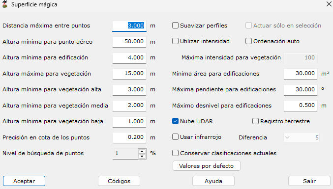

# Superficie mágica
<!-- id: superficie-magica -->

[Ficha de herramientas Clasificar LiDAR](/mdtopx/fichas-de-herramientas/ficha-de-herramientas-clasificar-lidar.md)

Esta herramienta está destinada a la búsqueda y clasificación de puntos LiDAR de forma automática. El funcionamiento interno está basado en la combinación de diversos algoritmos y herramientas disponibles en el programa de forma inteligente, evitando al usuario la decisión de qué algoritmos y con qué parámetros se debe procesar en cada momento, en función del tipo de archivo y tipo de zona.

Funciona con un archivo de nube de puntos abierto o con un proyecto. Además del suelo, la vegetación y la edificación, clasifica los puentes y pasarelas, la calzada y los vehículos, y los cables y apoyos de las líneas eléctricas (ver [Qué clasifica](#qué-clasifica)), y al terminar agrupa los puntos en [objetos](#los-objetos).

Los parámetros que precisa son los siguientes:

* **Distancia máxima entre puntos**: Distancia máxima para considerar que dos puntos sean considerados vecinos en la zona. Se recomienda que esta distancia sea 2 o 3 veces la distancia nominal en el momento del escaneado.
* **Altura mínima para punto aéreo**: Diferencia de altura mínima que debe tener un punto con su entorno para que sea clasificado como punto aéreo. Si se introduce un cero, no se tendrá en cuenta.
* **Altura mínima para edificación**: Diferencia de altura mínima que debe tener un punto con su entorno para que sea clasificado como punto edificación. Si se introduce un cero, no se tendrá en cuenta.
* **Altura máxima para vegetación**: Diferencia de altura máxima que debe tener un punto con su entorno para que sea clasificado como vegetación. Si se introduce un cero, no se tendrá en cuenta. Las copas de los árboles más altos que este valor, si tienen vegetación debajo y no forman un plano, también son vegetación alta.
* **Altura mínima para vegetación alta**: Diferencia de altura mínima que debe tener un punto con su entorno para que sea clasificado como vegetación alta. Si se introduce un cero, no se tendrá en cuenta.
* **Altura mínima para vegetación media**: Diferencia de altura mínima que debe tener un punto con su entorno para que sea clasificado como vegetación media. Si se introduce un cero, no se tendrá en cuenta.
* **Altura mínima para vegetación baja**: Diferencia de altura mínima que debe tener un punto con su entorno para que sea clasificado como vegetación baja. Si se introduce un cero, no se tendrá en cuenta.
* **Precisión en cota de los puntos**: Precisión en la definición de la cota.
* **Nivel de búsqueda de puntos**: Valor entre 1 y 10 indicando el nivel de búsqueda de puntos del programa. Cuanto más bajo sea, más exhaustivo será el programa en la búsqueda, reiterando algunos de los procesos incluidos.
* **Suavizar perfiles**: Considerando que la toma de datos ha sido realizada siguiente líneas, se puede proceder a realizar un suavizado previo de los puntos para eliminar irregularidades. Sin embargo, esto también podría eliminar elementos característicos del relieve.
* **Actuar sólo en selección**: Si se han seleccionado puntos en pantalla antes de ejecutar la herramienta, se da la opción al usuario de que sólo calcule con los puntos seleccionados.
* **Utilizar intensidad**: Se podrá seleccionar esta opción si se desea utilizar el campo intensidad de cada punto para realizar la clasificación. La intensidad podría ser determinante en lugares donde existe alto contraste entre el suelo y los objetos sobre él, como puede ser en una plantación (olivar, viñedo, etc.). No es recomendable en el resto de situaciones.
* **Ordenación auto**: Se puede seleccionar esta opción para ordenar los puntos previamente. Esto es útil se los puntos proceden de varias uniones de grupos de puntos. Para ello, se utilizará el tiempo GPS de cada punto.
* **Máxima intensidad para vegetación**: Si se ha seleccionado la opción anterior, se podrá indicar cuál es el valor máximo para que un punto sea considerado como vegetación. Este valor oscilará entre 0 y 255.
* **Mínima área para edificaciones**: Para identificar edificaciones correctamente se puede indicar un valor mínimo de superficie. Por debajo de este valor, la zona no se considerará edificación.
* **Máxima pendiente para edificaciones**: Al igual que el valor anterior, este valor limitará las zonas consideradas como edificación, considerando que la superficie generada no podrá tener un valor de pendiente superior a este.
* **Máximo desnivel para edificaciones**: Por último, se puede indicar el valor máximo de desnivel que puede existir entre puntos pertenecientes a la misma zona que tiene posibilidad de ser edificación.
* **Nube LiDAR:** Activar si la nube procede de medidas láser o desactivar si la nube procede de una multicorrelación fotogramétrica (ver [Nubes fotogramétricas](#nubes-fotogramétricas)). Con un archivo, la casilla viene marcada según la nube: es LiDAR si sus puntos tienen tiempo GPS o intensidad, y fotogramétrica si no tienen ninguno de los dos y tienen color. Con un proyecto, se marca a mano.
* **Registro terrestre**: Se deberá seleccionar esta opción si el registro es terrestre, ya que la resolución y la precisión es muy superior al caso aéreo.
* **Usar infrarrojo**: Se deberá seleccionar esta opción si se desea utilizar el valor Infrarrojo en cada punto. Para ello, se deberá tener falso color en cada punto, es decir, la terna IR-R-B. Con ella, se podrá calcular el valor NDVI que permite identificar dónde hay vegetación y, por tanto, diferenciarla de la edificación.
* **Diferencia**: Si se ha seleccionado la opción anterior se deberá indicar el grado de sensibilidad de NDVI. Se indicará un valor cercano a 1, si el valor de infrarrojo no está muy definido en las zonas de vegetación; y cercano a 10, en caso contrario.
* **Conservar clasificaciones actuales**: La nube se clasifica siempre desde cero, pero al terminar los puntos que ya tenían una clase (cualquiera salvo 0 y 1, sin clasificar) la recuperan. Sirve para no perder lo editado a mano. Esos puntos no entran en los objetos nuevos, y no se quitan los puntos sintéticos de la vez anterior ni se añaden otros. Desmárquela para que toda la nube tome la clasificación nueva.
* **Valores por defecto**: Pone los valores por defecto en todos los parámetros. No cambia los [códigos](codigos-lidar.md), que tienen su propio cuadro, ni las casillas **Actuar sólo en selección** y **Conservar clasificaciones actuales**. Si algún valor del cuadro no es válido, lo indica y no cambia nada.
* [**Códigos**](codigos-lidar.md): Pulsando este botón se podrá acceder a un cuadro de diálogo donde cambiar el valor de clasificación de puntos secundarios.

Los valores por defecto son:

| Parámetro | Por defecto |
|---|---|
| Distancia máxima entre puntos | 3 m |
| Altura mínima para punto aéreo | 50 m |
| Altura mínima para edificación | 4 m |
| Altura máxima para vegetación | 15 m |
| Altura mínima para vegetación alta | 3 m |
| Altura mínima para vegetación media | 2 m |
| Altura mínima para vegetación baja | 1 m |
| Precisión en cota de los puntos | 0,2 m |
| Nivel de búsqueda de puntos | 1 |
| Máxima intensidad para vegetación | 100 |
| Mínima área para edificaciones | 30 m² |
| Máxima pendiente para edificaciones | 30º |
| Máximo desnivel para edificaciones | 0,5 m |
| Diferencia (infrarrojo) | 5 |

El programa comenzará a procesar el archivo actual e irá mostrando los resultados parciales sobre el [panel de Resultados](../../../introduccion/paneles-de-la-aplicacion/panel-resultados.md) del programa. Si desea **Cancelar** el proceso el programa le preguntará si desea conservar los cálculos generados hasta ese momento. Además, si en la vista actual del documento se ha elegido visualizar los puntos mediante el parámetro clasificación LiDAR, la vista se irá actualizando para apreciar en tiempo real el progreso de la herramienta.

## Qué clasifica

Cada clase se asigna con el código que tenga en el cuadro [Códigos LiDAR](codigos-lidar.md):

| Clase | Por defecto | Qué es |
|---|---|---|
| Suelo | 2 | El terreno. |
| Vegetación baja, media y alta | 3, 4 y 5 | La vegetación, según su altura sobre el suelo. |
| Edificación | 6 | Los tejados y cubiertas. |
| Hundidos | 7 | Los puntos muy por debajo de su entorno: errores de medida. |
| Paredes | 12 | Las fachadas. |
| Aéreos | 13 | Los puntos muy por encima de su entorno. |
| Cables | 14 | Los conductores y cables de guarda de las líneas eléctricas. |
| Apoyos | 15 | Las torres y postes de las líneas eléctricas. |
| Calzada | 35 | Las calles y carreteras. |
| Otros | 90 | Lo que no es suelo, vegetación ni edificación, como el mobiliario urbano. |
| Vehículos | 103 | Los vehículos sobre la calzada o junto a ella. |
| Puentes | 250 | Los tableros de los puentes y las pasarelas. |

### El suelo en lomas y cerros

En las lomas y cerros con laderas empinadas o con muros de bancales, el suelo se busca también subiendo desde el terreno que lo rodea: por las rampas, los caminos y las laderas, y no por las fachadas ni por las copas. Así, la cima de un cerro sale como suelo, y los edificios que haya en ella, como edificación.

### Puentes y pasarelas

Son puente:

* Los tableros de los puentes sobre cauces y vías: una superficie que cae en vertical 4 m o más a los dos lados hasta un mismo nivel bajo, que sigue por debajo del tablero (el cauce o la vía), de al menos 100 m² y 15 m de largo, y que por sus dos extremos acaba en el terreno, aunque baje a la calle por escaleras o rampas. También sus pretiles y barandillas.
* Las pasarelas de peatones, de hasta 4 m de ancho, con el terreno 2,5 m o más por debajo a los dos lados.

Un terraplén con muros verticales de 4 m o más a los dos lados se ve igual que un tablero desde arriba y puede salir como puente.

### Calzada

La calzada es el suelo casi horizontal y liso que, por su intensidad y su color, es asfalto. Se rehace como una red de calles con bordes paralelos y sin trozos sueltos.

En la zona urbana (donde los edificios ocupan una cuarta parte o más del entorno), las calles son el negativo de las manzanas: es calzada todo el suelo entre las fachadas, aceras incluidas, con edificios a los dos lados a 50 m o menos unos de otros y en redes de calles de 5.000 m² o más. Los patios de manzana cerrados no lo son; los abiertos a la calle por un portal y los jardines entre fachadas, sí.

Fuera de la zona urbana, la calzada que no llega a las calles de la zona urbana ni al borde de la nube y mide menos de 200 m de largo se quita.

### Vehículos

Son vehículo los grupos de puntos entre 0,3 y 4,5 m sobre el suelo, de hasta 20 × 4 m, sobre la calzada detectada como asfalto o a menos de 5 m de ella, que no tocan nada más alto ni a la vegetación de los márgenes. En las calles de la zona urbana que no se han detectado como asfalto no se buscan vehículos.

### Cables y apoyos

Se buscan las líneas eléctricas con el mismo procedimiento que la herramienta [Líneas eléctricas](../../generar/lineas-electricas.md): los conductores y cables de guarda pasan a **Cables** y las torres y postes, a **Apoyos**. En los huecos de los conductores se añaden puntos sintéticos, con la clase de los cables más 32 y marcados como sintéticos. Al repetir la herramienta se quitan los sintéticos de la vez anterior y se ponen los nuevos. Con **Conservar clasificaciones actuales** o con selección no se quitan ni se añaden sintéticos.

### Nubes fotogramétricas

Con la casilla **Nube LiDAR** desmarcada, la nube es de una multicorrelación fotogramétrica, sin ecos ni intensidad. Además:

* Lo que no es plano a escala de 1 m no es edificación ni puente: las masas de árboles que salen como edificación pasan a vegetación alta.
* Los puntos sueltos sin clasificar, de otros o de paredes sin edificio cerca toman la clase del objeto que tienen al lado.

## Los objetos

Al terminar, la herramienta agrupa los puntos en objetos, que se ven y se seleccionan con **Editar objetos**: cada edificio con su tejado y sus paredes, cada árbol o masa de copas con su vegetación media y alta, cada vehículo, cada puente, cada grupo de otros, cada tramo de cable y cada apoyo. El suelo, la calzada, la vegetación baja, los puntos sin clasificar, los hundidos y los aéreos no forman objetos.

Los objetos nuevos sustituyen a los que tuviera la nube. Con selección, solo a los que tienen algún punto en ella; con **Conservar clasificaciones actuales**, solo a los que comparten algún punto con los nuevos. Con un archivo, se guardan al guardar la nube. Con un proyecto, cada archivo guarda los suyos en un `.OBJ` junto a él; con selección, los objetos de los archivos no cambian.

Vea también:

* [Buscar puntos elevados](/mdtopx/modulo-laser/buscar-puntos/buscar-puntos-elevados.md)
* [Buscar puntos aislados](/mdtopx/modulo-laser/buscar-puntos/buscar-puntos-aislados.md)
* [Buscar puntos aéreos](/mdtopx/modulo-laser/buscar-puntos/buscar-puntos-aereos.md)
* [Buscar puntos hundidos](/mdtopx/modulo-laser/buscar-puntos/buscar-puntos-hundidos.md)
* [Buscar puntos por diferencia de intensidad](/mdtopx/modulo-laser/buscar-puntos/buscar-puntos-por-diferencia-de-intensidad.md)
* [Buscar puntos según línea de vuelo](/mdtopx/modulo-laser/buscar-puntos/buscar-puntos-segun-linea-de-vuelo.md)
* [Buscar puntos según Geometría más RGB](../buscar-puntos-segun-geometria-mas-rgb.md)
* [Buscar puntos según Geometría más intensidad](../buscar-puntos-segun-geometria-mas-intensidad.md)
* [Buscar puntos en Superficies Planas](/mdtopx/modulo-laser/buscar-puntos/buscar-puntos-en-superficies-planas.md)
* [Buscar puntos en Paredes](/mdtopx/modulo-laser/buscar-puntos/buscar-puntos-en-paredes.md)
* [Buscar puntos Solo Suelo](../solo-suelo.md)
* [Buscar puntos vecinos](../buscar-vecinos.md)
* [Buscar puntos según infrarrojo](/mdtopx/modulo-laser/buscar-puntos/buscar-puntos-segun-infrarrojo.md)
* [Buscar huecos](/mdtopx/modulo-laser/buscar-puntos/buscar-huecos.md)
* [Buscar puntos según Área de superficie](../buscar-puntos-segun-area.md)
* [Buscar puntos según planos de usuario](../../formas-geometricas/buscar-puntos-sobre-planos.md)
* [Líneas eléctricas](../../generar/lineas-electricas.md)
