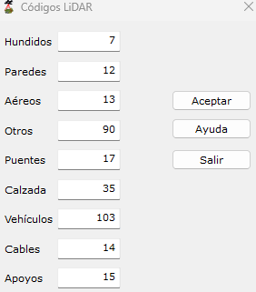

# Códigos LiDAR
<!-- id: codigos-lidar -->

[Superficie mágica](/mdtopx/modulo-laser/buscar-puntos/superficie-magica/)

Desde este cuadro de diálogo se podrán cambiar los valores de clasificación que se le asignan a algunos puntos que no son clasificados con las categorías principales.

Estos valores son los siguientes:

| Código | Por defecto | Qué es |
|---|---|---|
| **Hundidos** | 7 | Los puntos cuya cota es muy inferior a la del entorno, producido por algún error en la medida. |
| **Paredes** | 12 | Los puntos medidos sobre las fachadas de los edificios. |
| **Aéreos** | 13 | Los puntos cuya cota es muy superior a la del entorno, producido por algún error en la medida o por el rebote del rayo sobre un objeto aéreo. |
| **Otros** | 90 | Los puntos que no han podido ser identificados como vegetación, suelo o edificación, por ejemplo, mobiliario urbano. |
| **Puentes** | 17 | Los tableros de los puentes sobre cauces y vías y las pasarelas, con sus pretiles y barandillas. Es la clase estándar de LAS para los tableros de puente. Las versiones anteriores traían 250: si ya había usado la herramienta, el cuadro conserva ese valor hasta que lo cambie. |
| **Calzada** | 35 | Las calles y carreteras: el asfalto y, en la zona urbana, las calles de fachada a fachada con sus aceras. |
| **Vehículos** | 103 | Los vehículos sobre la calzada o junto a ella. |
| **Cables** | 14 | Los conductores y cables de guarda de las líneas eléctricas. Sus puntos sintéticos llevan esta clase más 32 (46 por defecto). |
| **Apoyos** | 15 | Las torres y postes de las líneas eléctricas. |

Ver qué clasifica la herramienta con cada código en [Superficie mágica](README.md#qué-clasifica).
