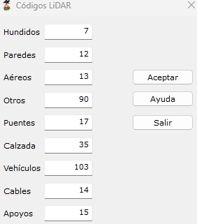

# Códigos LiDAR
<!-- id: codigos-lidar -->

[Superficie mágica](/mdtopx/modulo-laser/buscar-puntos/superficie-magica/)

Este cuadro de diálogo permite cambiar los códigos de clasificación de Hundidos, Paredes, Aéreos, Otros, Puentes, Calzada, Vehículos, Cables y Apoyos.

Códigos de clasificación:

| Código | Por defecto | Qué es |
|---|---|---|
| **Hundidos** | 7 | Los puntos cuya cota es muy inferior a la del entorno, producido por algún error en la medida. |
| **Paredes** | 91 | Los puntos medidos sobre las fachadas de los edificios. |
| **Aéreos** | 18 | Los puntos registrados con una cota muy superior a la del entorno debido a un error de medida o al rebote del rayo sobre un objeto aéreo. |
| **Otros** | 80 | Los puntos que no han podido ser identificados como vegetación, suelo o edificación, por ejemplo, mobiliario urbano. |
| **Puentes** | 17 | Los tableros de los puentes sobre cauces y vías y las pasarelas, con sus pretiles y barandillas. La clase 17 representa los tableros de puente en el formato de archivo LAS de nubes de puntos. Las versiones anteriores traían 250: si ya había usado la herramienta, el cuadro conserva ese valor hasta que lo cambie. |
| **Calzada** | 11 | Las calles y carreteras: el asfalto y, en la zona urbana, las calles de fachada a fachada con sus aceras. |
| **Vehículos** | 82 | Los vehículos sobre la calzada o junto a ella. |
| **Cables** | 14 | Los conductores y cables de guarda de las líneas eléctricas. Sus puntos sintéticos llevan esta clase más 32 (46 por defecto). |
| **Apoyos** | 15 | Las torres y postes de las líneas eléctricas. |

Las versiones anteriores traían 12 (Paredes), 13 (Aéreos), 90 (Otros), 35 (Calzada) y 103 (Vehículos). Para Paredes, Aéreos, Otros, Calzada y Vehículos, el cuadro ignora los códigos guardados por versiones anteriores y muestra los códigos por defecto de la tabla hasta que usted los cambie.

Ver qué clasifica la herramienta con cada código en [Superficie mágica](README.md#qué-clasifica).
