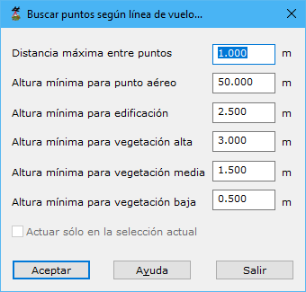

# Suavizar nube
<!-- id: suavizar-nube -->

[Editar puntos LIDAR](../../fichas-de-herramientas/ficha-de-herramientas-archivos-lidar/editar-puntos-en-archivos-lidar.md)

Esta herramienta suaviza las cotas de una nube LiDAR aérea a lo largo de las líneas de barrido del vuelo. Antes de suavizar, clasifica los puntos que sobresalen o se hunden respecto a sus vecinos de la línea, para que no deformen el perfil.

Los puntos tienen que estar en el orden en que se registraron. Si no lo están, se pueden ordenar por tiempo GPS con [Ordenar puntos LiDAR](ordenar-puntos-lidar.md).

## Cómo funciona

La herramienta recorre los puntos de cada pasada en el orden de registro y los agrupa en líneas de barrido: tramos de puntos consecutivos alineados en planta, con una tolerancia de 30 cm. Una línea termina cuando el punto siguiente ya no está alineado o cuando el salto hasta él es demasiado grande. El programa calcula ese salto a partir de la propia nube, con la distancia media entre puntos consecutivos y su desviación típica.

Solo intervienen los puntos sin clasificar o de suelo (clases 0, 1 y 2). Los puntos de las demás clases no cambian y no cuentan para el perfil.

En cada línea de barrido, la herramienta hace lo siguiente:

1. Compara la cota de cada punto con la del punto anterior y la del siguiente de la línea:
   * Si el punto está por encima de los dos en más de una de las alturas del cuadro, pasa a la clase de esa altura. Las alturas se prueban de mayor a menor: punto aéreo, edificación, vegetación alta, vegetación media y vegetación baja. Las clases son las del catálogo de la aplicación: ruido alto (18) para los puntos aéreos, edificación (6) y vegetación alta (5), media (4) y baja (3).
   * Si está por debajo de los dos en más de 3 m, pasa a la clase de ruido bajo (7).
   * Si está en un escalón de mucha pendiente, con un desnivel mayor que la altura de vegetación baja, pasa a la clase de muro (91).
   * Si el primer o el último punto de la línea difiere de su vecino en más de la altura de edificación, pasa a edificación.
2. Busca objetos pequeños, de unos pocos puntos, que suben y vuelven a bajar más que una de las alturas, y pasa sus puntos a vegetación media.
3. Calcula el perfil suavizado de la línea con una B-spline. Si un punto se separa del perfil de forma brusca, lo pasa a vegetación media o corta allí la línea en dos.
4. Repite los pasos anteriores hasta que no clasifica ningún punto más.
5. **Cambia la cota** de los puntos que quedan en la línea por la del perfil suavizado. Los extremos de la línea conservan su cota.

Los puntos que pasan a otra clase conservan su cota.

Al terminar, el [panel de Resultados](../../introduccion/paneles-de-la-aplicacion/panel-resultados.md) muestra los puntos clasificados, el desnivel medio y la distancia media entre puntos consecutivos de las líneas de barrido.

La herramienta modifica las coordenadas de los puntos. El resultado se puede deshacer con **Deshacer**. Si se cancela el proceso, la nube queda como estaba.

## Parámetros

* **Distancia máxima entre puntos**: El programa no utiliza este valor. El salto que corta una línea de barrido lo calcula a partir de la nube.
* **Altura mínima para punto aéreo**: Diferencia de cota con el punto anterior y con el siguiente de la línea para que un punto pase a la clase de ruido alto (18).
* **Altura mínima para edificación**: Diferencia de cota para que un punto pase a la clase de edificación. También es el desnivel que pasa a edificación los extremos de una línea.
* **Altura mínima para vegetación alta**: Diferencia de cota para que un punto pase a la clase de vegetación alta.
* **Altura mínima para vegetación media**: Diferencia de cota para que un punto pase a la clase de vegetación media.
* **Altura mínima para vegetación baja**: Diferencia de cota para que un punto pase a la clase de vegetación baja. También es el desnivel mínimo de un escalón para que sus puntos pasen a la clase de muro (91).
* **Actuar sólo en la selección actual**: La herramienta trabaja solo con los puntos seleccionados. Si esta opción no está activada y hay una vista de selección, trabaja con los puntos de la vista de selección.

Si una altura vale 0, la herramienta no busca esa clase.

Vea también:

* [Borrar picos](borrar-picos.md)
* [Ordenar puntos LiDAR](ordenar-puntos-lidar.md)
* [Filtrar puntos](filtrar-puntos.md)
* [Promediar pasadas](promediar-pasadas.md)
