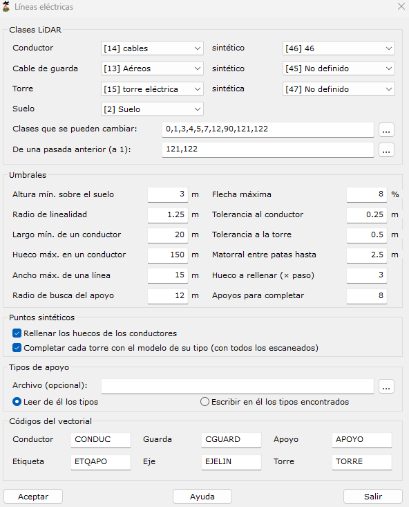

# Líneas eléctricas
<!-- id: lineas-electricas -->

[Generar a partir de LIDAR](../../fichas-de-herramientas/ficha-de-herramientas-archivos-lidar/calcular-a-partir-de-lidar.md)

Busca las líneas eléctricas aéreas de una nube de puntos LiDAR: los conductores de cada vano, los cables de guarda y los apoyos (torres de celosía y postes) con su tipo. Clasifica sus puntos, completa los huecos con puntos sintéticos y dibuja la línea como entidades vectoriales.

Funciona con un archivo de nube de puntos abierto o con un proyecto. En un proyecto, la línea se calcula con todos los archivos a la vez: el vectorial es continuo de un archivo a otro y cada punto sintético va a un solo archivo.

Para medir la línea y sus distancias reglamentarias al terreno, al arbolado y a los edificios, use después [Informe de líneas eléctricas](informe-lineas-electricas.md) sobre la nube ya clasificada.

## Qué hace

1. **Conductores**: busca los puntos lineales y casi horizontales que están por encima del suelo, los une en tramos y ajusta a cada conductor una curva (recta en planta y parábola en altura) de amarre a amarre. También encuentra los de las líneas de media tensión, con las fases a menos de un metro unas de otras y pocos puntos por metro.
2. **Vanos y apoyos**: los conductores paralelos que acaban en el mismo sitio forman un vano, y donde acaban hay un apoyo. La estructura del apoyo (torre de celosía o poste) se ajusta con los puntos que no son de ningún conductor. En las líneas de media tensión, el conductor casi no se quiebra en los postes: los postes se buscan debajo de los conductores (una columna estrecha de puntos que sube del suelo hasta el conductor, sin nada alrededor) y los conductores se cortan en ellos.
3. **Tipos de apoyo**: los apoyos con la misma estructura, salvo la altura del cuerpo, son del mismo tipo (o modelo). Con un [archivo de tipos de apoyo](#el-archivo-de-tipos-de-apoyo), los tipos son los del archivo, con sus nombres. Cada apoyo lleva una etiqueta con su número, su tipo y cuánto más alto es que el más bajo de su tipo (ver [La etiqueta de cada apoyo](#la-etiqueta-de-cada-apoyo)).
4. **Cable de guarda**: el conductor más alto de un vano, si va junto a la punta de los dos apoyos.
5. **Clase de cada punto**: conductor, cable de guarda o torre. Solo cambian de clase los puntos de las clases que se pueden cambiar. Los puntos de las clases de una pasada anterior que ya no son de la línea pasan a la clase 1 (sin clasificar). Los puntos de suelo y de edificios no se tocan.
6. **Puntos sintéticos** (opcional):
    * En los conductores: puntos sobre la curva del conductor donde le faltan puntos. Solo en conductores bien ajustados y sin pasar de sus amarres.
    * En las torres: cada torre se completa con el modelo de su tipo, hecho con todos los escaneados de las torres de ese modelo. Solo se añaden puntos donde a la torre le falta estructura que tienen las demás de su modelo.

    Los puntos sintéticos llevan la clase sintética elegida, el tiempo GPS del punto real más cercano de su conductor o torre y la intensidad mediana. Si vuelve a pasar la herramienta, se quitan los sintéticos de la vez anterior (los de las clases sintéticas) y se ponen los nuevos.

Si no encuentra ninguna línea, no cambia nada y lo indica en la ventana de resultados.

## El resultado

### La nube

Con un archivo, la clase de cada punto y los sintéticos se ponen en la nube abierta, y se puede deshacer. Con un proyecto, se guardan en cada archivo.

### La ventana de resultados

Al terminar, la ventana de resultados muestra:

* «Líneas eléctricas: *a* apoyos (*b* con estructura, de *m* tipos), *v* vanos y *c* conductores; *s* puntos sintéticos (*t* de torres).»
    * *a* apoyos: todos los sitios donde acaban los conductores de un vano. De ellos, *b* tienen estructura (una torre o un poste en la nube); el resto son apoyos sin estructura (ver [La etiqueta de cada apoyo](#la-etiqueta-de-cada-apoyo)).
    * *m* tipos: los tipos de apoyo que tienen algún apoyo; sin archivo de tipos, M1 a M*m*.
    * *c* conductores: los conductores de cada vano, contados vano a vano. Un conductor que pasa por cinco vanos cuenta cinco veces, aunque en el vectorial sea una sola polilínea.
    * *s* puntos sintéticos: todos los que se han añadido; de ellos, *t* son de torres y el resto de conductores y cables de guarda.
* Por cada archivo: «*archivo*: *x* puntos con otra clase, *y* puntos sintéticos de una pasada anterior quitados y *z* nuevos.»
* Con un archivo de tipos que se lee: «Tipos de apoyo de *archivo*: *x* del archivo con apoyos y *y* nuevos (apoyos que no se parecen a ninguno).» Con uno que se escribe: «Tipos de apoyo escritos en *archivo*: *n*.»
* Si no hay línea: «No se ha encontrado ninguna línea eléctrica: no se ha cambiado la clase de ningún punto.»

### El vectorial

El vectorial se crea en un documento nuevo llamado *Líneas eléctricas de …*. Sus elementos, con los códigos por defecto (se cambian en [Códigos del vectorial](#códigos-del-vectorial)):

| Código | Elemento | Qué es |
|---|---|---|
| CONDUC | Polilínea 3D | Cada conductor (fase): la curva ajustada a sus puntos, con un vértice cada 2 m o menos, de una pieza a lo largo de los vanos seguidos (ver [Los conductores, de una pieza](#los-conductores-de-una-pieza)). |
| CGUARD | Polilínea 3D | Cada cable de guarda, igual que los conductores. |
| APOYO | Punto | El pie de cada apoyo: el eje de su cuerpo a la altura del suelo. En un apoyo sin estructura, el centro de los extremos de sus conductores, en el suelo. |
| ETQAPO | Texto | La etiqueta de cada apoyo, en su pie, de 2 m de alto (ver [La etiqueta de cada apoyo](#la-etiqueta-de-cada-apoyo)). |
| EJELIN | Línea | El eje de cada vano: una recta del pie de un apoyo al pie del otro. |
| TORRE | Polilíneas 3D | La forma de cada apoyo con estructura: las cuatro aristas del cuerpo, del pie al arranque de la cabeza, con un cuadro abajo y otro arriba; y la caja de la cabeza, del arranque de la cabeza a la punta, que encierra las crucetas y los amarres. En un poste, lo mismo, más estrecho. Los apoyos sin estructura no tienen. |

### La etiqueta de cada apoyo

Junto al pie de cada apoyo hay un texto (código ETQAPO) con su número, si es un poste, su tipo y, si la tiene, su extensión. Por ejemplo:

| Etiqueta | Qué quiere decir |
|---|---|
| `A12 M3` | El apoyo 12 es una torre de celosía del tipo M3, de la altura de la más baja de su tipo. |
| `A12 M3+6` | El apoyo 12 es una torre de celosía del tipo M3, 6 m más alta que la más baja de su tipo. |
| `A40 poste M2+1` | El apoyo 40 es un poste del tipo M2, 1 m más alto que el más bajo de su tipo. |
| `A12 Doble circuito+6` | Con un archivo de tipos: el apoyo 12 es una torre del tipo que en el archivo se llama «Doble circuito», 6 m más alta que la más baja de su tipo. |
| `A7 sin apoyo` | En el apoyo 7 acaban unos conductores, pero en la nube no hay una torre ni un poste. |

* **A y un número**: el número del apoyo. Los apoyos se numeran desde 1 en todo el archivo o en todo el proyecto. Si se vuelve a pasar la herramienta, la línea se calcula de nuevo y los números pueden cambiar. El [informe](informe-lineas-electricas.md) también calcula de nuevo la línea; sus tablas usan los números de las etiquetas de su propio documento.
* **poste**: el apoyo es un poste. Si no lo pone, es una torre de celosía.
* **M y un número**, o el nombre del archivo de tipos: el tipo del apoyo. Sin archivo de tipos, dos apoyos son del mismo tipo si son los dos torres de celosía o los dos postes y tienen la misma estructura, salvo la altura del cuerpo:
    * el tronco del mismo ancho en las dos direcciones, a la misma profundidad bajo la punta, con una tolerancia de 0,3 m más el 5 % del ancho;
    * la misma conicidad del tronco;
    * la cabeza de la misma altura, con 1,5 m de tolerancia;
    * los amarres de los conductores a las mismas alturas bajo la punta, con 0,6 m de tolerancia.

    M1 es el tipo con más apoyos, M2 el siguiente, y así sucesivamente. Un tipo puede tener un solo apoyo, si ningún otro se le parece. Como las tolerancias son estrictas, un mismo tipo de apoyo puede salir partido en varios: por ejemplo, si en un apoyo no se ha encontrado uno de sus conductores, sus amarres no son los mismos que los de los demás. Para juntarlos, use un [archivo de tipos de apoyo](#el-archivo-de-tipos-de-apoyo). Con un archivo, el tipo de cada apoyo es el de la fila del archivo que más se le parece (ver allí).
* **+ y un número**: la extensión. Son los metros que el apoyo es más alto que el más bajo de su tipo, medidos del pie a la punta y redondeados al metro: es la misma torre o el mismo poste con el cuerpo más alto. Sin el «+», el apoyo es de los más bajos de su tipo (la diferencia es de menos de medio metro). Con un archivo de tipos, la extensión se mide desde la altura del tipo en el archivo, y si el apoyo es más bajo, sale negativa: `A5 M3-2` es 2 m más bajo.
* **sin apoyo**: los conductores acaban en ese sitio, pero en la nube no hay ninguna estructura. Suele ser el borde de los datos (el vano sigue fuera de la nube), un apoyo con muy pocos puntos (un poste delgado o tapado por los árboles) o el pórtico de una subestación. No tiene tipo ni forma (TORRE), y su punto (APOYO) está en el centro de los extremos de sus conductores.

### Los conductores, de una pieza

Cada conductor y cada cable de guarda es una sola polilínea a lo largo de los vanos seguidos. En cada apoyo, el conductor de un vano sigue en el del vano del otro lado cuyo amarre está en el mismo sitio, a la misma distancia del eje de la línea y a la misma altura, siempre que:

* los dos amarres estén a 5 m o menos;
* no haya otro conductor de ese vano casi igual de bien colocado.

Además:

* El cable de guarda solo sigue en otro cable de guarda.
* En un apoyo de ángulo se unen los vanos que giran hasta 100°. Dos vanos que salen del apoyo hacia el mismo lado no se unen.
* En un apoyo de amarre, entre los dos amarres va una recta, que hace de puente.
* Donde la línea se divide (una derivación), cada conductor sigue por el vano en que mejor encaja y, si encaja igual de bien en dos, por el que sigue más recto. Los demás empiezan allí una polilínea nueva.
* Si a cada uno de dos vanos seguidos le falta una fase distinta, las dos fases que quedan sueltas no se unen.

## El archivo de tipos de apoyo

Sin archivo, los tipos salen de comparar los apoyos entre sí, y un mismo tipo puede salir partido en varios. Con un archivo de tipos, los tipos de apoyo son los del archivo, con los nombres que se les den. Así se trabaja con él:

1. **La primera clasificación**: pase la herramienta con el archivo y la opción **Escribir en él los tipos encontrados**. El archivo se escribe con los tipos que ha encontrado, M1, M2…
2. **Ver los tipos**: haga el [Informe de líneas eléctricas](informe-lineas-electricas.md). Al final de su página está la relación de los tipos, con la planta y los dos alzados de un apoyo de cada uno. El informe escribe además sus tipos en `<nombre>_informe_tipos_apoyo.csv`, con el mismo formato.
3. **Nombrar y juntar los tipos**: abra el archivo con Excel o con el Bloc de notas y cambie la columna `nombre`:
    * Dé a cada tipo el nombre que quiera, por ejemplo el de su catálogo.
    * Dé el mismo nombre a las filas de los tipos que son el mismo: sus apoyos pasan a ser de un solo tipo.
    * Borre las filas de los tipos que no existen. Sus apoyos pasan al tipo más parecido, si se le parecen lo bastante (ver más abajo).
4. **Usarlo**: pase de nuevo la herramienta con el archivo y la opción **Leer de él los tipos**, y haga el informe con el mismo archivo.

El archivo es una tabla de texto con `;` como separador. Las dos primeras líneas, que empiezan por `#`, son comentarios. Cada fila es una forma de apoyo:

| Columna | Qué es |
|---|---|
| `nombre` | El nombre del tipo. Las filas con el mismo nombre son del mismo tipo. |
| `estructura` | celosía o poste. |
| `altura` | La altura del apoyo más bajo de ese tipo, del pie a la punta. De ella se mide la extensión de cada apoyo. |
| `cabeza` | La altura de la cabeza, de su arranque a la punta. |
| `anchos` | Los dos anchos del tronco en el arranque de la cabeza. |
| `conicidad` | Lo que entra cada cara del tronco por metro de altura. |
| `amarres` | Las alturas de los amarres de los conductores bajo la punta, de arriba abajo. |
| `apoyos`, `ejemplo` | Cuántos apoyos tenía cuando se escribió el archivo, y cuáles. No se leen. |

No cambie las medidas: describen la forma del tipo. Llevan su unidad («9.80 m») para que Excel no las cambie al guardar. El archivo se puede guardar desde Excel como CSV, con la coma o con el punto decimal.

Cuando se lee el archivo, los apoyos se agrupan como sin archivo, con las tolerancias de la [etiqueta](#la-etiqueta-de-cada-apoyo), y cada fila entra en la agrupación como un apoyo más:

* Un grupo de apoyos al que se une una fila es del tipo de esa fila. Si se le unen filas de varios tipos, cada apoyo es del tipo de la fila que más se le parece. Así, el archivo sin tocar da los mismos tipos que cuando se escribió.
* Un grupo al que no se une ninguna fila, porque se ha borrado la suya, es del tipo de la fila que más se parece a su apoyo central, si no se aparta de ella más de tres veces las tolerancias. La diferencia se mide en veces esas tolerancias: en el ancho, la conicidad, la cabeza y la altura de cada amarre, más uno por cada amarre que no tiene ninguno parecido en la otra forma (por ejemplo, un conductor que no se ha encontrado).
* Los grupos que no se parecen a ninguna fila forman tipos nuevos, con nombres M1, M2… que no estén ya en el archivo. El informe los marca como nuevos. Para que sean de un tipo del archivo, escriba el archivo de nuevo o copie sus filas del `_informe_tipos_apoyo.csv` del informe.

Las filas con el mismo nombre son un solo tipo, pero cada fila es una forma distinta: al completar las torres con puntos sintéticos, cada torre se completa solo con las de su misma forma.

## El cuadro de diálogo

### Clases LiDAR

| Clase | Por defecto | Significado |
|---|---|---|
| Conductor | 14 | Los puntos de los conductores (fases). |
| Cable de guarda | 13 | Los puntos de los cables de guarda. |
| Torre | 15 | Los puntos de la estructura de los apoyos. |
| Conductor sintético | 46 | Los puntos sintéticos de los conductores. |
| Guarda sintético | 45 | Los puntos sintéticos de los cables de guarda. |
| Torre sintética | 47 | Los puntos sintéticos de las torres. |
| Suelo | 2 | El suelo, a partir del que se miden las alturas. |

Las clases por defecto son las de ASPRS (14, 13 y 15). Las sintéticas son las mismas con el bit de punto sintético de LAS 1.0 a 1.3 (32): otros programas las leen como «14 sintético». Las siete clases tienen que ser distintas.

* **Clases que se pueden cambiar** (por defecto `0,1,3,4,5,7,12,90,121,122`): un punto que resulta ser de la línea solo toma su clase si tenía una de estas, o una de las de la línea.
* **De una pasada anterior (a 1)** (por defecto `121,122`, las de la herramienta anterior de MDTopX): los puntos de estas clases que ya no son de la línea pasan a la clase 1.

Las listas son números de 0 a 255 separados por comas. Se pueden escribir o elegir con el botón **…**, que abre la lista de las clases que hay en la nube (o en el proyecto) con sus puntos; las que ya están en el campo salen elegidas, y se eligen varias con Ctrl o Mayús.

### Umbrales

| Umbral | Por defecto | Significado |
|---|---|---|
| Altura mín. sobre el suelo | 3 m | Los conductores se buscan entre los puntos que están a esta altura o más sobre el suelo. |
| Radio de linealidad | 1,25 m | El radio de la vecindad con que se decide si un punto está en un cable. Con pocos vecinos se usa el doble, porque el cable de guarda tiene pocos puntos. |
| Largo mín. de un conductor | 20 m | Los conductores más cortos no forman vanos. |
| Hueco máx. en un conductor | 150 m | Dos tramos alineados de un conductor se unen a través de un hueco sin puntos de hasta esta longitud. |
| Ancho máx. de una línea | 15 m | Los conductores paralelos a menos de esta distancia son de la misma línea. |
| Radio de busca del apoyo | 12 m | La estructura del apoyo se busca a esta distancia de donde acaban sus conductores. |
| Flecha máxima | 8 % | La flecha de un conductor respecto al largo del vano. Una curva con más flecha no es un conductor. Hasta el 50 %. |
| Tolerancia al conductor | 0,25 m | Los puntos a esta distancia de la curva de un conductor, o menos, toman su clase. |
| Tolerancia a la torre | 0,5 m | Los puntos a esta distancia de una cara del cuerpo de la torre, o dentro de él, toman la clase de torre. |
| Matorral entre patas hasta | 2,5 m | Por debajo de esta altura sobre el pie suele haber matorral entre las patas de la torre: ahí solo toma la clase de torre lo que está pegado a sus caras. |
| Hueco a rellenar (× paso) | 3 | Un hueco de un conductor se rellena con puntos sintéticos si es más largo que el paso de sus puntos multiplicado por este valor (1 o más). |
| Apoyos para completar | 8 | El número de apoyos del mismo tipo, los más cercanos, con que se completa cada torre (de 1 a 50). |

### Puntos sintéticos

* **Rellenar los huecos de los conductores**.
* **Completar cada torre con el modelo de su tipo (con todos los escaneados)**.

### Tipos de apoyo

* **Archivo (opcional)**: el [archivo de tipos de apoyo](#el-archivo-de-tipos-de-apoyo). Vacío, los tipos salen de comparar los apoyos entre sí. El informe usa el mismo archivo.
* **Leer de él los tipos**: los tipos de apoyo son los del archivo, que tiene que existir.
* **Escribir en él los tipos encontrados**: los tipos salen de comparar los apoyos entre sí y se escriben en el archivo. Si el archivo ya existe, pregunta antes de sustituirlo: se perderían los nombres que se les hayan puesto.

### Códigos del vectorial

Los códigos de los elementos del [vectorial](#el-vectorial), de 1 a 6 caracteres y sin espacios:

| Campo | Por defecto |
|---|---|
| Conductor | CONDUC |
| Guarda | CGUARD |
| Apoyo | APOYO |
| Etiqueta | ETQAPO |
| Eje | EJELIN |
| Torre | TORRE |
