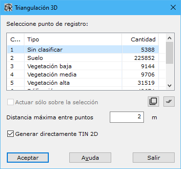

# Triangulación 3D
<!-- id: triangulacion-3d -->

[Obtener modelo digital](/mdtopx/modulo-laser/obtener-modelo-digital/)

Esta herramienta está destinada a la generación de un modelo digital del terreno de tipo TIN utilizando el algoritmo de la tetraedrización de Delaunay. Esta herramienta no admite la inclusión de líneas de ruptura por lo que su utilización se restringe a la triangulación de archivos de puntos láser.

Los parámetros que precisa son los siguientes:

* **Seleccione las tipologías origen**: Se deberán seleccionar las tipologías origen que se desean utilizar para calcular el modelo digital.
* **Distancia máxima entre puntos**: Distancia máxima para considerar dos puntos como adyacentes o vecinos en el terreno. Este parámetro dependerá de la densidad de puntos. No es adecuado poner un valor demasiado elevado provocará que se relacionen puntos muy alejados en la realidad, eliminándose las posibles zonas cóncavas del modelo. Si se indica un valor demasiado escaso, podrán generarse zonas vacías por encontrarse los puntos más espaciados que esta distancia. Si se indica un cero, no tendrán en cuenta la distancia entre los puntos, no generando concavidades en el modelo
* **Actuar sólo en la selección actual**: Se podrá activar esta opción para calcular sólo en los puntos que actualmente se tengan seleccionados.
* **Generar directamente TIN 2D**: Si se activa esta opción, el resultado será un modelo 2D con los triángulos correspondientes a las caras externas de los tetraedros generados. Si no se activa, el resultado será un modelo 3D con los tetraedros, pudiendo cambiar posteriormente el tamaño de dichos tetraedros en la cinta de herramientas de Edición TIN 3D, herramienta [Mostrar triángulos](../../fichas-de-herramientas/ficha-de-herramientas-edicion-tin-3d/actualizar-tin-3d.md), y obtener de ellos una superficie sin huecos con [Superficie sin huecos](../../herramientas-de-edicion-de-la-triangulacion/rellenar-huecos-3d.md#superficie-sin-huecos).
* **Superficie por frente (sin capas dobles)**: Solo con «Generar directamente TIN 2D». Cambia la forma de elegir los triángulos de la superficie (ver más abajo). La distancia máxima entre puntos pasa a ser solo un tope de la longitud de los lados.
* **Rellenar huecos de diámetro hasta**: Solo con «Generar directamente TIN 2D». Al terminar, rellena los huecos de la superficie cuyo diámetro no supere el valor indicado, en unidades del proyecto (0 = sin límite), como la herramienta [Rellenar huecos 3D](../../herramientas-de-edicion-de-la-triangulacion/rellenar-huecos-3d.md). El valor se recuerda.

## Los huecos de la superficie

Sin la opción «Superficie por frente», un triángulo forma parte de la superficie si sus tres lados son más cortos que la distancia máxima entre puntos. Con una nube de un escáner, los puntos están muy juntos a lo largo de cada línea de escaneo y más separados entre una línea y la siguiente, sobre todo en las superficies oblicuas o lejanas. Si la distancia máxima es menor que esa separación, entre las líneas quedan franjas sin triángulos. Si se sube la distancia, las franjas se cubren, pero la superficie pierde detalle y, donde se solapan varias pasadas, aparecen capas dobles (aristas compartidas por tres o más triángulos).

Con **Superficie por frente**, la superficie crece desde sus triángulos más pequeños y, en cada borde, añade el triángulo vecino más plausible: el de menor tamaño entre los que no se doblan demasiado respecto al que ya está (algoritmo de frente que avanza de Cohen-Steiner y Da). El resultado se adapta a la densidad de la nube: triángulos pequeños donde hay muchos puntos y más grandes solo donde hacen falta, sin capas dobles. La distancia máxima solo impide los lados más largos que ella, así que se puede poner un valor mayor que con el método habitual, por encima de la separación entre líneas de escaneo, sin perder detalle. Con 0 no hay tope y el frente puede tender triángulos enormes sobre los huecos reales: conviene indicar uno.

Los huecos que queden se pueden tapar con «Rellenar huecos de diámetro hasta», o después con las herramientas de [Rellenar huecos 3D](../../herramientas-de-edicion-de-la-triangulacion/rellenar-huecos-3d.md).

Vea también:

* [Triangulación](/mdtopx/desde-linea-de-comando/linea-de-comando-triangulacion.md)
* [Triangulación 2D](/mdtopx/modulo-laser/obtener-modelo-digital/triangulacion-2d.md)
