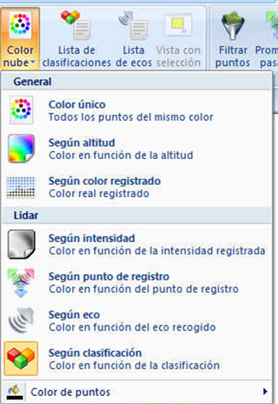
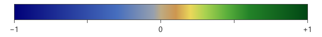
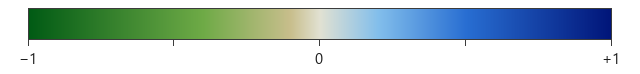

# Color de nube
<!-- id: color-de-nube -->

[Vista de puntos láser](/mdtopx/fichas-de-herramientas/ficha-de-herramientas-archivos-lidar/vista-de-puntos-laser.md)

Desde este listado se puede elegir cómo se quiere visualizar la nube de puntos. Las opciones de este listado también variarán en función de las propiedades contenidas en la nube de puntos.

Las opciones son las siguientes:

* **Color único**: Se mostrarán todos los puntos utilizando el mismo color. Dicho color puede ser definido desde la opción **Color de puntos** de este listado.
* **Según color registrado**: Se mostrarán los puntos con el color RGB guardado en cada uno: el que registró el escáner o el asignado con [Asignar color RGB a puntos](../editar/asignar-color-rgb-a-puntos.md).
* **Según intensidad**: Se mostrarán los puntos en diferentes colores en función de la intensidad registrada por el dispositivo láser.
* **Según eco**: Se mostrarán los puntos en función del eco LiDAR que los registró. El color de cada eco puede ser definido desde la [lista de ecos](lista-de-ecos.md). Esta opción sólo tiene sentido se se tienen diferentes ecos o rebotes en la nube de puntos, habitual en nubes de puntos LiDAR aéreo.
* **Según clasificación**: Se mostrarán los puntos en función de la clasificación LiDAR que tienen asignada. El color de cada clasificación puede ser definido desde la [lista de clasificaciones](lista-de-clasificaciones.md).
* **Según altitud**: Se mostrarán los puntos en función de la altitud o coordenada Z que tenga cada punto. Cuando se seleccione el programa mostrará un [cuadro de diálogo](../../otras-herramientas/seleccionar-gama-de-color.md) donde se podrá especificar la gama de color a utilizar.
* **Según punto de registro**: Se mostrarán los puntos con color diferente en función del punto desde el cual fueron registrados. Esta opción permitirá conocer las diferentes pasadas si es un archivo LiDAR aéreo o los diferentes estacionamientos si es un archivo de LiDAR terrestre.
* **Infrarrojo cercano**: Se mostrará el infrarrojo cercano (NIR) de cada punto en grises: cuanto más claro, más refleja el punto en el infrarrojo, como la vegetación sana. Ver [Infrarrojo](#infrarrojo).
* **Falso color**: Se mostrarán el infrarrojo cercano, el rojo y el verde de cada punto como rojo, verde y azul, la composición clásica en falso color: la vegetación sana sale en rojo. Ver [Infrarrojo](#infrarrojo).
* **Índice espectral**: Se mostrarán los puntos según un índice espectral (NDVI, GNDVI, NDWI, SAVI o EVI), en una escala de color fija de −1 a 1. Al elegir esta opción, el programa muestra un cuadro donde se elige el índice, con su fórmula y la leyenda de colores. Para cambiar de índice, vuelva a elegir la opción. Ver [Índices espectrales](#índices-espectrales).
* **Color de puntos**: Desde esta opción se podrá elegir el color a utilizar para mostrar los puntos, en caso de que la opción elegida sea **Color único**.

## Infrarrojo

Las opciones **Infrarrojo cercano**, **Falso color** e **Índice espectral** usan el infrarrojo cercano de los puntos, que puede venir de dos sitios:

* **Del campo NIR del LAS** (formatos de punto 8 y 10, como el PNOA 2024): el infrarrojo sale de ese campo y el rojo, el verde y el azul, del color de cada punto. Los puntos que no traen NIR, como los puntos sintéticos de los cables que añade la [Superficie mágica](/mdtopx/modulo-laser/buscar-puntos/superficie-magica/), salen en gris.
* **Del color, en falso color**: si la nube no tiene el campo NIR, el color de cada punto se lee como falso color: el canal rojo es el infrarrojo cercano; el verde, el rojo; y el azul, el verde. Es lo que se obtiene al asignar a la nube el color de una imagen infrarroja en falso color con [Asignar color RGB a puntos](../editar/asignar-color-rgb-a-puntos.md). Los puntos sin color salen en gris. Con una nube de color verdadero y sin NIR, estas opciones no tienen sentido.

Se decide para toda la nube, igual que en la opción **Usar infrarrojo** de la [Superficie mágica](/mdtopx/modulo-laser/buscar-puntos/superficie-magica/).

### Índices espectrales

| Índice | Fórmula | Qué muestra |
|---|---|---|
| NDVI | (NIR − R) / (NIR + R) | La vegetación sana, por encima de 0,3; el suelo desnudo y lo construido, cerca de 0; el agua y las sombras, por debajo de 0. |
| GNDVI | (NIR − G) / (NIR + G) | Como el NDVI, con el verde en vez del rojo: es más sensible a la clorofila. |
| NDWI | (G − NIR) / (G + NIR) | El índice de agua de McFeeters: el agua, por encima de 0; la vegetación, por debajo. |
| SAVI | 1,5 · (NIR − R) / (NIR + R + 0,5) | Como el NDVI, corrigiendo el brillo del suelo donde la vegetación es rala. |
| EVI | 2,5 · (NIR − R) / (NIR + 6 R − 7,5 B + 1) | Corrige el efecto de la atmósfera con el azul. Solo con el campo NIR del LAS, que viene con el azul verdadero; en falso color no hay azul y los puntos salen en gris. |

Las bandas se toman de 0 a 1; el infrarrojo del LAS, de 16 bits, se pasa antes a 8 bits, como el color. El valor del índice se recorta entre −1 y 1, y los puntos en los que no se puede calcular salen en gris.

La escala de color es fija, la misma en todas las nubes, para poder comparar vuelos:

* **NDVI, GNDVI, SAVI y EVI**: el agua y las sombras en azul, el suelo y lo construido en ocre, y la vegetación en verdes cada vez más oscuros.

* **NDWI**: la vegetación en verde y el agua en azules cada vez más oscuros.

> En los vuelos de invierno, la vegetación de hoja caduca no tiene hojas y su NDVI se acerca al del suelo.
