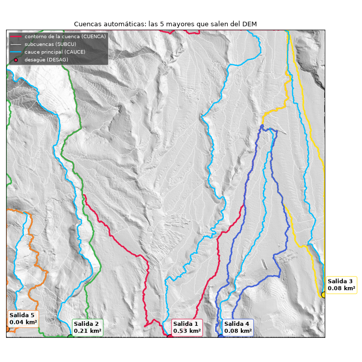

# Cuencas
<!-- id: hidrologia-cuencas -->

[VirtuaLand Hidrología](/mdtopx/fichas-de-herramientas/ficha-de-herramientas-virtualand/virtualand-hidrologia.md)

Esta herramienta obtiene la cuenca vertiente de cada desagüe sobre el DEM: su contorno, su cauce principal y, si se pide, sus subcuencas. Calcula sus parámetros, el tiempo de concentración y, si se dan los datos de la lluvia, el caudal por el método racional de la Instrucción 5.2-IC de drenaje superficial (Orden FOM/298/2016). Ver [Hidrología](README.md) para saber cómo corre el agua por el DEM.

Sirve para saber de dónde viene el agua que pasa por un punto (una obra de drenaje, un paso bajo una carretera, la salida de un valle) y cuánta puede llegar en una tormenta.

Los desagües se eligen en el cuadro de diálogo, de una de estas dos formas:

* **Automáticos**: las cuencas mayores que salen del DEM, por el borde o hacia un hueco sin dato. Es lo más rápido para ver cómo drena una zona sin preparar nada. Se llaman «Salida 1», «Salida 2»… de mayor a menor.
* **De un fichero de puntos** (Shape, DXF, DWG, DGN, BIN, GeoPackage, KML o texto): las entidades de un solo vértice (no los textos) y los puntos de las nubes de hasta 1000 puntos, en las coordenadas del fichero. El fichero no hace falta abrirlo. Cada desagüe se llama como su código, seguido de su número.

## Cuadro de diálogo

* **Desagües**
  * **Automáticos: las N cuencas mayores que salen del DEM**: el número de cuencas (5 por omisión).
  * **De un fichero de puntos**: el fichero con los desagües; el botón **...** abre el explorador para buscarlo.
  * **Radio de ajuste al cauce (0: auto)**: en metros, solo para los desagües de un fichero. Cada desagüe se lleva al nodo de más acumulación que haya a esa distancia, para que caiga en el cauce aunque esté picado al lado. Con 0, el radio es de dos pasos de rejilla. Los automáticos ya están en su cauce.
* **Red de cauces**
  * **Área mínima de cauce (0: auto)**: en metros cuadrados, el área que tiene que drenar un nodo para ser cauce.
  * **Una subcuenca por tramo de la red**: cada cuenca se divide en las subcuencas que drenan a cada tramo de su red de cauces.
* **Método racional (Instrucción 5.2-IC)**
  * **Calcular el caudal**: con la casilla marcada se calcula el caudal de cada cuenca con los tres datos siguientes.
  * **Precipitación diaria máxima Pd**: en milímetros, la del periodo de retorno del cálculo.
  * **Índice de torrencialidad I1/Id**: el del mapa de la Instrucción.
  * **Umbral de escorrentía P0**: en milímetros, ya corregido (P0 = P0i · β).
* **Informe HTML**: con la casilla marcada se escribe el informe en el fichero del campo de al lado, que por omisión es el nombre del DEM terminado en «_cuencas.html», junto al DEM; el botón **...** permite elegir otro. Si el fichero existe, se sustituye.

Al pulsar **Aceptar** no se pregunta nada más. Si ningún desagüe cae sobre el DEM, la ventana de información dice entre qué coordenadas están los puntos leídos y entre cuáles está el DEM.

## Resultado

Un dibujo nuevo, «Cuencas de» y el nombre del DEM, con:

* **CUENCA**: el contorno de cada cuenca, como una polilínea cerrada; los huecos (zonas sin dato dentro de la cuenca), como polilíneas aparte.
* **SUBCU**: el contorno de cada subcuenca.
* **CAUCE**: el cauce principal, de su origen al desagüe.
* **DESAG**: el desagüe, ya ajustado al cauce.

Cada entidad está enlazada con su fila de la tabla de atributos **CUENCAS**:

| Campo | Contenido |
|---|---|
| TIPO | CUENCA o SUBCUENCA |
| NOMBRE | El nombre del desagüe |
| AREA_KM2 | Área, en km² |
| PERIMETRO | Perímetro del contorno, en m |
| KC | Índice de compacidad de Gravelius: Kc = 0,28 · P / √A |
| COTA_MIN, COTA_MED, COTA_MAX | Cotas mínima, media y máxima |
| PEND_MED | Pendiente media de los nodos, en m/m |
| L_CAUCE, DESN_CAUCE, J_CAUCE | Longitud (m), desnivel (m) y pendiente (m/m) del cauce principal |
| INT_HIPSO | Integral hipsométrica: (media − mínima) / (máxima − mínima) |
| TC_TEMEZ | Tiempo de concentración de Témez, en horas |
| TC_KIRPICH | Tiempo de concentración de Kirpich, en horas |
| INTENSIDAD | Intensidad de la lluvia para el tiempo de concentración, en mm/h |
| C_ESCORR | Coeficiente de escorrentía |
| CAUDAL | Caudal, en m³/s |
| ORDEN | De las subcuencas: el orden de Strahler del tramo que la drena |
| AVISO | Si la cuenca está fuera del ámbito del método racional (ver abajo) |

## Cómo leer el resultado

* Cada contorno **CUENCA** encierra todo el terreno cuya agua acaba saliendo por su desagüe: la lluvia que cae dentro pasa por ese punto y la que cae fuera, no. En la imagen, la cuenca de la «Salida 1» (0,53 km²) recoge el valle central.
* Las **SUBCU** dividen la cuenca en las partes que vierten a cada tramo de cauce: sirven para ver qué ladera alimenta cada tramo. Con muchas subcuencas pequeñas, sube el **Área mínima de cauce**.
* El **CAUCE** es el recorrido del agua que más tarda en llegar al desagüe; con su longitud y su pendiente se calcula el tiempo de concentración.
* Para consultar los números de una cuenca, se selecciona su contorno y se miran sus atributos (la tabla **CUENCAS**). El informe HTML tiene lo mismo, más la curva hipsométrica y el método racional paso a paso.
* El índice de Gravelius **KC** dice cómo de redondeada es la cuenca: 1 es un círculo; cuanto más cerca de 1, más se juntan las crecidas.

La ventana de información da, al acabar, el número de cuencas, dónde está el informe y una guía de lectura como esta.

## Cauce principal y tiempo de concentración

El cauce principal es, de los recorridos del agua que empiezan en la divisoria de la cuenca, el que da el mayor tiempo de concentración, como pide la Instrucción. Su pendiente es su desnivel entre su longitud.

* **Témez** (Instrucción 5.2-IC): tc = 0,3 · L^0,76 · J^−0,19, con tc en horas y L en kilómetros.
* **Kirpich**: tc = 0,0195 · L^0,77 · J^−0,385, con tc en minutos y L en metros; la tabla lo da en horas.

## Método racional

Con A en km² y el tiempo de concentración de Témez (t, en horas):

* Factor reductor por área: KA = 1 − log10(A) / 15 (1 si A < 1 km²).
* Intensidad media diaria: Id = Pd · KA / 24.
* Intensidad: I = Id · (I1/Id)^(3,5287 − 2,5287 · t^0,1).
* Coeficiente de escorrentía: con r = Pd · KA / P0, C = (r − 1) · (r + 23) / (r + 11)² si r > 1, y 0 si no.
* Coeficiente de uniformidad: Kt = 1 + t^1,25 / (t^1,25 + 14).
* Caudal: Q = I · C · A · Kt / 3,6.

El campo AVISO marca las cuencas en las que la Instrucción no admite este método; el caudal se da igualmente, como referencia:

* **tc<0,25h**: con un tiempo de concentración menor de 0,25 horas no se aplica la fórmula de Témez; la Instrucción pide el método de las cuencas secundarias.
* **A>=50km2**: el método racional es para cuencas de menos de 50 km².

## Informe

El informe en HTML (el fichero del cuadro; no se abre solo: se abre con el navegador desde su carpeta) tiene, por cada cuenca, el resumen, la tabla de parámetros, la curva hipsométrica, el método racional paso a paso (si se pidió), con sus avisos, y las subcuencas.
