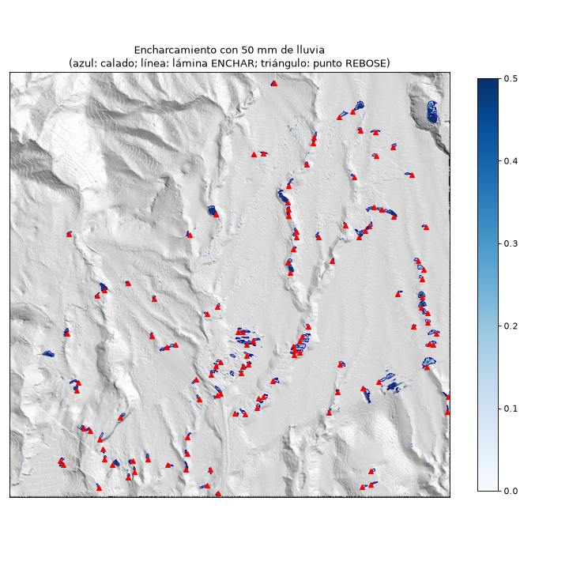

# Encharcamiento
<!-- id: hidrologia-encharcamiento -->

[VirtuaLand Hidrología](/mdtopx/fichas-de-herramientas/ficha-de-herramientas-virtualand/virtualand-hidrologia.md)

Esta herramienta obtiene dónde se queda el agua de una lluvia en las depresiones del terreno, con el algoritmo Fill-Spill-Merge (Barnes, Callaghan y Wickert, 2021):

1. El agua que escurre en cada nodo baja, por la mayor pendiente, hasta el fondo de su depresión. Aquí el DEM no se rellena.
2. Cada depresión se llena hasta la cota del collado por el que rebosaría.
3. Lo que le sobra pasa por el collado y baja a la depresión de al lado, la de más pendiente desde el collado.
4. Cuando dos depresiones vecinas se llenan, se juntan en una sola lámina, que sigue subiendo con el agua de las dos.
5. El agua que llega al borde del DEM o a un nodo sin dato sale del modelo.

Los llanos (nodos vecinos a la misma cota) cuentan como un todo: el agua que cae en un llano con salida, o que llega a un collado llano, sale por el punto de más pendiente del llano entero.

Cada lámina queda horizontal, con el volumen de agua que le llega. Es un cálculo estático: da dónde acaba el agua, no cuándo llega.

## Cuadro de diálogo

* **Lluvia**
  * **Precipitación**: en milímetros, la misma en todo el DEM.
  * **Umbral de escorrentía P0 (0: escurre toda)**: en milímetros. Con P0, el agua que escurre es C · P, con el coeficiente de escorrentía de la Instrucción 5.2-IC: C = (P/P0 − 1) · (P/P0 + 23) / (P/P0 + 11)² si P > P0, y 0 si no. Con 0 escurre toda la lluvia.
* **Láminas en el dibujo**: las láminas que no llegan a estos mínimos no salen en el dibujo, aunque sí en el DEM de calados y en los totales. En un DEM con ruido (sin filtrar o con puentes) hay muchas depresiones pequeñas.
  * **Área mínima**: en metros cuadrados.
  * **Profundidad mínima**: en metros, la del punto más hondo de la lámina.
* **DEM con los calados**: abre también un DEM con el calado de cada nodo con agua.

## Resultado

* Un dibujo nuevo, «Encharcamiento de» y el nombre del DEM, con:
  * **ENCHAR**: el contorno de cada lámina.
  * **REBOSE**: en las láminas llenas, el collado por el que rebosan, como un punto a su cota.

  Cada entidad está enlazada con la fila de su lámina en la tabla de atributos **ENCHARCAMIENTO**:

  | Campo | Contenido |
  |---|---|
  | LAMINA | Número de la lámina, de mayor a menor volumen |
  | COTA | Cota de la superficie del agua |
  | AREA | Área de los nodos con agua, en m² |
  | VOLUMEN | Volumen de agua, en m³ |
  | PROF_MAX | Profundidad máxima, en m |
  | COTA_REBOS | Cota del collado por el que rebosaría |
  | REBOSA | SI si la lámina está llena y lo que le llega de más sigue por el collado |

* Si se marcó, un DEM nuevo, «Calados de encharcamiento de» y el nombre del DEM.
* En la ventana de información, el número de láminas y el volumen que se retiene, el que escurre y el que sale del modelo.

## Cómo leer el resultado

* Cada contorno **ENCHAR** es un charco o una balsa: el agua que se queda en una depresión del terreno con esa lluvia. Su tabla dice a qué cota llega el agua, cuánta hay y lo honda que es.
* Un punto **REBOSE** está en el borde más bajo de una lámina llena: por ahí sigue el agua que ya no cabe. Si la lámina no está llena (REBOSA = NO), con más lluvia todavía crecería.
* En el DEM de calados, cada nodo tiene la profundidad del agua; 0 donde no se queda.
* En los totales de la ventana de información, el agua retenida en las láminas más la que sale del DEM es toda la que escurre. En el ejemplo, con 50 mm se retienen unos 4700 m³ de 58 000 m³; el resto sale del modelo.
* En un DEM con ruido salen muchas láminas pequeñas que no son reales: el área y la profundidad mínimas las quitan del dibujo.
