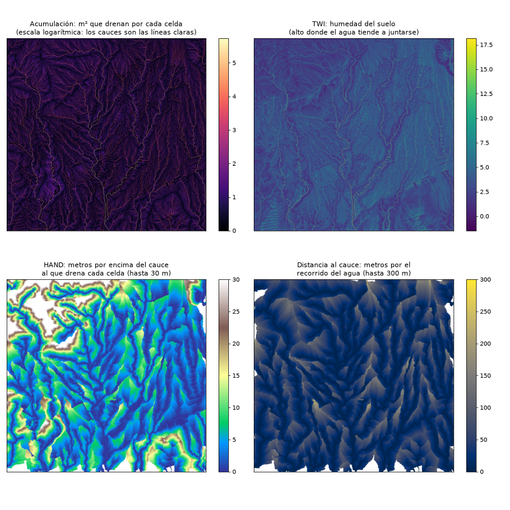

# Rejillas hidrológicas
<!-- id: hidrologia-rejillas -->

[VirtuaLand Hidrología](/mdtopx/fichas-de-herramientas/ficha-de-herramientas-virtualand/virtualand-hidrologia.md)

Esta herramienta calcula, en cada nodo del DEM, las rejillas hidrológicas que se marquen en el cuadro de diálogo, y abre cada una en un DEM nuevo con el nombre de la rejilla y el del DEM. Ver [Hidrología](README.md) para saber cómo corre el agua por el DEM.

## Cuadro de diálogo

* **Rejillas (un DEM nuevo por cada una)**: las que se calculan (al menos una).
* **Área mínima de cauce (0: auto)**: en metros cuadrados, el área que tiene que drenar un nodo para ser cauce. Solo cuenta en la altura y la distancia al cauce.

## Rejillas

En las fórmulas, a es el área específica (la acumulación entre el ancho de la celda, en metros) y tan β la pendiente del nodo.

| Rejilla | Contenido |
|---|---|
| Acumulación | Superficie que drena por el nodo, en m² |
| Pendiente | tan β, en m/m, con las diferencias centrales de las cotas de sus vecinos |
| Índice de humedad (TWI) | ln(a / tan β), con una pendiente mínima de 0,0001. Cuanto mayor, más húmedo |
| Potencia del cauce (SPI) | a · tan β: el poder erosivo del agua que corre |
| Factor LS de erosión | (a / 22,13)^0,6 · (sen β / 0,0896)^1,3 (Moore y Burch), el factor topográfico de la USLE |
| Altura sobre el cauce (HAND) | Altura del nodo sobre el cauce al que llega su agua, en metros, con las depresiones rellenas |
| Distancia al cauce | Longitud del recorrido del agua hasta ese cauce, en metros |

Los nodos cuya agua sale del DEM sin pasar por un cauce quedan sin dato en las dos últimas rejillas.

## Cómo leer el resultado

Cada rejilla se abre como un DEM: lo que en un DEM normal es la cota, aquí es el valor del índice. Se ve mejor con una paleta de colores por cota y consultando el valor de un punto con el cursor.

* **Acumulación**: los valores altos dibujan la red de cauces; un nodo con 10 000 m² recoge el agua de una hectárea.
* **TWI**: los valores altos están en los fondos de valle y en los llanos, donde el suelo tiende a estar húmedo o encharcado; los bajos, en las lomas.
* **SPI** y **factor LS**: los valores altos marcan dónde el agua corre con más fuerza, es decir, dónde hay más riesgo de erosión (cárcavas, taludes).
* **HAND**: 0 en los cauces; cuanto más alto, más a salvo de una crecida queda el nodo. Es la base de las [Zonas inundables](zonas-inundables.md).
* **Distancia al cauce**: lo que recorre el agua de cada nodo hasta llegar a un cauce.
