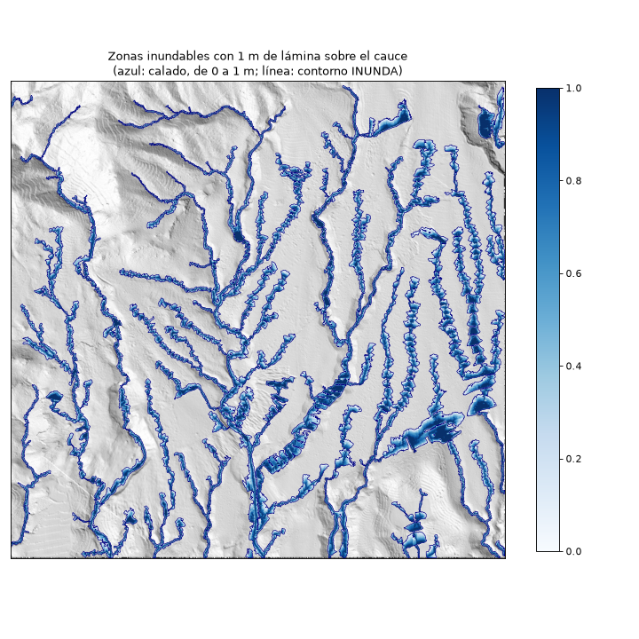

# Zonas inundables
<!-- id: hidrologia-zonas-inundables -->

[VirtuaLand Hidrología](/mdtopx/fichas-de-herramientas/ficha-de-herramientas-virtualand/virtualand-hidrologia.md)

Esta herramienta obtiene lo que se inunda cuando los cauces llevan una lámina de agua. Usa la altura de cada nodo sobre el cauce al que llega su agua (HAND, ver [Rejillas hidrológicas](rejillas-hidrologicas.md)): un nodo se inunda si esa altura no pasa de la lámina de su cauce, y su calado es la lámina menos esa altura. Ver [Hidrología](README.md) para saber cómo corre el agua por el DEM.

Es un cálculo estático: no simula cómo avanza el agua con el tiempo.

## Cuadro de diálogo

* **Lámina de agua en el cauce**
  * **Altura constante**: la misma lámina, en metros, en todos los cauces.
  * **Desde el caudal específico**: en m³/s por km² drenado. Cada tramo de la red lleva el caudal específico por el área que drena, y su lámina sale de ese caudal con la curva de gasto sintética de Manning sobre HAND (Zheng et al., 2018). Para una lámina h, las celdas que drenan al tramo dan la sección mojada A(h) = volumen inundado / longitud del tramo y el perímetro mojado P(h) = fondo inundado / longitud del tramo, y el caudal es Q(h) = A · (A / P)^(2/3) · S^(1/2) / n, con S la pendiente del tramo. La lámina es la menor que lleva el caudal.
  * **n de Manning**: el coeficiente de rugosidad (0,035 por omisión).
* **Área mínima de cauce (0: auto)**: en metros cuadrados, el área que tiene que drenar un nodo para ser cauce.
* **DEM con los calados**: abre también un DEM con el calado de cada nodo inundado.

## Resultado

* Un dibujo nuevo, «Zonas inundables de» y el nombre del DEM, con el contorno de cada zona inundada continua (código **INUNDA**), enlazado con su fila de la tabla de atributos **INUNDACION**: ZONA (número), AREA (m²), VOLUMEN (m³) y CALADO_MAX (m).
* Si se marcó, un DEM nuevo, «Calados de inundación de» y el nombre del DEM.
* En la ventana de información, el número de zonas y su área y su volumen.

## Cómo leer el resultado

* Cada contorno **INUNDA** es una mancha de agua continua: lo que quedaría bajo el agua si los cauces subieran la lámina indicada.
* En el DEM de calados, cada nodo tiene la profundidad del agua: la lámina en el cauce y menos hacia los bordes de la mancha.
* La tabla **INUNDACION** da el área, el volumen y el calado máximo de cada zona; la mayor es la ZONA 1.
* Es una aproximación rápida para ver qué queda expuesto. No sustituye a un estudio hidráulico: no tiene en cuenta puentes, obstáculos ni cómo avanza el agua.
