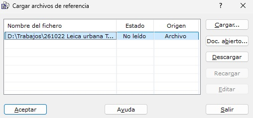

# Abrir archivos de referencia
<!-- id: abrir-archivos-de-referencia -->

[Editar Archivo](../fichas-de-herramientas/ficha-de-herramientas-editar/editar-archivo.md)

El programa permite cargar archivos de referencia para analizar la combinación de varios archivos con cartografía para, por ejemplo, comprobar cómo ha curvado el programa un modelo digital o cómo casan dos curvados contiguos.

Sólo se permiten cargar como archivos de referencia, archivos de dibujo \(archivos con formato DIGI, AutoCad, MicroStation, ASCII, o TopCal) o archivos como modelos digitales \(MDT). No se pueden cargar archivos de referencia de imagen, pero sí se puede cargar sobre un documento imagen otros archivos de referencia. Por ejemplo, se puede generar un mapa de tintas hipsométricas y cargar como fichero de referencia el modelo digital que lo generó para comprobar las cotas con los colores obtenidos.

Cuando se llama a esta herramienta el programa muestra el siguiente cuadro de diálogo:

Desde él, se podrán cargar archivos de referencia nuevo o descargar los actuales. Para ello muestra una lista con los archivos de referencia actuales. Para cargar archivos nuevos se deberá pulsar el botón **Cargar** y para descargar archivos actuales, éstos se deberán seleccionar primero en la lista utilizando el botón izquierdo del ratón y pudiéndose ayudar de las teclas \[Ctrl] y \[Mayúsculas] para hacer multi-selección, y pulsar posteriormente el botón **Descargar**.

Es posible también volver a recargar un archivo, cuando éste ha sido modificado después de haber sido cargado, pulsando el botón **Recargar**. Esta opción es útil cuando se tiene de referencia un archivo con el curvado sobre el documento con el modelo digital, y éste se vuelve a curvar, guardando el curvado con el mismo nombre del archivo de referencia. Sin descargar el archivo de referencia se puede volver a recargar.

El cuadro de diálogo también se abre desde el menú que aparece al pulsar con el botón derecho del ratón sobre la pestaña de un documento (**Cargar ficheros de referencia**). En ese caso, las referencias se cargan en el documento de esa pestaña.

## Origen de cada referencia

La columna **Origen** de la lista indica de dónde sale cada referencia:

* **Archivo**: se ha leído del disco.
* **Documento abierto**: es una copia de un documento abierto en MDTopX.
* **Copia en memoria**: es una copia de un documento que ya se ha cerrado. No se puede recargar ni editar.

## Cargar un documento abierto como referencia

Con el botón **Doc. abierto…** se puede cargar como referencia un documento que ya esté abierto en MDTopX, sin guardarlo antes: un dibujo, un modelo digital (TIN), un DEM o un archivo de viales. El programa muestra la lista de documentos abiertos, salvo el actual, para elegir uno.

La referencia es una copia del documento en el momento de cargarla. Si después se modifica el documento, la referencia no cambia hasta que se recarga. Si las coordenadas del documento no caben con la precisión del documento actual, o si es un DEM con otra semilla, no se carga y el programa avisa.

## Aviso de cambios

Cada vez que se activa un documento, al pasar a su pestaña o al volver a MDTopX desde otro programa, se comprueba si alguna de sus referencias ha cambiado desde que se cargó:

* si la referencia es un archivo, porque se ha vuelto a guardar;
* si es copia de un documento abierto, porque ese documento se ha modificado, aunque no se haya guardado.

Si alguna ha cambiado, el programa pregunta si se recargan. Si se responde **No**, no se vuelve a preguntar por ese mismo cambio, y en el cuadro de diálogo esas referencias aparecen como **Modificado**, para recargarlas desde él cuando se quiera.

## Editar una referencia

Con el botón **Editar** se puede pasar a editar una referencia. Se activa al seleccionar una sola referencia que ya esté cargada. Al pulsarlo, el cuadro de diálogo se cierra como con **Aceptar** (se aplican los demás cambios hechos en la lista) y:

* si la referencia es copia de un documento abierto, se activa ese documento;
* si el archivo ya está abierto como documento, se activa su pestaña;
* si no, el archivo se abre como un documento más. El documento nuevo tiene como referencias las mismas que el documento actual, salvo ella misma, y además el documento actual, como copia de documento abierto. Así, el aviso de cambios funciona en los dos sentidos: al volver al documento actual, avisa de que la referencia editada ha cambiado.

Para que la apertura sea rápida, el programa no vuelve a leer el archivo: usa la copia que ya tiene en memoria, siempre que con ella no se pierda nada. Los archivos DXF, DWG, DGN, ASCII, Shapefile y GeoPackage se vuelven a leer del disco, porque al abrirlos se procesan de otra forma que al cargarlos como referencia.

## Seleccionar en las referencias

Las entidades de las referencias de dibujo se pueden seleccionar, aunque no modificar. Para ello hay que activar **Seleccionar en referencias** en el menú [Seleccionar](../fichas-de-herramientas/ficha-de-herramientas-editar/editar-elementos.md) de la ficha Editar. Con esa opción activada:

* las ventanas de selección rectangular, circular e irregular, e **Invertir selección**, actúan también sobre las referencias;
* si no hay nada seleccionado en el documento, el [panel de propiedades](../introduccion/paneles-de-la-aplicacion/panel-propiedades/README.md) muestra la primera entidad seleccionada en una referencia, en solo lectura;
* el zoom a la selección incluye también lo seleccionado en las referencias;
* **Copiar de referencias** copia al dibujo actual lo seleccionado en las referencias: las entidades enteras y, de una nube de puntos, solo los puntos seleccionados. Las copias no llevan los atributos de base de datos de la referencia. La copia se puede deshacer.
