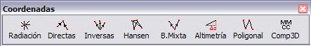
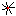
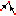
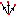
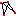
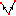

# Barra de herramientas Coordenadas
<!-- id: barra-de-herramientas-coordenadas -->

Esta barra de herramientas contiene las herramientas para calcular coordenadas de puntos, de las diversas formas que los métodos topográficos permiten. Estas herramientas únicamente estarán disponibles si se tiene activo un proyecto, y son:

*  [Radiación](../herramientas/radiacion/README.md): Permite calcular las coordenadas de nuevos puntos a partir de las coordenadas de una estación y las observaciones de ángulo y distancia correspondientes.
*  [Directas](../herramientas/intersecciones-directas/README.md): Permite calcular las coordenadas de nuevos puntos a partir de las observaciones de ángulo realizadas desde al menos dos puntos de coordenadas conocidas a un punto de coordenadas desconocidas.
*  [Inversas](../herramientas/intersecciones-inversas/README.md): Permite calcular las coordenadas de nuevos puntos a partir de las observaciones de ángulos realizadas a al menos tres puntos de coordenadas conocidas desde un punto de coordenadas desconocidas.
*  [Hansen](../herramientas/intersecciones-de-hansen/README.md): Permite calcular las coordenadas de dos puntos a partir de las observaciones realizadas desde esos dos puntos, de coordenadas desconocidas, a otros dos puntos de coordenadas conocidas.
*  [B.Mixta](../herramientas/biseccion-mixta/README.md): Permite calcular las coordenadas de un punto a partir de las observaciones angulares y de distancia a otros dos puntos de coordenadas conocidas realizadas desde dicho punto.
*  [Altimetría](../herramientas/compensacion-de-altimetria/README.md): Permite calcular la cota de un conjunto de puntos a partir de las observaciones realizadas en una red altimétrica, partiendo de al menos un punto con cota conocida.
*  [Poligonal](../herramientas/poligonales/README.md): Permite calcular las coordenadas de nuevos puntos a partir de las concatenación de observaciones de ángulos y distancias realizadas entre estos puntos y al menos uno de coordenadas conocidas.
*  [Comp3D](../herramientas/compensacion-por-minimos-cuadrados/README.md): Permite ajustar por el método matemático de mínimos cuadrados una red formada por un conjunto de puntos entre los que se han realizado observaciones angulares y/o de distancia y/o de altimetría. Para realizar este cálculo es necesario tener calculadas unas coordenadas aproximadas de los puntos no fijos que componen la red, para lo que se podrán utilizar el resto de herramientas aquí enumeradas.

