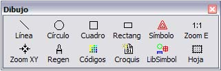
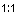
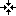
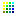
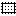

# Barra de herramientas Dibujo
<!-- id: barra-de-herramientas-dibujo -->

Esta barra de herramientas contiene comandos para insertar entidades, símbolos y la hoja en el archivo de croquis, ajustar la vista y abrir las listas de códigos y la librería de símbolos. Aparecen los siguientes comandos:

*  [Línea](../dibujo/dibuja-entidad.md): Muestra un cuadro de diálogo que permite registrar entidades geográficas (líneas o arcos) como unión de los puntos de los ficheros que están relacionados con el croquis. Esta opción sólo estará habilitada si se tiene activo un archivo de croquis.
*  [Círculo](../dibujo/insertar-circulo.md): Muestra un cuadro de diálogo que permite registrar círculos a partir de varios puntos almacenados en los ficheros que están relacionados con el croquis.
*  [Cuadro](../dibujo/insertar-cuadrado.md): Muestra un cuadro de diálogo que permite registrar cuadrados a partir de dos puntos almacenados en los ficheros que están relacionados con el croquis.
*  [Rectang](../dibujo/insertar-rectangulo.md): Muestra un cuadro de diálogo que permite registrar rectángulos a partir de tres puntos almacenados en los ficheros que están relacionados con el croquis.
*  [Insertar símbolo](../dibujo/insertar-simbolo.md): Muestra un cuadro de diálogo que permite registrar símbolos puntuales en puntos pertenecientes a los ficheros que están relacionados con el croquis. Esta opción sólo estará habilitada si se tiene activo un archivo de croquis.
*  **Zoom E**: Ajusta la vista para visualizar toda la extensión del documento de dibujo actual. Esta opción sólo estará habilitada si se tiene activo un archivo de croquis.
*  **Zoom XY**: Centra la ventana actual sobre un determinado punto o unas determinadas coordenadas. Esta opción sólo estará habilitada si se tiene activo un archivo de croquis.
*  **Regenera**: Vuelve a dibujar el croquis en la vista actual. Esta opción sólo estará habilitada si se tiene activo un archivo de croquis.
*  [Códigos](../opciones-de-visualizacion/preferencias-de-dibujo/listado-de-codigos-de-dibujo.md): Muestra la lista de códigos de dibujo.
*  [Croquis](../opciones-de-visualizacion/preferencias-de-croquizacion/lista-de-codigos-de-croquizacion.md): Muestra la lista de códigos de croquización automática.
*  [LibSimbol](../opciones-de-visualizacion/preferencias-de-simbolizacion/libreria-de-simbolos.md): Muestra la librería de símbolos.
*  [Hoja](../dibujo/insertar-hoja.md): Inserta un marco de hoja con cruces y coordenadas en los extremos.

