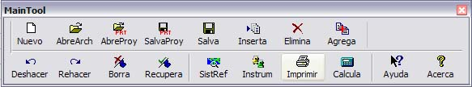
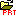
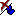
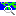
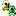

# Barra de herramientas MainTool
<!-- id: barra-de-herramientas-maintool -->

Esta barra de herramientas contiene los comandos generales del programa, como abrir, guardar o imprimir archivos o los comandos de ayuda. Los comandos incluidos son los siguientes:

*  [Nuevo](../estructura-de-archivos/crear-un-fichero-nuevo.md): Crea un documento nuevo: un proyecto o un archivo de puntos, visuales o croquis.
*  **AbreArch**: Abre un archivo de puntos o visuales existente y lo añade a la carpeta **Otros archivos**.
*  **AbreProy**: Abre un proyecto TopCal existente.
*  **SalvaProy**: Guarda el proyecto actual. Esta opción sólo estará activa si se modificó el proyecto.
*  **Salva**: Guarda el documento actual. Esta opción sólo estará activa si se modificó el documento.
*  **Inserta**: Inserta un archivo de puntos u observaciones en el proyecto actual.
*  **Elimina**: Elimina un archivo de puntos, observaciones o croquis del proyecto actual. Sólo estará disponible si se tiene activo un proyecto.
*  **Agrega**: Une archivos existentes al actual. Solamente se podrán agregar archivos del mismo tipo que el archivo actual, es decir, a un archivo de puntos sólo se le pueden agregar archivos de puntos y a los archivos de observaciones, únicamente este tipo de archivos. El programa abrirá el explorador de Windows para seleccionar los archivos a agregar. En este cuadro de diálogo se podrá seleccionar un solo archivo o varios, utilizando las teclas Mayúsculas y Control.
*  **Deshacer**: Permite deshacer los cambios realizados en el documento actual de puntos, observaciones o croquis. Se almacenan hasta las últimas diez operaciones realizadas. Este comando sólo estará activo se realizaron cambios sobre el documento.
*  **Rehacer**: Permite al usuario volver a rehacer algún cambio deshecho anteriormente. Los cambios sólo se refieren a los ficheros de puntos, observaciones o croquis y se almacenan hasta las últimas diez operaciones deshechas. Este comando sólo estará activo si se deshicieron operaciones.
*  **Borra**: Pone una marca de borrado al registro actual o a los registros seleccionados. Si se tiene activo que se presenten dichos registros, estos se mostrarán en color rojo en la hoja de cálculo. Para activar esta opción consulte el cuadro de diálogo [Preferencias](../opciones-de-visualizacion/preferencias.md)
*  **Recupera**: Quita la marca de borrado de los registros seleccionados.
*  [Sistemas de referencia](../otros-comandos/sistemas-de-referencia/listado-de-sistemas-de-referencia.md): Muestra un listado con los sistemas de referencias almacenados en la aplicación, útiles para la creación de ficheros de puntos.
*  [Instrumentos topográficos](../otros-comandos/instrumentos-topograficos/listado-de-instrumentos-topograficos.md): Muestra un lista con los instrumentos topográficos almacenados en la aplicación, útiles para la creación de ficheros de visuales.
*  **Imprimir**: Imprime el documento actual.
*  **Calculadora**: Muestra la calculadora del sistema, para realizar operaciones de cálculo sencillas.
*  **Ayuda**: Muestra la ayuda del programa. Si se pulsa un elemento mostrará información acerca de éste. Si se pulsa sobre un lugar cualquiera de la pantalla mostrará información general del programa.
*  **Acerca de**: Muestra información acerca de la versión de TopCal 21.

